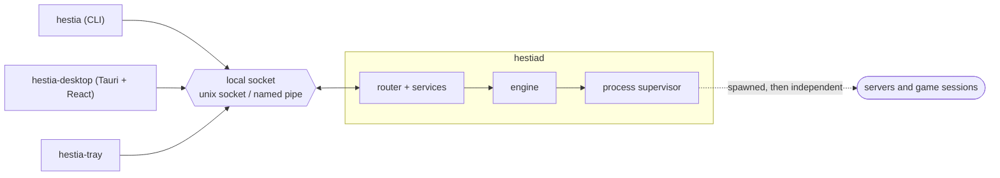
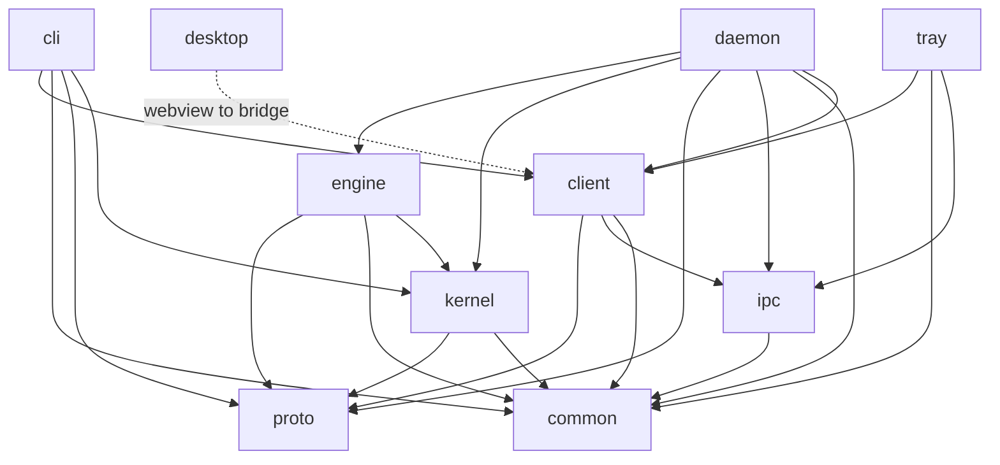
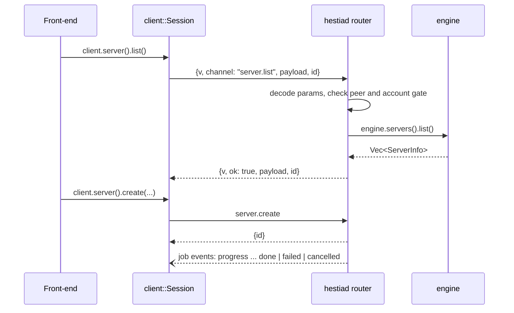

# Architecture

Hestia is a Minecraft launcher built as **one resident daemon with several thin front-ends**. This page is the map.
Each subsystem has its own page, linked [below](#subsystem-pages).

- New to the codebase: read this page, then the subsystem you are touching.
- Extending it: [contributing.md](contributing.md) has the recipes.
- Driving it: [cli.md](cli.md) is the command reference.

## The shape of it

The launcher core (accounts, downloads, Java, servers, instances, content) is a Rust library, the **engine**. One
long-lived process, `hestiad`, owns it. Every front-end is a thin client that talks to that daemon over a local socket.



- **One core, many faces.** Business rules exist once. A server created from the CLI is the server the desktop lists.
- **The compiler enforces the boundary.** Only `daemon` depends on `engine` (`cargo tree -i engine` shows one consumer),
  so a front-end cannot reach launcher logic except over the socket.
- **Workloads outlive the launcher.** A running server or game session is not a child of the daemon. Stopping one is
  always something you asked for.

| Front-end | Binary           | Stack                 | Purpose                                                    |
|-----------|------------------|-----------------------|------------------------------------------------------------|
| CLI       | `hestia`         | clap + ratatui        | scripting and terminal use                                 |
| Desktop   | `hestia-desktop` | Tauri v2 + React/Vite | library, entries, skins, the settings of each entry        |
| Tray      | `hestia-tray`    | tray-icon + tao       | status and quick actions beside every serving daemon       |

## The crate graph

One cargo workspace under `crates/*`. An arrow is a dependency; a missing arrow is the guarantee.



| Crate     | Role                                                                                              |
|-----------|---------------------------------------------------------------------------------------------------|
| `proto`   | wire contracts and domain types (serde), shared verbatim by both sides                            |
| `ipc`     | transport (socket or pipe) and the JSON envelope; reads `common` only to scope the endpoint       |
| `common`  | identity, paths, logging, crash reports, document schema ([below](#cross-cutting-code))           |
| `kernel`  | the registry, `Builtin`, the WASM sandbox, network vetting ([below](#the-kernel))                  |
| `sdk`     | `hestia-sdk`, the guest side of `hestia:kernel`; built for `wasm32-wasip2`, not a default member  |
| `client`  | typed SDK, one facade per domain over a `Session`; re-exports `proto`                             |
| `engine`  | the launcher core; knows no socket; lists the built-in plugins it compiles in                     |
| `daemon`  | `hestiad`: router, services, job managers, the plugin registry, autostart; links `client` (ping)  |
| `cli`     | `hestia`; links `kernel` without its `sandbox` so the author's commands apply the host's rules   |
| `desktop` | Tauri shell; the UI is the root `frontend/`                                                       |
| `tray`    | `hestia-tray`                                                                                     |

## A request, end to end

A plain call is request/response. A long-running one answers at once with a job id and streams progress.



## Where things live on disk

What is yours sits at the top level. What the launcher can regenerate sits under `meta/` and `cache/`.

```
<data_home>/
├── config.json          settings
├── accounts.json        signed-in accounts (owner-only)
├── plugins.json         the plugins you turned off
├── repositories.json    plugin repositories: pinned key, highest sequence seen
├── plugins.key          the key that vouches for the compiled plugin cache (owner-only)
├── plugins/<id>/        an installed plugin: package, approved digest, settings, secrets (owner-only)
│                        (<id>.previous and <id>.staging exist only mid-update)
├── plugins/pending.json the plugins an install is bringing, only while it runs (owner-only)
├── sandbox/<id>/        the plugin's own files, its `/data`
├── servers/<slug>/      one directory per server
├── instances/<slug>/    one directory per instance
├── skins/               the skin library
├── shared/              the shared settings store (sync)
├── java/                installed Java runtimes
├── meta/                regenerable game files and compiled plugins
│   └── versions/ libraries/ assets/ natives/ plugins/
├── cache/               content-addressed download cache
├── processes/           supervisor records and captured logs
├── tmp/                 downloads in flight; emptied at start
└── logs/                per-binary logs and crash reports
```

The data home resolves as `--home`, then `$HESTIA_HOME`, then a persisted pointer (`config set home`), then the
platform default (`~/.hestia`, `%APPDATA%\Hestia`). Portable and debug builds anchor at a `data/` directory inside their
own layout (`target/<profile>/data` in development), so neither touches your real directory.

The socket lives elsewhere: the runtime directory is ephemeral and per session, the data home is yours.

## Cross-cutting code

`crates/common` is UI-free and domain-free; every binary links it.

| Module     | Provides                                                                                                    |
|------------|-------------------------------------------------------------------------------------------------------------|
| `app`      | `NAME`, `ID`, `TRAY_ID`, `VENDOR`, `CHANNEL`, `VERSION`, `user_agent()`                                     |
| `paths`    | the data-home resolution above, `sibling_binary`, `install_scope`, `log_dir`, `config_path`                 |
| `logging`  | `init_logging(console_level, Option<FileLog>)`: the subscriber, the crash hook, a `LogGuard`                |
| `crash`    | the panic hook and `record()` for crashes that never touch the Rust stack (webview errors)                  |
| `time`     | local-time stamps for logs and reports; backup archives are named in UTC                                    |
| `appimage` | `image()`, `host_env()`, `sidecar_env()`: the AppImage launcher's environment, undone where it matters      |
| `atomic`   | write-through-a-temp-and-rename                                                                             |
| `schema`   | `Document`, `load`/`save` with the `schemaVersion` stamp, quarantine of unreadable files and its notices    |

`install_scope` names the anchor of a portable or debug build. `ipc` scopes the daemon endpoint with it. A build using
the per-user directory answers `None`.

**Logging.** Each binary writes to `<data_home>/logs/<binary>/` through up to three sinks:

| Sink               | Content                                                           | Use                                  |
|--------------------|-------------------------------------------------------------------|--------------------------------------|
| console (stderr)   | as requested; gated while a fullscreen CLI surface owns the tty   | interactive                          |
| `latest.log`       | Hestia's crates at the file level, dependencies at warnings       | the log you read                     |
| `debug/latest.log` | every target at trace (the WASM compiler at info)                 | resident binaries only (`hestiad`, desktop) |

`HESTIA_LOG` overrides every computed directive. `latest.log` rolls daily or at 20 MB into gzipped archives; the debug
log rolls at 200 MB. Tokens and RCON passwords never reach a log line; the `-vv` wire trace reports frame sizes, not
contents.

**Crash reports.** Every binary gets the panic hook from `init_logging`. A panic is logged and written to
`<data_home>/logs/crashes/` with message, location, backtrace, platform and the tail of the live log. All binaries share
that directory. Release builds use `panic = "abort"` and `strip = true`, so release backtraces are bare addresses.

## The kernel

`crates/kernel` is the plugin kernel: the registry of built-in and WASM plugins, the sandbox, the typed `hestia:kernel`
API, grants and dependencies, repository trust, and the one network policy (`vetting`) that every request of Hestia goes
through. It depends on `proto` and `common` only, so it cannot reach the launcher. `engine` implements its `Builtin`
trait and sends core downloads through its vetting; `hestiad` owns the registry and the sandbox. The model and each
mechanism are on [the plugin kernel page](architecture/plugins.md); writing a plugin is in
[plugins/](plugins/README.md).

## Subsystem pages

| Page                                         | Covers                                                                            |
|----------------------------------------------|-----------------------------------------------------------------------------------|
| [The socket boundary](architecture/wire.md)  | contracts, the envelope, the client SDK, jobs, events, failures                     |
| [The engine](architecture/engine.md)         | the aggregate root, config, cache, downloads, Java, supervisor, accounts and skins |
| [The daemon](architecture/daemon.md)         | serve loop, router, runtime, job managers, autostart                              |
| [The plugin kernel](architecture/plugins.md) | the model, the registry, grants, trust, the sandbox, the API, built-in packages    |
| [Minecraft providers](architecture/minecraft.md) | editions, flavors, catalogues, profiles, materialize, launch plans, RCON      |
| [Servers and instances](architecture/entries.md) | entry stores, provisioning, backups, sync, worlds, Bedrock                    |
| [Content and modpacks](architecture/content.md)  | the source seam, the managed-dir install model, datapacks, modpacks, update checks |
| [Import and export](architecture/transfer.md) | Hestia's archive, pack-format detection                                          |
| [Front-ends](architecture/frontends.md)      | CLI grammar and presentation, the desktop bridge and query layer, the tray        |

## Project status

`v1.0.0-beta.3`. Every capability works end to end, from wire contract to at least one front-end: vanilla instances
and servers (Java and Bedrock) with an RCON or stdin console, backups, in-place version changes, local content and
modpack files, import and export, shared instance settings, Microsoft sign-in, skins and offline operation.
Core carries vanilla, Adoptium and Hestia's own archive. The provider seams (flavors, content sources, pack formats,
Java distributions) are in place and empty; other loaders, content sources and pack formats return with the new plugin
system. There is no known gap down to the oldest launchable versions.

## Conventions that hold everywhere

- **The disk is the registry.** Java runtimes, backups, servers, instances and finished processes are found by scanning
  a directory, not by consulting an index that can disagree with it.
- **Write through a temp, rename to commit.** Downloads, backups, installs and records stage to `.part` or `.staging`
  and rename on success. A restart reclaims anything abandoned.
- **A document says which schema it is.** Everything of the user's on disk carries a `schemaVersion`. One this build
  cannot read is set aside, never overwritten.
- **Validate at the edge.** Payloads decode through the contract, the config schema rejects unknown keys, and client
  paths are checked for escape.
- **Wire-in is one line, in one module directory** (see [contributing.md](contributing.md)).
- **Errors are typed.** `thiserror` in libraries, mapped to an `ErrorInfo` at the daemon boundary, `anyhow` at binary
  edges. A degraded but successful outcome rides on the result as a structured warning.
- **Never log tokens or secrets.** A launch must put the account token in the game's argv, so it is masked in the
  process record kept on disk and in the `ProcessInfo` a client renders. Only the in-memory spawn spec keeps it.
  Captured process logs are owner-only.

## Tech stack

Rust (edition 2021) under `rustfmt`, `clippy -D warnings` and `cargo-deny`.

| Area              | Crates                                                                 |
|-------------------|------------------------------------------------------------------------|
| Async + transport | tokio                                                                  |
| Serialization     | serde / serde_json                                                     |
| Logging           | tracing, flexi_logger                                                  |
| HTTP              | reqwest (rustls)                                                       |
| Crypto            | p256 (Xbox proof keys), sha1/sha2                                      |
| Archives          | `tar` + `flate2`, `zip`, all in-process                                |
| Game data         | fastnbt (`level.dat`)                                                  |
| CLI               | clap, ratatui                                                          |
| Desktop           | Tauri v2, React/Vite built with Bun, three.js for skin previews        |
| Tray              | tray-icon, tao                                                         |

## Testing

| Where                                  | What it pins                                                                              |
|----------------------------------------|-------------------------------------------------------------------------------------------|
| `crates/proto/tests/`                  | envelope and contract encodings, wire casing and omission rules, golden fixtures |
| `crates/engine/tests/`                 | persistence, the sign-in state machine, process-tree termination, provisioning, content, pack and Java flows against native test providers |
| `crates/engine/src/**`                 | unit tests beside the code: archive detection, launch plans, schema stamping, sync reconciliation, download vetting |
| `crates/client/tests/`                 | the SDK against a scripted daemon: marshalling, typed failures, timeouts, version mismatch, every way a job settles |
| `crates/daemon/tests/e2e.rs`           | a client-to-daemon round trip over a real socket                                          |
| `crates/engine/tests/fixture/`         | the native flavor, content source and pack format the flow tests drive                    |
| `frontend/tests/`                      | the message catalogue and a few pure conversions                                          |

```bash
cargo build                                    # every member but desktop
cargo clippy --all-targets -- -D warnings
cargo test
```

The frontend chain (`bun run generate:messages`, `check`, `typecheck`, `test`, `build`) is in
[contributing.md](contributing.md). CI runs `check` (fmt, clippy, test and the production-feature checks, on Linux and Windows), `frontend`, `desktop`
and `deny`; see [packaging.md](packaging.md).

## Recording a decision

A non-trivial architectural choice gets a numbered entry in [decisions/](decisions/README.md) that states the rejected alternative.
