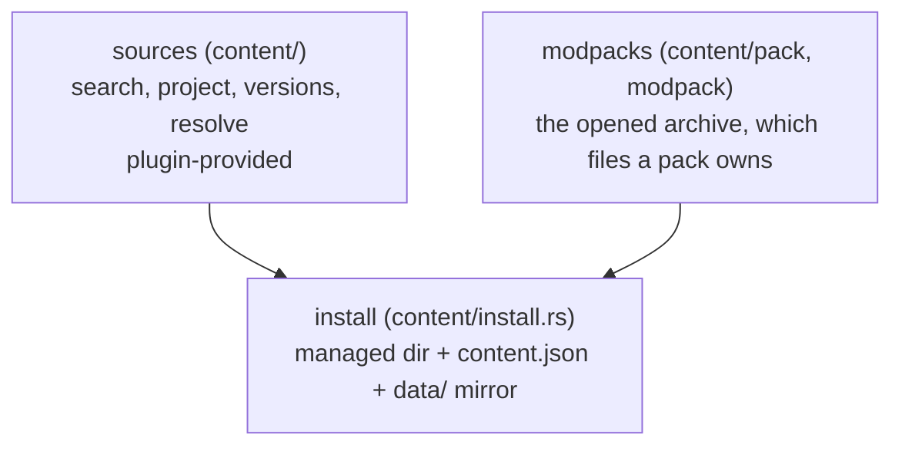
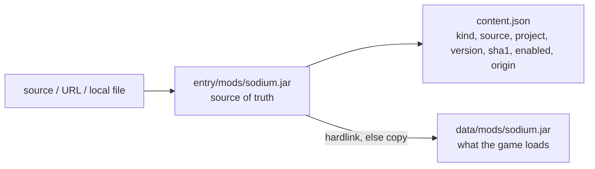
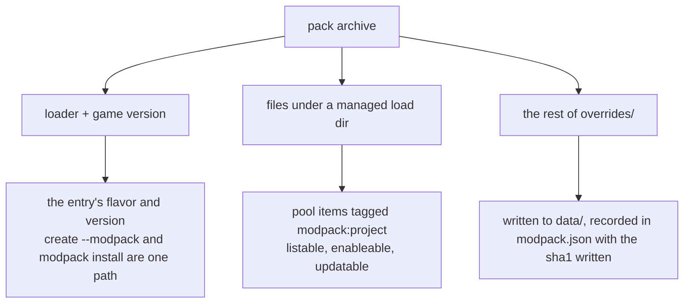

# Content and modpacks

*[← Architecture](../architecture.md)*

Content is everything you add to an entry that Mojang did not ship: mods, plugins, resourcepacks, shaders, datapacks,
and modpacks (all of those bundled with a loader and a version). A Bedrock server takes behaviour and resource packs
instead ([below](#bedrock-packs)).

Three layers, kept separate:

## Sources

`ContentProvider` is the trait: paginated search, project detail, version resolution filtered by loader and game
version, modpack resolution, URL recognition, the kinds and editions it serves, and whether it can serve now. Core ships
none: `modrinth` and `curseforge` are official plugins, and a fresh Hestia has an empty source list. The registry is
runtime-mutable (`register(owner, standing, provider)`, `unregister(owner)`); an id reads `<owner>.<id>`, and a bare
name is resolved by the roster.

- **No source.** Every content channel still answers: `content.sources` is empty, and a search or install that names
  none fails `NoContentSource` (an unregistered id fails `ContentSourceUnknown`).
- **A plugin source** declares `contributes.providers = [{ kind = "content", id }]`, answers `proto::provider::content`
  through `provider.invoke`, and must hold `content:read`, `network:connect` and a network host. `PluginContentProvider`
  stamps its own id on results, calls the guest under a 30 s deadline, maps a guest failure to `PluginCallFailed`, and
  drops any version file whose URL is not https on a granted host. The guest describes files; the engine downloads them.
- **Missing source.** Content installed from a source that is gone keeps its record and still loads; `content.list`
  names it in `unavailableSources` and front-ends mark it.
- **Normalized types.** Every response is mapped into `proto::content` at this boundary.
- **Editions and kinds.** `ContentProvider::editions()` defaults to Java and rides on `content.sources`; a call naming
  the wrong edition is refused (`ContentSourceEdition`). A source skips kinds it does not catalogue, and one with no
  datapack type says `datapacks_as_mods`.
- **Availability.** `available()` lets a source be listed while waiting on a plugin setting (`requiresSetting`);
  `content.*` then refuses it with `ContentSourceUnavailable` carrying the same setting, so a front-end can link to it.
- **Per-item source.** A `ContentAddItem` may name its own source, so a mixed selection need not be split.
- **A blocked file fails its item only.** An author who opts out of third-party distribution leaves no download URL;
  `ContentDownloadBlocked` names the source, the rest of the batch installs, and a pack with one still installs minus
  that file. The check is in the one download step all flows share (`flows/download.rs`). Local import is the way
  through; Hestia does not reconstruct a CDN path.

## What an entry accepts

Composed from what the flavor's loader consumes and what the side reads itself, never a table:

|                                    | mods | plugins | resourcepacks | shaders | datapacks |
|------------------------------------|:----:|:-------:|:-------------:|:-------:|:---------:|
| server on a modloader flavor       | yes  |         |               |         | yes       |
| server on a plugin-platform flavor |      | yes     |               |         | yes       |
| vanilla server                     |      |         |               |         | yes       |
| instance on a modloader            | yes  |         | yes           | yes     | yes       |
| vanilla instance                   |      |         | yes           | yes     | yes       |
| Bedrock server                     |      |         | yes (+ behaviour packs) |  |           |

A refusal carries the accepted set, and `ServerInfo` and `InstanceInfo` carry `accepts`, so no front-end keeps a copy.

## The install model

Content is written to a **managed directory in the entry root** with provenance in `content.json`, then hardlinked (or
copied) into the game directory. Managed names are the game's own load-dir names (`mods/`, `plugins/`, `resourcepacks/`,
`shaderpacks/`).

The managed copy is the record, so:

1. **Restore heals itself.** A backup restore swaps `data/` but not the managed directories, and a reconcile pass
   re-mirrors them at next start. Archives stay world-focused. Server mods and plugins also survive through the
   backup's preserve list; datapacks live inside the world archive and rely on the mirror.
2. **Provenance survives**, so `update` knows each item's project and version.
3. **A hand-dropped jar in `data/` is surfaced as untracked**, never adopted. A file placed in the managed directory is
   neither indexed nor reported.

All index writes go through one `Pool`, opened after downloads finish: `upsert` for an install or pack item, `replace`
for an update, source move or update from a file. It saves the index first and deletes superseded files after, so a
crash leaves an orphan file rather than an index naming a missing one. Downloads share `download_batch` and
`target_version`.

**Resolution.** A platform install picks the newest version compatible with the entry's game version and (for mods)
loader, and resolves required dependencies breadth-first. A URL or local file records `source: "file"`.

**Who owns which field.** An `InstalledContent` mixes three groups no single flow owns:

| Group     | Fields                                                  | Written by                                  |
|-----------|---------------------------------------------------------|---------------------------------------------|
| `Project` | id, slug, title, icon                                   | the install; carried unchanged afterwards   |
| `Release` | source, version, filename, sha1, url                    | an install, update or re-supply             |
| `Holding` | origin, `enabled`, per-world disables, world targeting  | the entry alone, never anything upstream    |

`content::record::assemble` is the only writer: an update is `repin(item, release)` and a pack re-supply is
`rehold(item, holding)`. It is exhaustive, so a new field does not compile until classified. The launch-time mirror
reads `enabled` and per-world disables off the record, so losing a group would put a disabled item back where the game
loads it.

### Operations

| Operation        | Behaviour                                                                                                    |
|------------------|--------------------------------------------------------------------------------------------------------------|
| `enable`         | flips a flag; enforced at the launch-time mirror, which keeps a disabled item out of `data/`                 |
| `check_updates`  | separate from `list`, so `list` stays fast and offline; served from the update cache within its TTL         |
| `hold`           | keeps an item at its version; "update all" and auto-update skip it                                           |
| `update`, `remove` | take a batch of references as one job; named items are resolved before the first moves                     |
| `update` + `path` | moves one local item onto a file, keeping its enabled flag and worlds; tracked or pack-owned items refused |
| `set_version`    | re-pins one item to a chosen published version, optionally from another source                              |

All refuse a running or busy entry (open jars lock on Windows, and changes take effect at next start anyway).

### Update checks

A check runs when its answer is used, never on a timer:

| Trigger                                                 | Checks                                                       |
|---------------------------------------------------------|--------------------------------------------------------------|
| daemon start, network back online                       | every ready Java entry, in one pass                          |
| `content.check_updates` (a content tab opens, `list`)   | that entry and kind                                          |
| an instance launch                                      | every entry, off the launch path, unless auto-update runs in it |

`UpdateCache` (`content/updates.rs`) keeps one answer per installed release, game version and loader for 30 minutes.
`content.available_updates` lists what it holds without asking upstream. The flow (`flows/content/updates.rs`) groups
items by source, game version and loader across entries and asks each group in one request through
`ContentProvider::latest`, resolving exactly only items whose bulk answer differs. A source without `latest` resolves
each item. An unpinned update plans from the same answers. A new finding publishes `content.updates_found { fresh }`.

**Auto-update** (`content.auto-update`, off by default) moves every platform-sourced, unheld item not installed by a
modpack. On an instance it runs inside the first session's launch, with failures as a `ContentNotUpdated` warning. On a
server it starts a `content.update` job when a check finds updates while the server is stopped and unclaimed.

### Local files

- **Inspected.** `content.inspect(path)` reads the archive's central directory and returns kind, validity and a reason.
  Detection is loader-agnostic (any loader's manifest; a datapack versus resourcepack by `data/` versus `assets/`).
  The kind is a suggestion: `content.add` hard-rejects only what cannot be single-file content (an unreadable archive or
  a modpack) and otherwise honours the requested kind.
- **Identified.** `ContentProvider::identify` hands each source the files and gets back the version each is. A
  recognised file is recorded as that release, so it updates and exports like a sourced one. The installed bytes stay
  local, dependencies are not resolved, and a failed lookup leaves the import untracked. `content.inspect` runs the
  same lookup so the review step can list matches.
- **Updated from a file.** A local item has no source, so a newer build is supplied as a file, which replaces the
  record in place (keeping its enabled flag, per-world disables and targeting).
- **Icons.** An untracked record takes the icon the archive carries (`fabric.mod.json`, `quilt.mod.json`, `mods.toml`,
  `mcmod.info`, or a root `pack.png`), decoded under size limits, shrunk to a 64 px PNG and stored as a `data:` URI on
  the record. Where an archive has none, the record borrows the icon of the project a source knows it as, and stays
  `file` with nothing to update against.

## Datapacks

A datapack loads from inside a world, so its mirror is per world, but it still has a managed copy,
`<entry>/datapacks/<file>`.

|             | Server                          | Instance                                                              |
|-------------|---------------------------------|-----------------------------------------------------------------------|
| Mirrored to | `data/<level-name>/datapacks/`  | `data/saves/<world>/datapacks/`                                       |
| Which world | the one in `server.properties`  | named (repeatable `--world`); none named means every world, now or later |

One index entry per pack carries its worlds, so removal clears every mirror unless narrowed. The client-side support
flag is waived for datapacks: they run on a world's server side, including the integrated server.

## Bedrock packs

An add-on is a `.mcpack` or `.mcaddon` zip; BDS loads folders listed per world by uuid. The pack file is the item of
record (sha1, provenance, pin, enable, removal work as for a mod): behaviour packs in `behavior_packs/`, resource packs
in `resourcepacks/`, a `.mcaddon` split on install. Packs come from a file or direct link; no Bedrock source is wired.

At each start sync extracts every enabled pack into `data/behavior_packs/<uuid>/` or `data/resource_packs/<uuid>/`
(marked `.hestia`) and rewrites the world's `world_behavior_packs.json` or `world_resource_packs.json`. Only Hestia's
own uuids are touched; shipped packs (recorded in `.bds-packs`) and hand-dropped ones are left as found, the latter
shown as untracked.

## Modpacks

A pack installs into a new or existing entry from a project, a page URL or a local file. `pack.rs` owns the opened
`Archive` (its root and the override trees to extract), apart from the source that served it and the format that read
it. The zip is read by the reader import and export share (`transfer/archive.rs`), which validates every path before
the first write.

- **Formats are plugins.** Core reads no pack format. Each format is a plugin `pack` provider that hands the install
  flow the archive and the trees to extract. A pack that names files by id delegates its manifest to the owning source
  (`resolve_manifest`), so it installs when that source can serve and is refused `ContentSourceUnavailable` otherwise.
  Files are fetched under the policy of whoever vetted them.
- **Download.** A pack from a source is fetched like any file into a unique file under `tmp/`, read, and removed at
  once. A zip without a pack manifest is `NotAModpack`; an artifact with no URL is `ContentDownloadBlocked`.

A pack decomposes into three parts, each going where it already belongs:

Only the third needed anything new, because those files are configs you edit. An update replaces a file the pack still
owns and leaves a tweaked one as found, reporting `WarningInfo::ModpackOverridesKept`. A first install overwrites.

- **Removal** is told which of two things you mean. The default deletes the pool items and owned override files.
  `keepContent` clears `modpack.json` and the items' origin tag, so they become ordinary items.
- **Updates are asked.** `modpack.check_update` resolves the newest version through the pick an unpinned update makes
  and answers both version numbers plus `updatable`. A pack read off disk is first looked up by hash; one no source
  recognises has nothing to check.
- **A version change moves the pack.** `server.update` and `instance.update` take a pack policy (`move`, the default,
  or `keep`). `move` runs one job: a pack update when the pack has a build for the target game version, otherwise the
  plain version change plus a `PackNotMoved` warning.
- **A file updates any pack.** `modpack.update` with a `path` goes through the same update (downgrade gate, stale-item
  sweep, keep-if-edited). It is the only way an unpublished pack moves. A file carries a name and free-text version but
  no id, so "the same pack" is the project where a source recognises both and the name otherwise; a different pack is
  refused `ModpackDifferentPack` unless `allowOtherPack`. `modpack.preview_update` answers both questions first.
- **Identity.** Every resolved `ModpackFile` leaves with source, ids, version and project. A pack naming files by URL
  and hash has each URL put to every source (`recognise_file_url`); `hydrate` fills what is missing in one bulk call
  per source, best-effort. A jar in an override tree is looked up by hash once on disk, and the pack's own source wins
  a tie. A jar in `overrides/mods/` becomes a pool item in the managed directory; `<name>.jar.disabled` becomes a
  disabled item. Only an unrecognised file records as `file`.
- **`env.server` is a claim.** A server install filters files with itzg/docker-minecraft-server's exclude list, adopted
  verbatim, and reports them as `WarningInfo::ModpackFilesExcluded`. It is server-side only. Per-pack rules key on the
  source project slug, so a pack from another platform matches only the global rules; `modpack.exclude-files` corrects
  one.
- **Limits.** A pack cannot install into an entry whose flavor or game version differs from what it pins, or pin a
  loader with no Hestia flavor. An update does carry the game version, behind the explicit downgrade gate.
