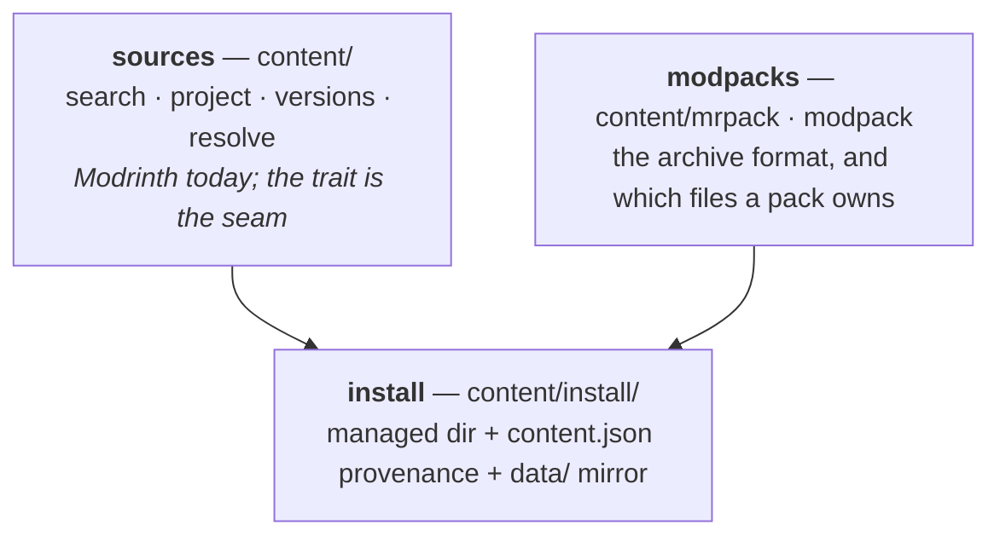
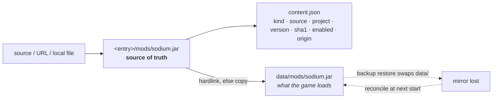
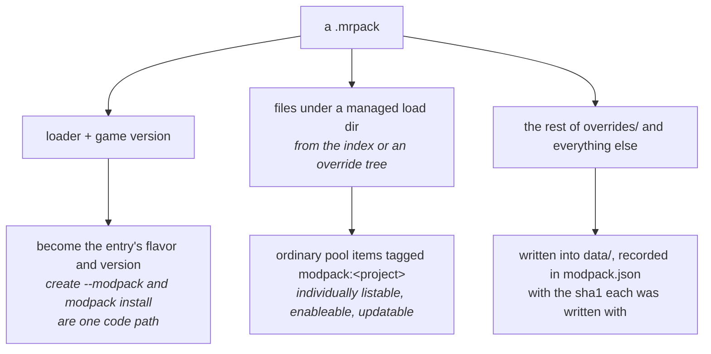

# Content & modpacks

*[← Architecture](../architecture.md)*

Content is everything you add to an entry that Mojang did not ship: mods,
plugins, resourcepacks, shaders, datapacks — and modpacks, which are all of the
above bundled with a loader and a version.

Three layers, deliberately separate:

## Sources

`ContentProvider` is the trait: search with pagination, project detail, version
resolution filtered by loader and game version, modpack resolution, URL
recognition, the kinds a source catalogues, and whether it is configured enough
to serve. `modrinth` and `curseforge` are the shipped sources — adding one is a
new impl plus one line in `Content::new`, the same shape as the flavor registry.
Stateless but for the API keys `configure()` hands down.

Every platform response is mapped into the normalized `proto::content` types at
this boundary, so a front-end never sees a platform's raw shape
([0010](../decisions/0010-one-content-provider-trait.md)).

A provider also recognises its own site's project and version page URLs, so a
pasted `modrinth.com/mod/…` or `curseforge.com/minecraft/…` link installs exactly
like a slug.

> **A second source pays for the trait — and it is only offered when it can
> serve.** CurseForge is the impl the `ContentProvider` seam was written for, and
> it arrived carrying every asymmetry a normalized trait exists to absorb: it
> keys projects by *class* rather than project type (no plugins — the API stopped
> serving class 5, so Hestia does not list a kind that returns nothing), models
> only modloaders (so a datapack's files name no loader at all, and the version
> pick's `datapack` pseudo-loader is stamped on from the class the request already
> named), publishes no per-project side support, has no created-at ordering (so
> "newest" and "recently updated" both resolve to `LastUpdated`), and wraps every
> response in `data`. None of that reaches the rest of the engine — the flows, the
> CLI and the desktop drive both sources through one vocabulary.
>
> The API key makes *availability* a property of a source rather than a constant.
> CurseForge refuses every request without an `x-api-key`, so the trait grew
> `available()` and `configure()`: `content.sources` lists only sources that can
> serve, `content.*` refuses a named-but-unconfigured one with
> `ContentSourceUnavailable` (naming what to set, rather than the "unknown
> source" a filtered registry would have to claim), and a pasted
> `curseforge.com` URL still parses — it is recognised, then refused for the
> reason that is actionable. Resolution is the `content.curseforge-key` setting,
> else a key a distributor baked in at build time
> (`HESTIA_CURSEFORGE_API_KEY`), so official builds can ship one while a source
> build simply has none and the source stays hidden. It is re-applied on every
> `config set` (`Engine::set_config`, the reason that wrapper exists), so a key
> takes effect on the running daemon. The key is never logged — only whether one
> resolved.
>
> Two shapes had to change for it. A `ContentSource` now carries the `kinds` it
> catalogues, because "which sources can I browse mods on" is a daemon fact and a
> front-end must not keep its own table (the same no-drift rule `accepts` follows
> on the entry views). And a `ContentAddItem` may name its **own** source,
> overriding the batch's: with two sources a user's selection is naturally mixed,
> and a spec-wide source would have forced the front-end to split a batch it has
> no other reason to split — a URL item already resolved its own source this way.

> **A blocked file fails its item, and nothing else.** CurseForge lets an author
> opt out of third-party distribution; the API then lists the file with a null
> download URL. The `ContentDownloadBlocked` refusal says so and names the source,
> the rest of the batch installs, and local-file import is the documented way
> through — Hestia deliberately does not reconstruct the CDN path to download it
> anyway. The check lives in the one download step every flow shares
> (`flows/download.rs`) rather than the provider, because an artifact with no URL
> is unusable whoever produced it — and a blocked file is routine in a pack: a
> CurseForge pack listing one still installs, minus that file, naming it.

## What an entry accepts

Not a table anywhere — composed from two independent facts: what the **flavor's**
loader consumes, and what the **side** reads for itself.

| | mods | plugins | resourcepacks | shaders | datapacks |
|---|:--:|:--:|:--:|:--:|:--:|
| server on a modloader (fabric, neoforge) | ✓ | | | | ✓ |
| server on a platform (paper, folia, spigot, bukkit) | | ✓ | | | ✓ |
| vanilla server | | | | | ✓ |
| instance on a modloader | ✓ | | ✓ | ✓ | ✓ |
| vanilla instance | | | ✓ | ✓ | ✓ |

A refusal carries the accepted set rather than a sentence, and `ServerInfo` /
`InstanceInfo` carry `accepts` on the wire so no front-end keeps its own copy
([0008](../decisions/0008-flavor-declares-accepted-content.md)).

## The install model

Content is written to a **managed directory in the entry root** — Hestia's
namespace — with its provenance in `content.json`, then hardlinked (or copied)
into the game directory.

The managed copy — not the one in `data/` — is the source of truth, which pays
off three ways:

1. **Restore heals itself.** A backup restore swaps `data/`, but the managed dirs
   live outside it and are on the backup exclude list, so a reconcile pass
   re-mirrors them at the next start. Archives stay world-focused. Server mods
   and plugins also survive a restore through the backup's preserve list, which
   carries them over from the live tree; datapacks, which live inside the world
   archive, rely on the mirror.
2. **Provenance survives**, so `update` knows each item's project and current
   version.
3. **A hand-dropped jar in `data/` is surfaced as untracked**, never silently
   adopted. A file placed by hand in the managed directory itself is neither
   indexed nor reported: that directory is Hestia's namespace.

([0013](../decisions/0013-managed-dir-of-record.md))

Managed directory names are the game's own load-dir names (`mods/`, `plugins/`,
`resourcepacks/`, `shaderpacks/`), so the mirror is symmetric.

Every write to the index goes through one `Pool`, opened after the downloads
finish: `upsert` for an install or a pack item, `replace` for an update, a source
move or an update from a file. Downloads share one batched step
(`download_batch`) and one version lookup (`target_version`). The pool saves the
index first and deletes the files it superseded after, so a crash leaves an
orphan file rather than an index naming one that is gone.

### Resolution and dependencies

A platform install picks the newest compatible version — filtered by the entry's
game version and, for mods, its loader — and resolves required dependencies
breadth-first. A direct URL or local file import records `source: "file"` with no
version to update against: no source updates it, and a newer build is supplied
as a file instead ([0079](../decisions/0079-a-local-item-updates-from-a-file.md)).

### Who owns which field of a record

An `InstalledContent` mixes three independently-owned groups, and no flow owns
all of them: an install has a project and a version but no prior record, an
update has a record and a version but no project, a modpack re-supply has both
over an item the entry is already holding a particular way.

| Group | Fields | Who writes it |
|---|---|---|
| `Project` | id, slug, title, icon | the install; carried unchanged by everything after |
| `Release` | source, version, filename, sha1, url | an install, an update, a re-supply |
| `Holding` | origin, `enabled`, per-world disables, world targeting | the entry alone — never anything upstream |

`content::record::assemble` is the only place those fields are written, so a
flow cannot reset a group it does not own: an update is `repin(item, release)`
and a modpack re-supply is `rehold(item, holding)`. The assembler is exhaustive,
so a new field on the record does not compile until it has been classified
([0064](../decisions/0064-a-record-is-mutated-not-rebuilt.md)).

This matters beyond bookkeeping: the launch-time mirror reads `enabled` and the
per-world disables straight off the record, so a group lost in a rebuild does
not merely misreport an item — it puts a disabled one back where the game loads
it.

### Beyond add and remove

| Operation | Behaviour |
|---|---|
| `enable` | flips a flag in `content.json`. Enforced at the single point it needs — the launch-time mirror keeps a disabled item out of `data/`, so it can never be resurrected by a restore. A datapack's mirror is per world, so disabling drops the mirror in the chosen worlds |
| `check_updates` | a *separate* on-demand call, not baked into `list`, so `list` stays fast and offline |
| `update` / `remove` | take a *batch* of references — one job, one call. Named items are resolved before the first one moves, so a batch naming something that does not exist changes nothing; an empty batch means every item of the kind (`update`) and is refused (`remove`). Past that an update is per-item like an install: every item resolves, the moves download side by side under one progress extent, and an item that cannot move comes back as a failure while every one that did is recorded |
| `update` with a `path` | moves the one named *local* item onto that file, keeping its enabled flag and worlds; a tracked or pack-owned item is refused. The old mirrors go first, so a rebuild under the same name is what loads next ([0079](../decisions/0079-a-local-item-updates-from-a-file.md)) |
| `set_version` | re-pins one item to a chosen published version — the update path with an explicit pin instead of "newest". With a `source`, the version comes from that source instead: the installed file's hash finds the project there (`matches` lists which sources recognise it), and the record moves to it. A local file adopts a source the same way ([0075](../decisions/0075-a-local-file-is-identified-by-its-hash.md)) |

All of them refuse a running or busy entry: open jars lock on Windows, and
changes only take effect at the next start anyway
([0014](../decisions/0014-enable-update-check-and-pin.md)).

### Local files are inspected, not trusted

`content.inspect(path)` reads the archive's central directory and classifies it,
returning the detected kind, validity and a reason. Detection is
**loader-agnostic** — a mod is any loader's manifest (`fabric.mod.json`,
`quilt.mod.json`, `META-INF/mods.toml`, `neoforge.mods.toml`, …) — and a datapack
is told from a resourcepack by the `data/` vs `assets/` tree under a shared
`pack.mcmeta`.

The detected kind is a **suggestion, not a verdict**: `content.add` hard-rejects
only what genuinely cannot be single-file content (an unreadable archive, or a
modpack) and otherwise honours the requested kind, so a review-step override
installs where you asked
([0015](../decisions/0015-local-imports-are-inspected.md)).

A local file is also **identified**. `ContentProvider::identify` hands each
source the files and gets back the version each one is — Modrinth by sha1,
CurseForge by its own fingerprint — and a recognised file is recorded as that
release rather than as source `file`, so it updates and exports like anything
installed from a source. The bytes installed are still the local ones, its
dependencies are not resolved, and a lookup that fails (offline, unknown file)
leaves the import untracked rather than failing it. Every source is asked, and
the add item's `source` says which match to track (`file` for none);
`content.inspect` runs the same lookup, which is how the review step lists the
matches to choose from before install
([0075](../decisions/0075-a-local-file-is-identified-by-its-hash.md)).

A file left untracked has no project to borrow an icon from, so `content::icon`
reads the one the archive carries: the `icon` a `fabric.mod.json` or
`quilt.mod.json` names, the `logoFile` of a `mods.toml`, `neoforge.mods.toml` or
`mcmod.info`, and otherwise a root `pack.png` — which covers resource packs,
datapacks and the shader packs that ship one. The lookup is the same for every
kind; a plugin's `plugin.yml` has no icon field, so a plugin has one only when
its jar happens to carry one of those. The image is decoded under size limits,
shrunk to a 64px PNG and stored on the record as a `data:` URI, so it travels in
`content.json`, over the socket and inside an exported archive with no second
file to keep in step. The same read runs wherever an untracked record is made: a
local import, a modpack's override jars, and an imported instance's loose files.

A shader pack and a plugin carry no icon at all, so an import kept untracked is
still looked up by hash, and where the archive has no icon of its own the record
borrows the one of the project a source knows it as. Only the icon is borrowed:
the item stays source `file`, with no project id and nothing to update against.
A file no source recognises and that embeds nothing keeps the placeholder.

## Datapacks are the exception

A datapack loads from *inside a world*, not a flat directory, so its mirror is
per world. It still has a managed copy, `<entry>/datapacks/<file>`, like every
other kind: an instance with no world yet can take one, a world created later
receives the packs installed before it, and a server backup restore — which swaps
the world, and with it any datapack installed since — is healed by the launch-time
sync. Mods and plugins survive a restore through the backup's preserve list; a
datapack, being inside the archive, relies on the mirror.

| | Server | Instance |
|---|---|---|
| Mirrored to | `data/<level-name>/datapacks/` | `data/saves/<world>/datapacks/` |
| Which world | the one, from `server.properties` | named — repeatable `--world`, or an interactive multi-select; none named means every world, now or later |

One index entry per pack carries the worlds it loads in, so a removal clears
every mirror unless narrowed. The client-side support flag is waived for
datapacks: a datapack runs on a world's server side, including a client's
integrated server ([0016](../decisions/0016-datapacks-are-world-of-record.md)).

## Modpacks

A pack installs into a new or existing server or instance from a project, a page
URL, or a local `.mrpack`. `pack.rs` owns the *formats* (whether a zip is a pack,
which format and at what root, the `.mrpack` manifest, and which override trees to
extract for either format), deliberately apart from the platform that serves them
— a pack picked off disk has no source and is read the same way. The zip itself is
read by the one reader import and export share (`transfer/archive.rs`), which
validates every path before the first write and hashes only when asked; the
install flow receives the archive already open, whether it came from a download
or from `instance import`.

**A pack archive knows its own format.** CurseForge modpacks arrive as a zip like
Modrinth's, but with a `manifest.json` that *names* its single overrides tree
instead of `.mrpack`'s fixed `overrides/` + `client-overrides/` +
`server-overrides/`, and with a file list of project/file ids rather than URLs.
Only the second difference needed the platform: `pack.rs` detects which format a
zip is (the shallowest marker, an `.mrpack` index beating a manifest at the same
depth, and a `manifest.json` counting only when its `manifestType` is a modpack)
and answers with that format's override trees, so the install flow
extracts either without being told where the archive came from — while the
id-based file list stays in `curseforge.rs`, since resolving those ids into
downloads *is* an API call. A CurseForge pack installed from a **local file**
goes the same way round: the archive hands its manifest to the platform it names
(`ContentProvider::resolve_manifest`), so it installs whenever CurseForge can
serve and is refused as `ContentSourceUnavailable` — naming the key to set —
when it cannot.

**A pack from a source goes through the downloader.** The version the flow picks
already carries the archive's artifact, so it is fetched like any other file: into
a uniquely named file under the data home's `tmp/`, with progress, cancellation
and the download cache. The archive is read from there and the file is removed at
once; `reclaim_temp()` empties the directory at start. A zip with no pack manifest
is refused as `NotAModpack`, and an artifact with no URL as
`ContentDownloadBlocked`.

A pack decomposes into three things Hestia already has, and each goes where it
belongs:

Only the third needed anything new, and for one reason: those files are configs
and keymaps **you edit**. So an update replaces a file the pack still owns and
leaves a tweaked one exactly as found, reporting which through
`WarningInfo::ModpackOverridesKept`. A *first* install writes over whatever is on
disk — nothing there is yours yet
([0011](../decisions/0011-modpack-decomposes-into-existing-parts.md)).

**Taking a pack out is two different things**, so `modpack.remove` is told
which. The default deletes the pack's pool items and the override files it still
owns. With `keepContent` only the pack goes: `modpack.json` is cleared and its
pool items lose their origin tag, so they become removable and syncable like
anything the user installed, and the override files simply stop being recorded.

**Whether there is an update is asked, not assumed.**
`modpack.check_update` resolves the pack's newest published version
through the same pick an unpinned update makes, and answers with both version
numbers plus `updatable` — so what a front-end offers and what an update would
install cannot disagree. A pack read off disk is first asked after by hash: an
archive a source published is recorded as that release, and updates like one
installed from the source. One no source recognises has no catalogue behind it
and answers with nothing to check, the same reason `fetch_update` refuses it.

**A version change moves the pack.** `server.update` and `instance.update` take a
pack policy (`move` by default, or `keep`). With `move` the daemon asks the same
`entry_modpack_update` for the pack version built for the target game version and
runs one job: a pack update when there is one, the plain version change plus a
`PackNotMoved` warning when the pack has no build for the target
([0086](../decisions/0088-the-daemon-sequences-a-version-change.md)). The
`gameVersion` of `modpack.check_update` stays as the preview a front-end shows
before the request.

**A pack file updates any pack.** `modpack.update` takes a `path` in place
of a version, and the file goes through the same update: the game-version move
behind the downgrade gate, the stale-item sweep, the keep-if-edited rule. It is
the only way an unpublished pack moves, and a published one may take it too — a
file no source recognises then leaves it unpublished. A pack file carries a name
and a free-text version but no id, so whether it is *the same pack* is the
project where a source recognises both and the name otherwise; a different one is
refused as `ModpackDifferentPack` unless `allowOtherPack` says it is meant.
`modpack.preview_update` answers both questions — same pack, downgrade —
before a job starts, so a front-end asks once instead of failing a job to find
out ([0078](../decisions/0078-a-pack-updates-from-a-file.md)).

**A resolved pack file carries its identity.** A CurseForge manifest names each
file by project and file id, and resolving it already fetches the file and
project records, so every `ModpackFile` leaves the resolve with its source, ids,
version number and project. A `.mrpack` index names files by URL and hash alone;
a Modrinth CDN URL carries both ids, which the index parse reads. `hydrate` then
asks only for what is still missing (a Modrinth file's version number and
project), in one bulk call per source. Best-effort: a pack still installs when
the catalogue is unreachable, it just reads less well.

What the pack does not identify — a jar shipped in an override tree, an index
file hosted anywhere but Modrinth's CDN — is asked after
by hash once it is on disk, the same lookup a local-file import makes; where
several sources publish it, the pack's own wins. A jar in `overrides/mods/` is
therefore a pool item like any other, in the managed directory rather than
written straight into `data/`. Only a file no source recognises records as
`source: "file"`: installable, just not updatable
([0076](../decisions/0076-a-pack-file-is-identified-wherever-it-came-from.md)).

**A pack's `env.server` is a claim, not a fact.** Packs routinely declare
client-only mods as server-required, so a *server* install filters them using
`itzg/docker-minecraft-server`'s list, adopted verbatim. What is held back rides
on the result as `WarningInfo::ModpackFilesExcluded`, naming each file. The
correction is server-side only — applied to an instance it would strip out
precisely the mods the pack was installed for
([0012](../decisions/0012-pack-server-declarations-are-corrected.md)).

For a CurseForge pack the correction is not a refinement but the *only* signal:
the API publishes no per-project side support, so every required file reads as
wanted by both sides and the exclude table is what tells a server's mods from a
client's. The table's per-pack rules are keyed by the pack's slug, which is
Modrinth's — a CurseForge edition of the same pack matches the global rules but
not its per-pack entry, so `modpack.exclude-files` is the way to correct one.

**What a pack cannot do:** be installed into an entry whose flavor or game
version differs from what it pins, or pin a loader with no Hestia flavor. An
update *does* carry the game version with it — that is what updating a pack means
— behind the same explicit downgrade gate as any version move.

## Decisions

- [0010 — Content is normalized behind one trait](../decisions/0010-one-content-provider-trait.md)
- [0011 — A modpack is three things at once](../decisions/0011-modpack-decomposes-into-existing-parts.md)
- [0012 — A pack's `env.server` is a claim, not a fact](../decisions/0012-pack-server-declarations-are-corrected.md)
- [0013 — Installed content is managed-dir-of-record, mirrored into `data/`](../decisions/0013-managed-dir-of-record.md)
- [0014 — Enable/disable, update-check and pin extend the same model](../decisions/0014-enable-update-check-and-pin.md)
- [0015 — A local-file import is inspected, not trusted](../decisions/0015-local-imports-are-inspected.md)
- [0016 — Datapacks are managed like every other kind, mirrored per world](../decisions/0016-datapacks-are-world-of-record.md)
- [0075 — A local file is identified by its hash](../decisions/0075-a-local-file-is-identified-by-its-hash.md)
- [0076 — A pack file is identified wherever it came from](../decisions/0076-a-pack-file-is-identified-wherever-it-came-from.md)
- [0078 — A pack updates from a file, and leaves an entry two ways](../decisions/0078-a-pack-updates-from-a-file.md)
