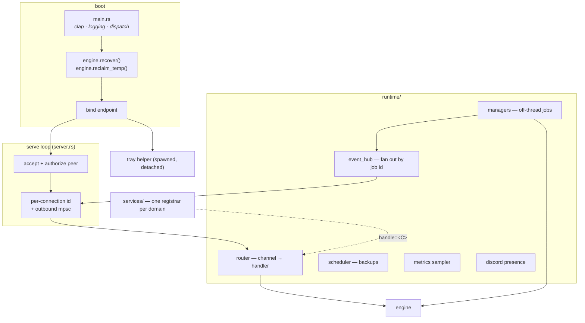
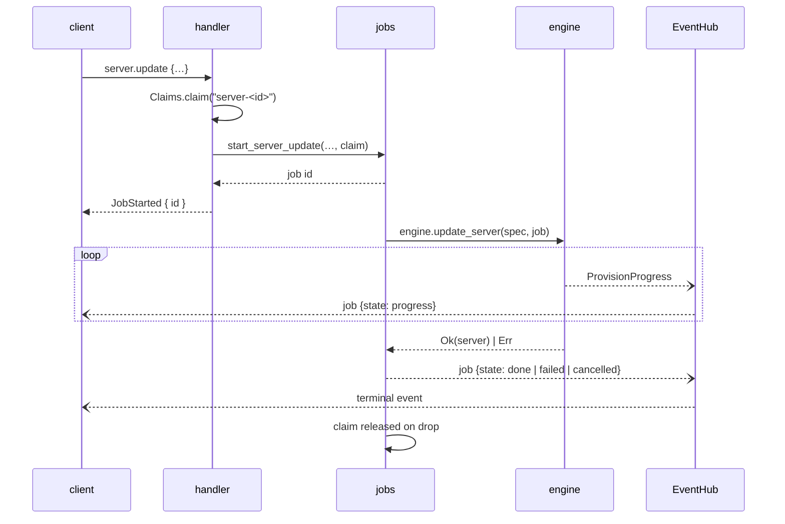

# The daemon

*[← Architecture](../architecture.md)*

`hestiad` is the resident core. It owns the IPC endpoint, routes requests to
handlers, runs the background loops, and manages login autostart. It is the only
crate that links the [engine](engine.md) — which is what makes the front-end
boundary a compile-time fact rather than a convention.

## Bootstrap and the serve loop

**`main.rs`** is bootstrap only: clap parsing (`serve` — the default — plus
`ping` and `stop`), logging init, and dispatch. `hestiad stop` is a graceful
self-stop that leaves supervised processes running, which lets the Windows
installer quiesce the daemon without requiring the CLI.

**`server.rs`** binds the endpoint, then accepts connections, rejecting any peer
that is not `authorized()`. Each connection gets an id and an outbound mpsc
channel drained by a writer task — which is why a streaming channel like
`events.subscribe` is an ordinary handler that simply pushes onto that channel.
The loop runs under `tokio::select!` against a stop request (`daemon.stop`) and
an OS signal (SIGTERM / Ctrl-C).

Once listening, it spawns the tray helper: best-effort, detached, skipped on a
headless session or under `HESTIA_NO_TRAY=1`
([0051](../decisions/0051-the-daemon-spawns-the-tray.md)).

## `runtime/` — the long-lived collaborators

`Runtime` holds the `Engine`, the `EventHub`, the job managers, and the stop
`Notify`. **`HandlerContext`** is what every handler receives:
`{runtime, conn_id, out}` — collaborators through `ctx.runtime.*()` and the
outbound channel for streaming. The peer is authorized once, at accept.

### Router

`Router` maps a channel string to a handler; an unknown channel becomes a
well-formed error response. `Channels` is the registrar: `on.handle::<C>(…)`
decodes `C::Params` (a malformed payload answers `bad_request` for you), invokes
the handler, and encodes `C::Result`, mapping a returned `ServiceError` to its
protocol code.

Because the channel name and payload shapes come from the contract, a handler
**physically cannot** drift from the client SDK.

One rule lives at the router rather than in handlers: the whole `instance.*`
surface (plus the instance-only `sync.*`) is refused with `unauthorized` until an
account exists. It is a whole-domain lockdown, and prefixing covers every
instance-only channel without touching its module. The verbs both sides share
(`content.add|…`, `modpack.update|…`) have no prefix to match, so
`guards::entry_for` applies the same gate by the target in their payload
([0030](../decisions/0030-instance-surface-gated-on-an-account.md)).

### Job managers

`runtime/managers/` holds one value, `Jobs`, and one file per job family, each
adding its `start_*` functions to it: Java install, server create and update,
instance launch, backup, content, modpack, transfer, self-update download.

They all answer the channel immediately with a job id, run the blocking engine
work off-thread, and publish `JobEvent`s through the hub — but none of them
implements that: `Jobs::run` in `job.rs` does. A `start_*` function builds a
`Spec` naming its id, prefix and the claim it holds, and hands `run::<C>` a
closure taking the engine and a `Reporter` and returning `C::Done`. `C` is the
start contract (`proto::job::Job`): it fixes the progress and done types and
supplies the `channel` every event carries. A family that serves several
contracts takes `C` as a type parameter, so the event names the channel that
actually started the job. Spawning, progress coalescing, cancellation, terminal
classification, event construction and logging are the runner's, so they cannot
drift per job ([0061](../decisions/0061-a-job-declares-what-differs.md),
[0083](../decisions/0083-a-job-is-its-contract-and-reports-on-one-topic.md)).

`managers/job.rs` is the plumbing they share: the `JobEvent` builder, the job-id
generator and `Jobs` itself. `runtime/claims.rs` holds **`Claims`** — one map
from an entry key to the `JobKind` holding it, whose `claim()` returns a guard
released on drop (so a panicking job cannot wedge its key) or the holder's kind,
which the guards turn into the typed busy error. A handler takes the claim in
`guards` and moves it into the job it starts, so the check and the claim are one
step; the scheduler takes the same claim before a scheduled task or backup
([0086](../decisions/0086-an-entry-has-one-claim.md)).

`Jobs` hands a prepared `LaunchPlan` to the supervisor under a deterministic
process id (`server-<id>`, `instance-<id>_<seq>`), so every channel can find an
entry's process without bookkeeping. The entry key claims are held under is that
same `server-<id>` / `instance-<id>` form.

### Background loops

| Loop | Cadence | What it does |
|---|---|---|
| `scheduler.rs` | every minute | run each **running** server's due **scheduled tasks** — a restart (stop, wait for exit, start through the same `Runtime::start_server` a client's start uses), a console command, or a backup (a `Backup` job archiving as `scheduled`, then pruning the scheduled archives beyond the task's retention; a stopped server's world cannot change, so it is never re-archived). A task is stamped before it runs, so a failure waits for its next slot instead of retrying every minute, and it takes the entry's claim first, so none runs while a backup or version change owns the tree |
| `metrics.rs` | every 2 s | sample CPU and memory for supervised processes, normalising CPU by logical core count so a multi-threaded JVM reports a share of the machine rather than 800% |
| `presence.rs` | every 5 s, on its own thread | publish Discord Rich Presence — the newest running session, else idle — sending only when the card changed. Gated on `discord.enabled` and skipped entirely under `HESTIA_NO_PRESENCE=1`; a missing Discord client is polled for at a sixth of the rate ([0059](../decisions/0059-discord-presence-is-a-daemon-loop.md)) |

`event_hub.rs` fans events out to subscribed connections, filtered by id, and
unsubscribes them on disconnect.

## `services/` — the wire-in point

One registrar per domain, each registering its channels with one
`on.handle::<C>(…)` apiece. `services/mod.rs`'s `make_router()` is nothing but
the list of `register()` calls; `services/guards.rs` holds the preconditions the
registrars share. A handler does not assemble its own: it names what it is about
to do — `Intent::{Read, Idle}`, or a `Hold` that takes the entry's claim — and
`server_for` / `instance_for` (`server_held` / `instance_held` for a claim)
resolve the entry and refuse whatever holds it ([0029](../decisions/0029-one-registrar-per-domain.md)).

There is no `Service` class per prefix — a handler is a closure, and the grouping
is purely a compile-time one that keeps `make_router()` from becoming a
1100-line function ([0029](../decisions/0029-one-registrar-per-domain.md)).

### The channel surface

| Registrar | Channels |
|---|---|
| `lifecycle` | `health.ping`, `app.info`, `daemon.status\|stop`, `events.subscribe`, `job.cancel` |
| `config` | `config.get\|set\|list` — the reserved `home`/`autostart` keys routed to the path pointer and login registration |
| `cache` | `cache.info\|list\|clear` |
| `java` | `java.releases\|list\|install\|uninstall` |
| `accounts` | `account.login.begin\|login.complete`, `account.list\|switch\|remove` |
| `skins` | `skin.list\|add\|update\|equip\|reset\|remove`, `cape.equip\|clear` |
| `process` | `process.start\|stop\|list\|status\|logs` |
| `server` | `server.flavors\|loaders\|versions\|resolve`, `server.create\|update\|rename\|list\|status\|info\|remove\|start\|stop\|logs\|command\|ping`, `server.config.get\|set\|list`, `server.properties` |
| `files` | `server.files.list\|read\|write\|mkdir\|move\|copy\|remove\|import\|compress\|extract` |
| `tasks` | `server.task.list\|save\|remove` — stored on the server record; the scheduler loop runs them |
| `players` | `server.players`, `server.players.set\|kick` — the lists are read from the server's own files; a change is a console command, so it needs the server running |
| `instance` | the `instance.*` counterparts, plus `instance.launch\|stop\|logs`, `instance.worlds`, `instance.sync.adopt` |
| `backup` | `server.backup.create\|list\|restore\|remove` |
| `content` | `content.sources\|search\|project\|versions\|inspect\|resolve_url`, and the per-entry `content.add\|list\|remove\|update\|enable\|check_updates\|matches\|set_version`, each aimed by an `EntryTarget` |
| `modpack` | `server\|instance.modpack.install`, and the per-entry `modpack.update\|preview_update\|status\|check_update\|remove`, each aimed by an `EntryTarget` |
| `sync` | `sync.get\|set\|status` |
| `update` | `update.check\|download` |

Two conventions worth knowing when reading them:

- **A verb both sides share is one channel aimed by a target.** Its params carry
  an `EntryTarget { kind, entry }`, and `guards::entry_for` resolves it through
  `server_for` / `instance_for`, so the handler holds no per-side branch. Only
  `server.modpack.install` and `instance.modpack.install` stay two channels,
  because a server install carries the EULA and a port.
- **`info` is static, `status` is live.** `info` answers the descriptor, on-disk
  locations and disk footprint (a directory walk); `status` merges the stored
  record with live process state. Keeping the walk off `status` is what makes
  `status` cheap enough to poll.

`process.start` has no CLI verb on purpose: it is the supervisor's test seam, the
only way to put a workload under a real out-of-process daemon without Java or the
network. The end-to-end tests drive adoption, log following and `daemon stop
--all` through it ([0041](../decisions/0041-every-capability-gets-a-verb.md)).

## Autostart

`autostart/` registers or removes the daemon as a login-time service per
platform (`linux.rs`, `windows.rs`, `unsupported.rs` behind one interface),
driven by the `config` service when the reserved `autostart` key is set.

On Linux the entry runs the daemon's own executable — except under an AppImage,
where that executable sits on a mount that is gone by the next login. There the
entry runs the image itself with `--daemon`, which has the desktop shell (the
image's only entry point) start the daemon through `Client::start` and exit
without a window
([0080](../decisions/0080-only-the-shell-runs-in-the-appimage-environment.md)).

## Stopping

`daemon.stop` takes a boolean `stop_processes` — and deliberately does *not*
define what a bare "stop the launcher" means when a server is running. That third
meaning, **ask**, lives in the front-end: the CLI prompts on a terminal and
refuses when piped; the tray's Quit and the desktop's stop button both leave
workloads running, because a menu item cannot ask
([0036](../decisions/0036-stopping-the-daemon-has-three-meanings.md)).

On shutdown the daemon calls `stop_all_and_wait()` only when asked to; otherwise
supervised processes simply carry on without it.

## Decisions

- [0029 — One registrar function per domain, not a Service class per prefix](../decisions/0029-one-registrar-per-domain.md)
- [0030 — Instances are gated on a signed-in account, in the router](../decisions/0030-instance-surface-gated-on-an-account.md)
- [0031 — An aggregation point is a directory, not a file](../decisions/0031-an-aggregation-point-is-a-directory.md)
- [0036 — Stopping the daemon has three meanings](../decisions/0036-stopping-the-daemon-has-three-meanings.md)
- [0080 — Only the shell runs in the AppImage's environment](../decisions/0080-only-the-shell-runs-in-the-appimage-environment.md)
