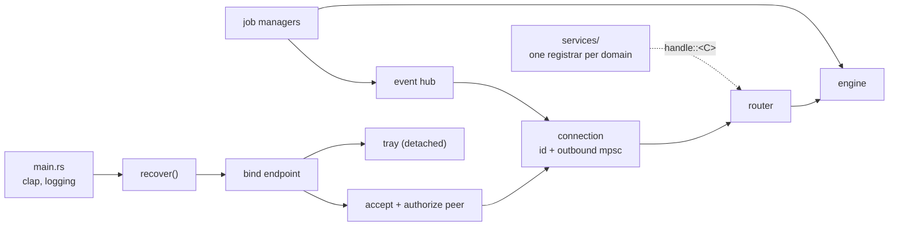
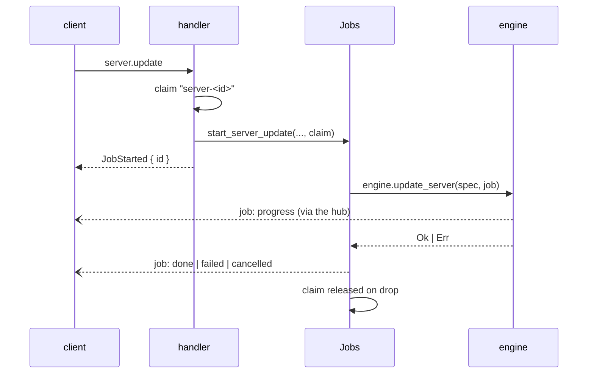

# The daemon

*[← Architecture](../architecture.md)*

`hestiad` is the resident core. It owns the IPC endpoint, routes requests to handlers, runs background loops and manages
login autostart. It is the only crate that links the [engine](engine.md), which makes the front-end boundary a
compile-time fact.

## Bootstrap and the serve loop

- **`main.rs`** is bootstrap only: clap (`serve`, the default, plus `ping` and `stop`), logging, dispatch. `hestiad
  stop` is a graceful self-stop that leaves supervised processes running, so the Windows installer can quiesce the
  daemon without the CLI.
- **`server.rs`** binds the endpoint and accepts connections, rejecting any peer that is not `authorized()`. Each
  connection gets an id and an outbound mpsc channel drained by a writer task, so a streaming channel such as
  `events.subscribe` is an ordinary handler that pushes onto it. The loop runs under `tokio::select!` against
  `daemon.stop` and an OS signal.
- Once listening it spawns the tray, best-effort and detached; skipped on a headless session or with `HESTIA_NO_TRAY=1`.

## runtime/

`Runtime` holds the `Engine`, the `EventHub`, the job managers and the stop `Notify`. A handler receives a
`HandlerContext { runtime, conn_id, out }`: collaborators through `ctx.runtime.*()` and the outbound channel for
streaming.

### Router

`Router` maps a channel to a handler; an unknown channel is a well-formed error. `Channels` is the registrar:
`on.handle::<C>(...)` decodes `C::Params` (a bad payload answers `bad_request`), runs the handler and encodes
`C::Result`, mapping an `ErrorInfo` to its code. Because names and shapes come from the contract, a handler cannot
drift from the client.

The router also enforces the account gate: the whole `instance.*` surface (and the instance-only `sync.*`) answers
`unauthorized` until an account exists. Verbs both sides share (`content.add`, `modpack.update`) have no prefix, so
`guards::entry_for` applies the same gate by the target in the payload.

The router also gates by owner: a contract that sets `const OWNER` is answered with `plugin_disabled` while that plugin
is not enabled in the engine's registry. The kernel's own channels have no owner.

### Job managers

`runtime/managers/` holds one value, `Jobs`, and a file per family: Java install, server create and update, instance
launch, backup, content, modpack, transfer, self-update download. Each answers at once with a job id, runs blocking
engine work off-thread and publishes `JobEvent`s through the hub.

A `start_*` function builds a `Spec` (id, prefix, the claim it holds) and hands `Jobs::run::<C>` a closure taking the
engine and a `Reporter` and returning `C::Done`. The runner owns spawning, progress coalescing, cancellation, terminal
classification, event construction, logging and the `JobInfo` registry behind `job.list`. A family serving several
contracts takes `C` as a type parameter, so the event names the contract that started it.

**Claims.** `runtime/claims.rs` holds `Claims`: one map from an entry key (`server-<id>`, `instance-<id>`) to the
`JobKind` holding it. `claim()` returns a guard released on drop, or the holder's kind, which the guards turn into the
typed busy error. A handler takes the claim in `guards` and moves it into the job it starts, so check and claim are one
step. The scheduler takes the same claim before a scheduled task or backup.

`Jobs` hands a prepared launch plan to the supervisor under a deterministic process id (`server-<id>`,
`instance-<id>_<seq>`), so any channel can find an entry's process without bookkeeping.

### Background loops

| Loop           | Cadence      | Does                                                                                                     |
|----------------|--------------|----------------------------------------------------------------------------------------------------------|
| `scheduler.rs` | every minute | runs each running server's due scheduled tasks (restart, console command, backup)                        |
| `metrics.rs`   | every 2 s    | samples CPU and memory of supervised processes, CPU normalised by logical cores                          |
| `network.rs`   | ticking      | confirms a stale reachability state and pushes every transition to subscribers                           |
| `ready.rs`     | per start    | pings a started server's game port and publishes `server.ready` when it answers                          |
| `updates.rs`   | on demand    | checks installed content for updates at startup, on reconnect, at launch and when an entry opens         |

`event_hub.rs` fans events out to subscribed connections, filtered by id, and unsubscribes on disconnect.

## services/

One registrar per domain, each registering channels with one `on.handle::<C>(...)` apiece. `make_router()` is only the
list of `register()` calls. `guards.rs` holds the shared preconditions: a handler names its intent (`Intent::Read`,
`Idle`, or a `Hold` that takes the claim) and `server_for` / `instance_for` (`server_held` / `instance_held`) resolve the
entry and refuse whatever holds it.

| Registrar                | Channels                                                                                          |
|--------------------------|---------------------------------------------------------------------------------------------------|
| `lifecycle`              | `health.ping`, `app.info`, `daemon.status`, `daemon.stop`, `events.subscribe`, `job.list`, `job.cancel` |
| `config`, `cache`, `java`, `update` | `config.*`, `cache.*`, `java.*`, `update.check`, `update.download`                     |
| `accounts`, `skins`      | `account.*`, `skin.*`, `cape.*`                                                                   |
| `process`                | `process.start\|stop\|list\|status\|logs`                                                         |
| `entry`                  | what a server and an instance share: `entry.flavors\|versions\|loaders\|rename\|remove\|stop\|logs\|config.*` |
| `server`, `files`, `tasks`, `backup` | `server.*` (create, update, start, command, properties, worlds), `server.files.*`, `server.task.*`, `server.backup.*` |
| `instance`               | `instance.*` (create, update, launch, worlds, servers, recent)                                    |
| `content`, `modpack`, `sync` | `content.*`, `modpack.*`, `sync.*`                                                            |
| `transfer`, `screenshot` | `instance.export*`, `instance.import*`, `screenshot.*`                                                      |
| `net`, `host`, `image`   | `net.status`, `host.info`, `image.fetch`                                                          |

- **A verb both sides share is one channel aimed by a target.** Params carry `EntryTarget { kind, entry }`, resolved by
  `guards::entry_for`, so a handler holds no per-side branch. `server.modpack.install` and `instance.modpack.install`
  stay separate because a server install carries the EULA and a port.
- **`info` is static, `status` is live.** `info` answers descriptor, locations and disk footprint (a directory walk);
  `status` merges the record with live process state, so it is cheap to poll.
- `process.start` has no CLI verb: it is the supervisor's test seam for the end-to-end tests.

## hestiad stdin-relay

A hidden subcommand: `hestiad stdin-relay --pipe <name> -- <program> <args...>`. On Windows the supervisor starts a
Bedrock server through it; the relay parents the server, owns its stdin and serves the named pipe a later daemon
reconnects to. On unix the supervisor uses a FIFO and never runs it.

## Autostart

`autostart/` registers or removes the daemon as a login service per platform (`linux.rs`, `windows.rs`,
`unsupported.rs` behind one interface), driven by the `config` service when `autostart` is set. On Linux the entry runs
the daemon's own executable, except under an AppImage, where that path sits on a mount gone by the next login: there it
runs the image with `--daemon`, which has the desktop shell start the daemon through `Client::start` and exit without a
window.

## Stopping

`daemon.stop` takes `stop_processes`. A bare "stop the launcher" with a server running is ambiguous, so the third
meaning, ask, lives in the front-end: the CLI prompts on a terminal and refuses when piped, naming both flags. The
tray's Quit and the desktop's stop button leave workloads running. `stop_all_and_wait()` runs only when asked.
