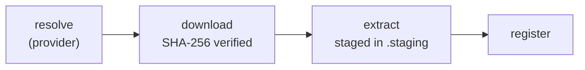
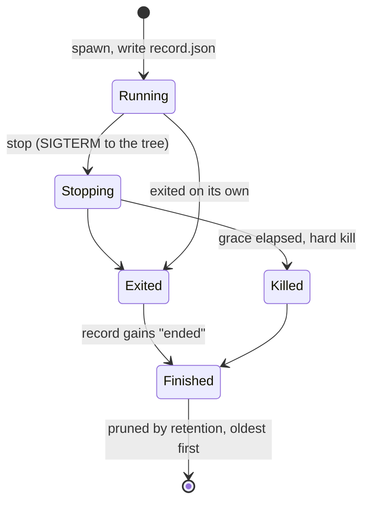
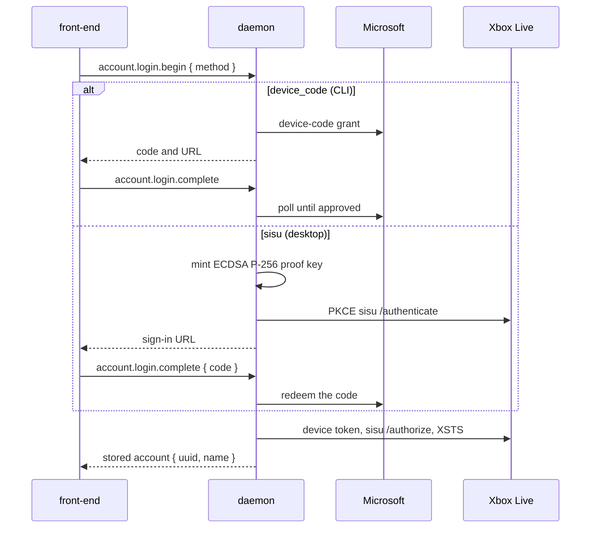

# The engine

*[← Architecture](../architecture.md)*

The engine is the launcher itself: config, downloads, Java, accounts, game providers, entry stores, content, process
supervision. It is daemon-internal. It links neither `ipc` nor `client` and knows no socket exists.

Larger domains have their own pages: [Minecraft providers](minecraft.md), [Servers and instances](entries.md),
[Content and modpacks](content.md).

## The aggregate root

`Engine` (`engine/mod.rs`) is built once by the daemon and handed to every handler. It resolves the data home once and
owns each subsystem as a member behind a getter, and nothing else.

| Plumbing                                   | Domain                                                    |
|--------------------------------------------|-----------------------------------------------------------|
| `config`, `net`, `cache`, `java`, `processes` | `minecraft`, `content`, `servers`, `instances`, `skins`, `sync`, `accounts` |

- Adding a subsystem is a module, a member and a getter.
- A flow that spans subsystems is not a method on the aggregate. It lives in `engine/flows/<concern>.rs` as its own
  `impl Engine` block, so callers write `engine.provision_server(...)` and the aggregate stays wiring.
- The data home is fixed at construction. `config set home` writes the pointer and the daemon stops itself, leaving
  workloads running. The CLI and desktop start it again onto the new home. It is refused while a server, session or job
  runs (`WorkRunning`).

### Startup reconciliation

No job survives a daemon stop, so anything half-finished on disk at boot belongs to a job that will not return. The
daemon runs `processes().recover()` and then `Engine::recover()` before serving.

| Pass                           | Settles                                                                          |
|--------------------------------|----------------------------------------------------------------------------------|
| `ProcessSupervisor::recover()` | re-adopts surviving processes; marks ones that died unsupervised as ended        |
| server phase reconcile         | discards a record still `Provisioning`; keeps and logs one mid-`Updating`        |
| `reclaim_temp()`               | deletes abandoned `.part` and `.staging` artifacts and empties `tmp/`            |

Reclaim is not recursive: each subsystem knows the one directory its artifacts land in.

## Persisted documents

Every user-owned file (settings, accounts, an entry record, a content index, the skin library) is a `schema::Document`
carrying a top-level `schemaVersion`, read and written through `common::schema`.

| Concern                            | How                                                                           |
|------------------------------------|-------------------------------------------------------------------------------|
| Version                            | `Document::VERSION`, 1 for all; there is no migration chain                   |
| No stamp                           | read as the baseline                                                          |
| Newer than this build or malformed | renamed `<name>.unreadable-<stamp>`, defaults used, a warning recorded        |
| Writing                            | temp file renamed into place; owner-only mode set before the rename where it matters |

Derived state (process records, Java records, the download cache) is not a document. Quarantines collect in one
process-wide sink and surface through `daemon.status` and on an import's own result. Archives are documents too, but an
archive is not Hestia's to rename aside, so a schema failure there is refused (`ArchiveTooNew`, `ArchiveInvalid`).

## Settings

`config` is one `Settings` struct: a setting is a field with a default, persisted as JSON. Code reads a `settings()`
snapshot and writes through `update()`. Dotted-path `get` and `set` serve the `config.*` channels and reject unknown
keys and mistyped values, so the struct is the validation. `normalize()` handles rules a type cannot carry.

- Every `config set` value passes one typed schema. Property values for `server.properties` come from a curated table.
- `defaults.jvm-args` and `defaults.memory` fall back into any start or launch whose record leaves the field unset
  (`JavaSettings::or_defaults`).
- `home` routes to the path pointer and `autostart` to the platform login registration; neither is stored.
- Keys are kebab-case on the wire while the file stores camelCase.

## The network

Every outbound request crosses `net`.

- **Vetting.** No request leaves the engine except under a `kernel::vetting::Policy`: https only, no IP literal, no
  credentials in the URL, a granted host, and a resolver that refuses addresses inside the machine (loopback, private,
  link-local, CGNAT, multicast, unspecified, and the IPv6 forms that wrap one), which dials only the addresses it
  vetted. The client keeps no cookies and follows no redirect itself: `Policy::get` walks them and vets every hop; an
  API call (`Policy::request`) follows none. A body is checksummed, or comes from a host the policy declares as serving
  unhashed files. An API or metadata call runs under `Limits::REQUEST` (30 s, 32 MiB), its body read only through
  `net::Answer` or `net::read`; a file download under `Limits::DOWNLOAD` (2 GiB and 30 s without data, no total, since a
  Java runtime on a slow line is not a failure). A policy that lists its hosts goes through the proxy
  `HTTPS_PROXY`/`ALL_PROXY` names (minus `NO_PROXY`); an open one goes direct, so a URL from content cannot reach what
  the proxy sees. The hosts Hestia itself reaches are listed in `net/hosts.rs` (`mojang`, `bedrock_catalogue`,
  `bedrock`, `accounts`, `adoptium`), plus `typed` (a URL the user typed) and `untrusted` (a file an archive named; a
  checksum is required). Plain-http loopback is reached only through `Hosts::with_loopback`, which exists in a build
  with the kernel's `loopback` feature, enabled by the engine's tests.
- **Client.** Retries are bounded with jittered backoff and honour `Retry-After`. Only transport failures, 429 and
  5xx are retried, never a 4xx or a checksum mismatch.
- **Reachability.** `net::Network` is `Online | Offline | Unknown`, derived from real traffic: any answer marks it up,
  and only a transport failure with retries spent marks it down. `network.offline` pins it, and nothing is attempted
  while set. The daemon ticks `Network::refresh`, which probes only when state is stale: every 10 s while offline, and
  while online only after a quiet minute.
- **Catalogue store.** `net::store` keeps the last good copy of each catalogue response under `meta/catalogue/`, keyed
  by URL, so a version list fetched while offline is served stale.

### Remote images

The webview never contacts an image host. `image.fetch` (`net/image/`) fetches for it and the desktop serves the bytes
over the `hestia-image` scheme. The fetch runs under an open policy, follows at most five redirects each vetted
(https, a host name, no credentials), caps the body at 10 MiB and the fetch at 15 s, and sniffs the bytes as png, jpeg,
gif, webp, avif or svg. Results are stored in the cache by SHA-256, with `cache/images.json` mapping URL to blob (256
entries, oldest dropped). A repeat view, or any view while offline, makes no request.

## Downloads and the cache

- **`Downloader`** streams a URL to a `.part` file under the `Policy` it is built with, hashes incrementally, aborts a
  body above the policy's cap, and renames only on success.
- **`Cache`** is content-addressed under `cache/<algorithm>/<hex[..2]>/<hex>`, keyed by checksum, so a file fetched once
  is reused whatever URL asked. It serves per-entry destinations (server jars and libraries, mods, modpack files).
  Files in the shared `meta/` tree and the JDK archive bypass it. Hits are re-hashed on the way out; a damaged blob is
  evicted and refetched. The cache can make things faster, never wrong.

## Java runtimes

`Java` installs runtimes under `<data_home>/java/<vendor>-<major>/` beside a `runtime.json`. Listing scans the
directory. A runtime already on disk is used without any provider.

A `JavaProvider` resolves a build and nothing else. Eclipse Temurin from Adoptium is built in and is the default; the
`java.provider` setting names the provider a bare install uses, and an unknown name fails `ProviderUnknown`. `Java`
downloads the build, verifies its SHA-256, extracts it and registers it in-process:

## Process supervision

`ProcessSupervisor` owns every process Hestia starts: servers, game sessions and the `server.properties` schema run. It is engine state because its directory is engine-owned and because engine flows that
shell out must not spawn bare children.

A supervised process is decoupled from the daemon: its own process group (a job object on Windows), no `kill_on_drop`,
no pipes back.

- **Records and identity.** `<data_home>/processes/<id>/record.json` holds `{pid, start-time token, spec}`, written
  through a temp file, owner-only. Args are stored with credentials masked. `recover()` re-adopts survivors after
  verifying the pid against its start-time token (`identity.rs`, per platform), so pid reuse is never mistaken for the
  process. An adopted process is not our child: its exit is detected by polling and its exit code is `null`.
- **Output lives on disk.** `LogSource::File` points at a log the process writes itself (`logs/latest.log`, with a
  `jvm.log` for pre-log4j stderr). `LogSource::Capture` redirects into a supervisor-owned `output.log`. `tail.rs` polls
  the file for `process.output` events, and `process.logs` reads the tail on demand. Each line carries the byte
  `offset` it starts at, so it has one identity streamed or read back (within one file).
- **Stops are polite and reach the tree.** SIGTERM first, a hard kill after a grace period, both at the whole tree.
  `StopMethod::Line("stop")` writes a line to stdin first; BDS needs it because it saves on `stop`.
- **A process can keep a stdin endpoint.** `ProcessSpec.stdin` gives it one that lives as long as the process and is
  recorded in `record.json`, so an adopted process reattaches after a daemon restart (`process/stdin/`). On unix it is
  a FIFO the child holds open read-write. On Windows it is a named pipe served by a relay, `hestiad stdin-relay`, which
  parents the program.
- **A finished process is labelled.** On exit `record.json` gains an `ended` section (state, exit code, time) and keeps
  its spec. The startup sweep deletes only directories with no readable record.
- `task.rs` runs a program to completion, relays what it narrates as progress, and is cancelled through the supervisor.

## Editions

`edition/` holds what differs between a Java and a Bedrock server: `mod.rs` has the shared vocabulary and a closed
`match` on the record's `Edition`; `java.rs` and `bedrock.rs` each side. It answers property rules, ports, start
config, process I/O, console transport, status, backup pause and resume, worlds and import, content sync and player
lists. A flow calls `edition::...` and never branches on an edition.

## Provider seams

Flavors (`FlavorProvider`), content sources (`ContentProvider`), Java distributions (`JavaProvider`) and pack formats
(`PackProvider`) are traits held in a runtime-mutable `Roster` (`roster.rs`); only the built-ins are registered: vanilla
Java and Bedrock, Adoptium, and Hestia's own archive. No content source is built in. Each flavor, content
source and Java package names the `Policy` its downloads run under (`download_policy`, `JavaPackage::policy`, and a pack
format's `policy`), so a built-in states its hosts in `net/hosts.rs` and a plugin will state its granted ones.
Flavors, content sources, pack formats and Java distributions beyond the built-ins return with the new plugin system.

The registry is not the engine's: it lives in the [kernel](../architecture.md#the-kernel). The engine only lists the
built-ins it compiles in (`engine::builtins()`, empty until servers, instances and content become plugins).

## Accounts and skins

Playing needs a Microsoft account that owns the game. Hestia signs in through Microsoft's own flows, keeps tokens in the
daemon and never sends them over the socket. A stored account is also proof of ownership, so the `instance.*` surface
is refused until one exists (enforced once, in the router).

### Sign-in

Accounts live in `<data_home>/accounts.json` (owner-only on POSIX). Both methods use the well-known Minecraft client
id, so no per-distribution Azure app is needed. Sign-in is two steps so a front-end can render what the user must do:

- `access_token()` runs the signed tail to rotate a token only within 5 minutes of expiry. With Microsoft unreachable
  it yields the stored token flagged stale.
- `accounts/microsoft.rs` holds the HTTP steps. `accounts/signing.rs` signs Xbox requests (the proof key and a
  FILETIME-stamped `Signature` header) with one cross-platform `p256` implementation.
- `account.switch` picks the account launches run as.

### The skin library

`<data_home>/skins/` holds PNG blobs as `<key>.png` beside `library.json`. A row is keyed by Mojang's texture hash, so
matching the equipped skin is a key comparison.

- One `skin.list` answer merges the saved library, 18 vanilla defaults (`defaults.rs`, listed by public texture URL,
  not bundled) and whatever the account currently wears.
- Before any change, the equipped skin is saved into the library if neither it nor a default already records it.
- `skins/mojang.rs` holds the profile calls (fetch, upload, by-URL change, reset, cape set and clear), authenticated
  with the rotated token. A 30 s per-account profile cache absorbs `skin.list` bursts, because Mojang rate-limits.
- Skins are a desktop-only surface; the CLI has no skin command.

## Small shared pieces

| Module         | Role                                                                                                    |
|----------------|---------------------------------------------------------------------------------------------------------|
| `cancel.rs`    | `Cancel`, the cooperative flag, and `Job`, which carries it beside the progress reporter               |
| `registry.rs`  | `allocate_id` (a UUIDv7) and `dir_name` (a slug), shared by the entry stores                           |
| `usage.rs`     | directory footprint; a symlink is a boundary                                                           |
| `error.rs`     | the engine's `thiserror` enums, mapped at the daemon's service boundary                                |
