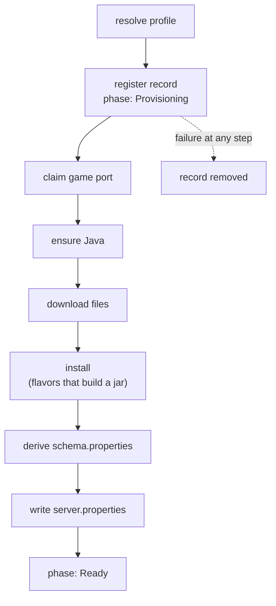
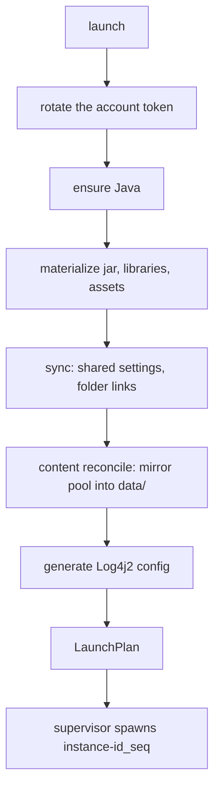
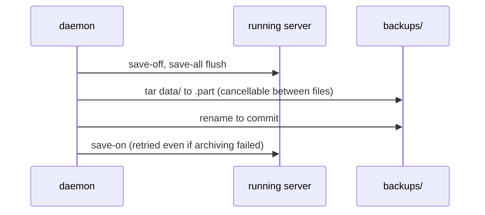
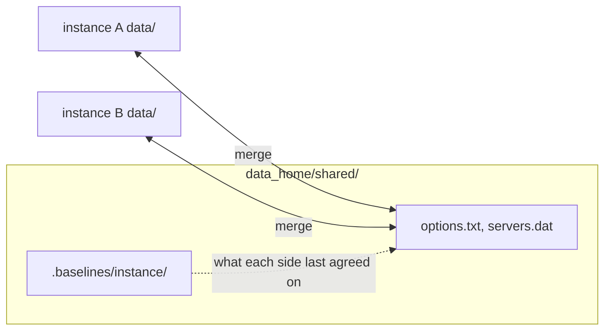

# Servers and instances

*[← Architecture](../architecture.md)*

An **entry** is a server or an instance: a named thing you create, configure, start and remove. They share records,
ids, Java settings, content and version updates, and differ the way a dedicated server differs from a game client.

|                          | Server                                      | Instance                                       |
|--------------------------|---------------------------------------------|------------------------------------------------|
| Provisioned              | fully, at create                            | at each launch                                 |
| Sessions                 | one                                         | many, opt-in                                   |
| Console                  | RCON (Java) or a stdin endpoint (Bedrock)   | none                                           |
| Backups                  | archive and restore, plus a scheduled task  | none; [import and export](transfer.md) instead |
| Shared settings (`sync`) | no                                          | yes                                            |
| Ports                    | claimed and reconciled                      | n/a                                            |
| Runs as                  | itself                                      | the signed-in account                          |

A server has an **edition** (`java` or `bedrock`) stored on its record. What differs by edition lives in the engine's
`edition/` module, and the daemon reports results (`ports`, `accepts`) on `ServerInfo`. A Bedrock server runs a native
executable with no Java and no JVM settings.

## Directory layout

The entry root is Hestia's namespace; `data/` is the game's working directory, the launch plan's cwd.

```
servers/<dir>/                    instances/<dir>/
├── server.json     record        ├── instance.json    record
├── icon.<ext>, icon.json         ├── icon.<ext>, icon.json
├── schema.properties             ├── content.json     install index
├── content.json    install index ├── modpack.json     if from a pack
├── modpack.json    if from a pack├── mods/ resourcepacks/ shaderpacks/
├── mods/ plugins/  managed       ├── logs/session-N.log
├── backups/                      ├── recent.json      what was joined lately
└── data/           the game dir  └── data/            the game dir
```

Directories appear on demand. A Bedrock `data/` holds the unpacked BDS (`bedrock_server`, `server.properties`,
`allowlist.json`, `permissions.json`, `worlds/`, `behavior_packs/`, `resource_packs/`).

The **icon** is part of the entry: `icon.<ext>` (PNG, JPEG, WebP or GIF by its bytes, up to 10 MB) plus `icon.json` for a
generated one. It moves, exports and is removed with the entry; an entry made from a modpack takes the pack's icon.

## Identity

The `id` is a UUIDv7 hex string minted at create, never a path component. The directory is `slugify(name)`. A rename
rewrites the name and moves the directory (refused unless the entry is stopped and idle); the id, and everything keyed
by it, does not change. You address an entry by name: `proto::naming::reference_matches` resolves an exact id or any
spelling that slugs to the display name, so the daemon and every front-end resolve identically.

## Records and settings

`server.json` and `instance.json` hold the resolved profile snapshot and per-entry settings. Both stores are one generic
`registry::Store`: name uniqueness, id allocation, rename and removal are written once, and every read-modify-write runs
under one write lock.

| Setting    | On       | Meaning                                                                                       |
|------------|----------|-----------------------------------------------------------------------------------------------|
| `memory`   | both     | drives `-Xms` and `-Xmx`; rejected above installed memory, which `host.info` reports          |
| `jvm-args` | both     | extra JVM arguments                                                                           |

A scheduled backup is a `Backup` task beside restart and console-command tasks, with an optional retention count,
counted from its own last run.

Servers also pass `server.properties` keys through `config set`. A key must be in the server's derived schema, and the
Hestia-managed port and RCON keys are rejected. Every value passes `engine::keys::validate`: a kind (boolean, integer
with range, choice, memory, JVM args) from a curated table of well-known properties; an unknown property takes any
string. A refusal is `config_invalid` naming the key and reason. The rules ride on the flavor catalogues and
`config.list`, so a create form's limits are the daemon's.

JVM settings resolve in layers, each filling only what the one above left unset: the entry's own, then
`defaults.jvm-args` and `defaults.memory`, then the flavor's recommended flags. `server info` names which layer supplied
the effective flags.

Updates and flows mutate the loaded record and write it back; they never rebuild it, so a server keeps its tuning,
schedule and game port across a version change.

## Creating a server

`create` pays the whole cost once (jar, Java, EULA), so `start` is an immediate spawn that cannot fail on the network.



The record is registered first because it holds the port claim through a long download. `ServerPhase` is
`Provisioning`, `Ready` or `Updating`, so startup recovery can discard the first and keep the last.

### Ports

A server claims its game port at create: lowest free from 25565 (Java) or 19132 (Bedrock), or pinned. A Java server also
claims an RCON port and random password at first start. Claims are checked against every other record plus a live bind
probe under the store's write lock. The edition's `configure_start` writes them into `server.properties` before each
spawn, preserving user edits. Vanilla RCON has no bind address, so the per-server random password is the only barrier;
it never appears in a log.

A Bedrock server binds two ports. `ServerInfo.ports` lists each with its protocol, game port first. The game port is
probed for TCP and UDP; a second UDP port is allocated from 19133 at each start and written with `transport=nethernet`.

### The properties schema

The create job runs the downloaded server once in a throwaway `<entry>/.schema/` directory with no `eula.txt`; the
server writes a complete `server.properties` (every key and default for that version, mods included) and exits before
binding ports. That file is stored as `schema.properties`. Generation is best-effort: failure is a warning, and a server
with no schema accepts any unmanaged key. Bedrock cannot print defaults, so its schema is the file shipped in the BDS
zip, captured at install and refreshed on update.

The `server.properties` channel lists the union of the schema's keys and the live file's, each with the effective value,
the version's default, and flags only the daemon can answer: `managed`, `secret` (sent blank) and `locked` (pinned by
another setting, such as hardcore). A front-end holds no table of keys.

## Launching an instance



**Sessions.** Concurrent sessions are opt-in twice: the `instance.multi-session` setting (off by default; a launch
asking while it is off fails `MultiSessionDisabled`) and `new_session` on the launch. `instance-<id>` is the entry key
and each launch gets a session key `instance-<id>_<seq>`. A relaunch is the launch job with `replace`, which stops the
named sessions (or all) first. Each session writes its own `logs/session-<seq>.log`.

**Joining directly.** `InstanceLaunchParams.quickPlay` is one optional target (world folder, server address or Realm
id) that adds Minecraft's `--quickPlaySingleplayer|Multiplayer|Realms`. It is validated before anything is
materialised: a game older than 1.20, a missing world, an unparsable address or a non-numeric Realm id is refused
(`QuickPlayUnsupported` and friends) rather than dropping the player at the title screen.

**Recently played.** `instance.recent` answers the last five joins across instances, each a `RecentPlay` with the
`QuickPlay` target that returns to it. Every 1.20+ launch passes `--quickPlayPath <entry>/logs/session-<seq>.quickplay.json`
and the client rewrites it at each login. `engine.record_plays` folds each session's file into `recent.json` on exit and
again before the list is read. A target that can no longer be joined is left out.

## Version updates

`update_server` and `update_instance` re-resolve the same flavor at another version and swap the profile. Both
directions work; a downgrade must be allowed explicitly, and direction is the position in the flavor's newest-first
catalogue, not a parsed version string.

- A **server** takes an automatic `update` backup first, re-materialises under the phase gate and regenerates its schema.
- An **instance** pays at next launch and **is not backed up**; its downgrade warning says so.

An update refuses a running or still-creating entry, except a server update with `restart`: the job stops the server,
waits, updates, and starts it again whichever way the update ended, reporting a failed start as a warning. A modpack the
entry runs moves with the game version unless the request says `keep`. The daemon sequences all of it in one job.

## Backups

Server backups are gzipped tars of `data/` in `backups/`, named `<utc-stamp>-<kind>.tar.gz` (`manual`, `scheduled`,
`update`).



- A live **Bedrock** server uses BDS's protocol: `save hold`, poll `save query` until the world files are ready, copy
  each file truncated to the length the server reports, then `save resume`.
- Creation skips what is re-materialised (server jar, `libraries/`, `logs/`, `cache/`, managed content mirrors,
  `session.lock`). Restore extracts to staging, carries the skipped top-level names over from the current tree (they
  belong to the version the record runs), and swaps; a failure leaves current data untouched.
- Retention prunes only `scheduled` archives. One backup or restore runs per server at a time.
- Instances have no backups: they travel as a file you write on purpose.

## The file tree

`server.files.*` serves `data/` as a tree a front-end can browse and edit (`engine::FileTree`).

- Paths are relative and `/`-separated, and none resolves outside `data/`. The check is lexical (no absolute path, no
  `..`) and physical: the existing part of the path is canonicalised and must land under the root, so a link cannot be
  used to read or write through it. The root can be listed, never renamed or removed.
- A file is read and written whole as text, up to 2 MiB. Larger or binary files are refused rather than truncated but
  can be moved, copied, archived or removed. Writes stage to `.part` and rename.
- Edits are allowed on a running server (`Intent::Idle`); they wait only on jobs that rewrite the tree.
- `import` copies files from absolute paths on the machine. `compress` writes a `.zip`. `extract` unpacks `.zip` or
  `.tar.gz`, refusing members that land outside the destination. Moving a tree is one call, not a job.

## Sync: shared settings across instances

Instances share a closed catalogue, and each unit names its mechanism. Nothing is linked, worlds are never shared, and
servers are deliberately excluded.

| Unit            | File                  | How two copies settle                                                      | Needs  |
|-----------------|-----------------------|----------------------------------------------------------------------------|--------|
| `options`       | `options.txt`         | key by key, through a typed catalogue, in the file the game wrote          | none   |
| `servers`       | `servers.dat`         | row by row against the agreement                                           | none   |
| `commands`      | `command_history.txt` | a union, capped at the game's 50 lines                                     | 1.20.2 |
| `hotbars`       | `hotbar.nbt`          | slot by slot, one store per item-format era                                | 1.12   |
| `screenshots`   | `screenshots/`        | nothing copied; folders read as one listing                                | none   |
| `resourcepacks` | the content pool      | by identity: installed where a pack fits, enabled and removed everywhere   | none   |



- **Off until enabled with a source.** `sync.enable` names the instance to seed from; every other instance's baseline is
  recorded as its own current content, so its first pass settles the shared copy's way. With several holders and none
  named, the daemon refuses and lists candidates.
- **Baseline, not clock.** A side reconciles against the content it and the shared copy last agreed on; only a side
  that moved wins, and the clock breaks only ties. A missing side is never an edit; a key, entry or line only one side
  knows is carried through.
- **When it runs.** At every launch and when each session exits, over every idle instance at daemon start, and when the
  catalogue changes.
- **The game's own file.** Comments, key order and line endings survive; an unreadable file skips the unit instead of
  being replaced; `servers.dat` rows keep tags this build does not model. Before sharing first lands on an instance, its
  copy is kept under `<store>/.backups/<instance>/`.
- **Version gates.** A unit below its version floor is skipped with a warning naming the version. The 1.20.5 item-format
  break is a split, not a floor: hotbars are stored per era.
- **Overrides.** An instance can keep any unit to itself and can pin individual `options.txt` keys local. Some keys are
  never shared: the pack selection, and keys describing the file, machine or moment (`version`, `lastServer`, display
  and audio keys, first-run prompts).
- **Resource packs** share a project id, source and file hash, installed through the ordinary content pool. A version
  change never propagates.

## Worlds

`instance.worlds` describes each save from its `level.dat`: name, version, mode, difficulty, hardcore and cheat flags,
last played, footprint and `icon.png` (base64). The folder stays the identity, and every other field is best-effort: a
corrupt or mid-write save appears with the folder alone and `read: false`.

`server.worlds` lists a Java server's one world, or every folder under a Bedrock server's `worlds/` (active first, then
most recent), read from a little-endian `level.dat`. `server.worlds.import` is a job that brings a `.mcworld` into a
stopped Bedrock server, optionally making it active; a cancel or failure leaves no partial folder.

## The multiplayer list

`instance.servers` reads and edits the instance's `servers.dat`; `instance.servers.arrange` takes the whole visible order
at once and refuses one that does not name each entry exactly once (the game keeps hidden direct-connect rows).
`minecraft.ping` gives one address's status, including the `favicon`. The running game rewrites the file on exit, so an
edit under a live session is made and reported degraded (`ServerListInUse`).

## Known limits of Bedrock servers

- The Windows stdin relay builds behind `#[cfg(windows)]` but has not been run on Windows; the unix FIFO is tested.
- Only vanilla BDS ships.
- No ban list, and `op` needs the player online.
