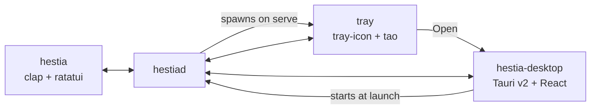
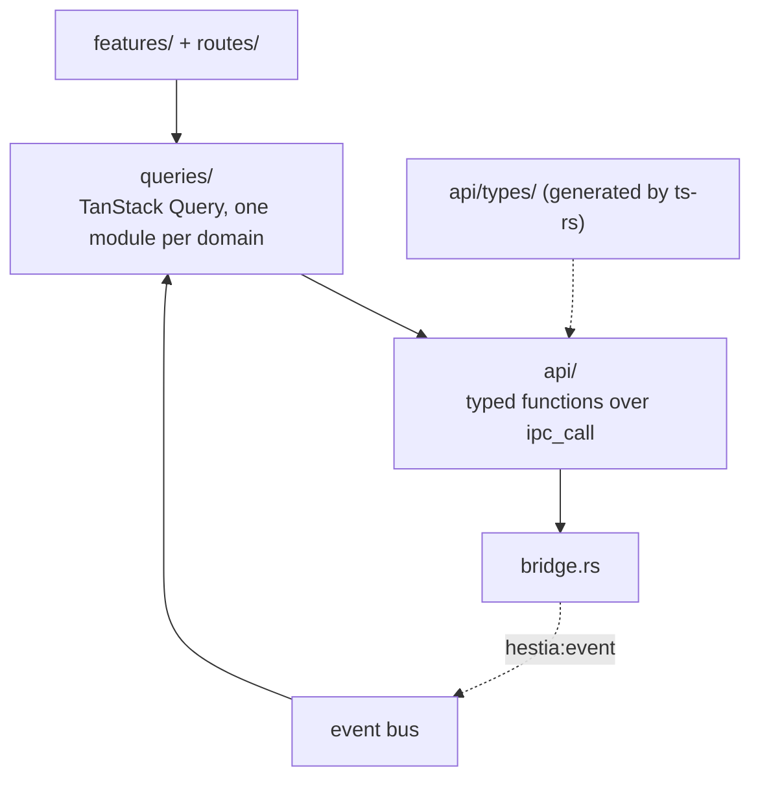

# Front-ends

*[← Architecture](../architecture.md)*

Three ways to drive one daemon. None links the engine; all go through [`client`](wire.md#client-the-typed-sdk) over the
socket.



Each front-end declares what it means by an ambiguous action. The CLI asks before stopping a daemon with workloads
running; the tray and desktop leave workloads running, because a menu item cannot ask.

# CLI: hestia

A thin client on clap's derive API. `main.rs` defines a `Command` enum; each variant is a module under `commands/`
exposing a `Subcommand` and a `run()`. A domain with many verbs is a directory whose `mod.rs` holds only grammar and
dispatch. The user reference is [cli.md](../cli.md).

## Grammar

Noun-first and **entry-first**: catalogue verbs read `hestia server create|list|versions|flavors`, and anything acting on
an entry names it once, right after the noun.

```
hestia server smp start
hestia server smp config set memory 4G
hestia instance modded mod add sodium
```

clap models this with an `external_subcommand` variant on the noun: an unrecognised first token, the entry name, is
captured and re-parsed by a `no_binary_name` parser, so per-entry actions keep full help and validation.

Two shortcuts sit on top: `hestia play [instance]` and verb-first `hestia start|stop|restart|logs|rename <name>`, which
resolves a name across both registries. Everything scriptable also has the explicit noun-first form.

- **Edition first.** `server create` takes `--edition java|bedrock` (default `java`) and the wizard asks for it before
  the provider, skipping the step when only one is offered. The CLI labels lists `allowlist` or `whitelist` by edition
  and takes the listed-name property from the catalogue's `nameKey`, never from a flavor table.
- **Interactive when it can be.** Anything a `create` needs but was not given is asked on a terminal; piped invocations
  error naming the flag to pass.
- **Every daemon capability gets a scriptable verb, or a written reason it has none.** Skins are the documented
  exception. A channel with no verb is fine when the architecture says why and a bug when it does not.

## Connection, flags and exit codes

Global `--verbose`, `--quiet`, `--json` and `--home` sit on the root. `--home` is exported as `$HESTIA_HOME` and only
takes effect when `hestia daemon start` spawns the daemon. No command auto-spawns: `connect()` and `connect_running()`
need a running daemon; `start()`, behind `daemon start`, spawns it. `-vv` shows every frame (channel, correlation id,
size, round trip), never payloads.

A state query answers through its exit code, in systemd's vocabulary (`cli/src/exit.rs`):

| Code | Meaning                                         |
|------|-------------------------------------------------|
| 0    | did what was asked, or the subject is running   |
| 3    | answered, and the subject is not running        |
| 1    | the command failed                              |
| 2    | usage (clap's own)                              |

Only verbs that assert one subject's running-ness produce 3 (`daemon status`, `server <name> status`).

## Presentation

Commands never print directly. They build a `View` (`Line`, `Note`, `Detail`, `Status`, `Table`, `Warning`, `Empty`,
`Json`) and hand it to `ui::show`.

- **`--json`** is decided in one place (`ui/json.rs`): `ui::show` collects every view into one `{data, warnings}`
  document written when the command ends. A table carries stable column keys; `Empty` prints a note for a person and
  `[]` for a script. `is_interactive()` is false under `--json`, so prompts take their no-terminal error and progress is
  silent. See [cli.md](../cli.md).
- **Cells.** A table or detail value is a `Cell` (`ui/cell.rs`) with a human face and a typed value
  (`Cell::bytes`, `seconds`, `time`, `flag`, `token`, `list`), so nothing is parsed back out of display text.
- **Failures** print the error and, when there is one, the next step (`ui/failure.rs`), derived from
  `ErrorInfo::hint`, which is never sent on the wire. The desktop words its own hint from the same tag.
- **Fullscreen sessions** (`ui/session/`): an RAII `TerminalGuard` for raw mode and the alternate screen (released on
  drop, including panic), an event loop (50 ms poll, drain-before-redraw, resize re-wrap) and an 80x24 minimum notice. A
  surface implements the `Screen` trait (`draw`, `on_key`, `on_mouse`, `on_event`, `tick`) and composes
  `ui/components/` (`TextInput`, `SelectList`, `LogView`, `Picker`, the gauge). A session with async input is fed by a
  driver future through an mpsc channel; its outcome prints plainly after the terminal is restored.
- **Prompts and streams** (`ui::prompt`, `input`, `confirm`, the `logs -f` follower) are not widgets: they print to
  scrollback so output stays searchable. Progress with no interaction is one stderr line rewritten in place.
- Piped or redirected, surfaces degrade to plain text and widgets to arguments. Bare `hestia` prints help today; the
  intended end state is a full-screen TUI over the same `Screen`s and `View`s.

---

# Desktop: hestia-desktop

A Tauri v2 shell hosting the React frontend in the root `frontend/`, behind the same one-way boundary as the CLI. The
webview runs under a Content Security Policy that allows no remote host.

## The Rust shell is a pipe

The wiring is one seam, `src/bridge.rs`:

- a shared `Client` as Tauri managed state, started at shell launch, so opening the app brings its daemon up;
- **one generic** `ipc_call(channel, payload, timeout_ms)` through the session's `call_raw` (no timeout means
  `DEFAULT_TIMEOUT`; the TS layer names the contract's);
- event forwarding: an unscoped session listener subscribes to every daemon event and re-emits each as a
  `hestia:event` webview event.

A watcher notices a lost daemon, emits `hestia:connection` transitions and reconnects passively. **Reconnection never
spawns**: a daemon stopped during the session was stopped on purpose. While down, the bridge answers `connection_lost`
from held state, so a burst of reads costs one socket attempt per watch interval.

Everything else in `commands/` is there because only the shell process can do it:

| Command                                  | Why it is not generic                                                                         |
|------------------------------------------|-----------------------------------------------------------------------------------------------|
| `account_login_sisu` (`auth.rs`)         | Microsoft sign-in completes by reading a native webview window's redirect URL                 |
| `prefs_list\|set\|remove` (`prefs.rs`)   | UI state in `<data_home>/prefs.json`, never crossing the socket                               |
| `icons_allow`, `screenshots_allow`       | widen the asset protocol's scope to entry icons and an instance's screenshots folder          |
| `crash_report`, `log_write`              | a webview error kills the UI without touching the Rust stack                                  |
| `open_path`, `open_url` (`opener.rs`)    | the host's default handler must start with the host's environment (AppImage)                  |
| `hestia-image` scheme (`proxy.rs`)       | an asynchronous URI scheme serving `image.fetch` bytes                                        |
| `pending_archive`, `pending_repository`  | hand the webview the `.hestia` archive or `hestia://add-repo?url=` link the app was opened with |
| `ready` (`splash.rs`)                    | the webview reports it has painted, which reveals the window                                  |
| `start_daemon`, `relaunch_daemon`        | the `Client::start()` spawn path behind the offline overlay and after a restart or home move  |

## The frontend



**`api/`**: `core/` holds the `ipc_call` wrapper, the event bus and a `runJob` driver mirroring `Session::run_job`
(client-generated job id, subscribe before start). `types/` is generated from `proto` (ts-rs payloads, plus
`channels.ts`). `call('server.status', ...)` takes params and returns results from the `Channels` table and applies the
contract's timeout; `runJob` resolves with the `Done` payload; `onDaemonEvent` payloads are narrowed by topic. One
module per domain mirrors the client facades. The browser mock's handlers and `queries/invalidation.ts` are typed
against the same tables, so a renamed channel or drifted fixture fails typecheck.

**`queries/`**: one module per domain, for channels a screen uses. Each exports **factories** (options objects, not
hooks: `serverQueries.detail(id)`, `serverMutations.start(id)`) passed to TanStack's `useQuery` and `useMutation`, so one
definition serves a component, a route loader and an imperative fetch. A named hook exists only where a factory cannot
express it (a read composing two sources, or one accumulating live events).

- Keys come from one hierarchical factory, always by **stable entry id**, with sub-resources nested under `detail(id)`.
- Long operations are **job mutations** through a global job store, so an activity surface sees every in-flight job,
  surviving unmount and navigation. The store alone reports a job's outcome.
- Freshness: mutations invalidate their own key prefixes on settle, and `queries/invalidation.ts` maps daemon topics (a
  finished job by start channel, a `changed` event by scope) to prefixes, so CLI, tray and schedule changes land without
  polling. A reconnect invalidates everything.
- Streaming is hooks too (`useConnection()`, `useDaemonEvent(topic, handler)`, log hooks). Components never touch the
  event bus.

**`features/` and `routes/`**: pages for the library, servers, instances, content browse, skins, plugins and settings,
over a shell with an offline overlay, a first-run sign-in prompt and route guards for the account-gated instance
surface. Every feature has the same shape, and a directory exists only once it has something in it:

```
features/<name>/
├── page.tsx          the route body; detail.tsx for a $id route
├── components/       presentational pieces
├── dialogs/          one file per dialog
├── hooks/            use-*.ts
├── lib/              pure helpers, no React
├── tabs/             a detail page's tab bodies
└── <flow>/           a wizard: dialog.tsx, steps/, its own hooks/ and lib/
```

- A directory is reached through its `index.ts`; imports from outside name the directory, never a file inside.
- Every dialog is an `AppDialog` (`components/dialog`): the parent owns the box, size, header and close button, and a
  dialog supplies a `DialogBody` and a `DialogFooter`. A feature never composes `DialogContent` itself.
- Vocabulary two features share lives in `features/shared/`, a leaf that may not import a feature. `shared/entry` is what
  a server and an instance both are; `shared/content` is the content vocabulary. Everything else is one-directional
  (`library` to `instances`, `instances` and `servers` to `content`), so the feature graph is acyclic.
- **Plugin approval is a native dialog**, never a webview modal. The Plugins page inspects a package, shows its grant
  through `dialog.ask` with full-access permissions first, and installs against the inspected `grantDigest`. A grant
  past `MAX_DIALOG_LINES` gets a summary in the dialog and the full list in an in-page review. The daemon says which
  permissions are full access (`unrestricted`), so the frontend keeps no tier table.
- **A dropped file goes through one pipeline** (`lib/file-drop`, shaped like `react-dropzone`): `useDropzone` returns
  `getRootProps()` and `isDragActive`. The drop goes to the innermost accepting zone under the pointer. Bootstrap starts
  the one window-wide drag-drop listener (only it carries a real path, and the daemon takes paths, not bytes) and the
  pipeline hit-tests by hand.

### Plugin pages

The desktop draws a plugin's `UiNode` tree with its own components (`features/plugins/`). Three slots, set by the
manifest's `PageSlot`:

- **`nav`** adds a sidebar item opening `/plugins/$plugin/$page`.
- **`entry`** adds a tab to a server or instance detail; the page receives the entry id in its `PageContext`.
- **`settings`** adds a section to the plugin's own page under its declared settings.

`PluginView` fetches the tree (`pluginQueries.render`, keyed by locale and under `keys.plugins`) and `view/render.tsx`
maps each node type to a component (layout, data, form). An unknown node renders a notice, not a failure. Markdown is
rendered with `raw={false}`, and images resolve to `hestia-plugin` URLs through `pluginAsset`. An action calls
`plugin.ui.action` and applies the effects (`render`, `toast`, `navigate`, `refresh`). A page with `topics` or
`refresh_every` is redrawn on such a topic (at most twice a second) or interval. `remote_image` is a `plugin.image` query
rendered as a data URL. `usePluginText` loads `plugin.messages` to translate manifest titles and setting labels.

A plugin's `[[contributes.commands]]` appear where they act: server- or instance-scoped ones in that entry's actions
menu, top-scoped ones on the plugin's page. Arguments open a generated form; each runs as a `plugin.run` job through the
job store.

### Themes

A theme (`[[contributes.themes]]`, needing `ui:css`) is picked in Settings, Appearance, and stored as the `theme` pref.
`ThemeHost` appends one stylesheet link to the plugin's `hestia-plugin` URL once a theme is chosen and safe mode has
answered no. A theme that is removed, disabled or fails to load falls back to the built-in look. `hestia-desktop
--safe-mode` or `HESTIA_SAFE_MODE=1` loads no plugin CSS and shows a notice with a button that clears the pref.

## Editions in the desktop

The create wizard consumes `editions[]` directly: the provider list, property rules and name field come from the chosen
edition's catalogue, and versions, loaders and create all send the edition. Pages render what the daemon says rather
than testing for Bedrock: ports from `ServerInfo.ports`, content tabs and sources from `accepts` and
`ContentSource.editions`, worlds from `server.worlds` with `.mcworld` import, and a Java row only when `javaMajor` is
present. A flavor's display name is looked up scoped by edition.

## Notifications and saves

Every piece of feedback has one surface and one owner:

| Surface           | For                                                                          |
|-------------------|------------------------------------------------------------------------------|
| Toast             | an outcome that arrives off-screen or in the background                      |
| Inline            | feedback on the control in view, such as a routine "saved"                   |
| Notification list | every notice of the session, and anything to come back to                    |
| `WarningNotice`   | a degraded state that is still true                                          |

Toasts go through `lib/notify.ts`, the only module allowed to import `sonner` (a lint rule enforces it): bottom-right, at
most three, success and info and warning expire while an error or any toast with an action stays. Each is also recorded
in the notification list under its id. A finished operation is one toast (`notify.outcome` folds warnings and failed
items into the description). The job store reports a job's outcome and a call site never toasts a failure; a cancel says
nothing; jobs another client started, jobs interrupted by a restart and outcomes a dialog already showed are recorded
quietly.

The **bell** in the status bar opens the notification panel: running jobs first (title, stage, percent, Cancel), then
the session's notices newest first. The job store mirrors the daemon's registry (`job.list`, then `job` events carrying
each job's subject), so CLI-started and pre-reload jobs appear. **Inline saves** use `useSaveState` and `SaveButton`: a
spinner only if the write outlasts a short delay, a check for two seconds after. The **launch readout** replaces the Play
button during a launch (stage, percent, bytes, rate, ETA from the job's overall totals, Cancel), appears only once a
launch outlasts a short threshold and is pinned on every route while it downloads.

## Two kinds of offline

A lost **daemon** covers the window (`OfflineOverlay`), since nothing works without it. A lost **connection** blocks
nothing: instances launch, servers run, installed content is there. It gets its own light in the status bar, seeded from
`net.status` and kept live by `net.state` (`queries/net.ts`), and each surface that needs upstream says so itself:

| Surface                                             | Offline treatment                                             |
|-----------------------------------------------------|---------------------------------------------------------------|
| Content browse, project detail, install and version dialogs | `OfflineState` for the whole surface                  |
| Skin library                                        | `OfflineState` when nothing is cached                         |
| Version pickers in the create wizard                | `StaleNotice`: answered from the cached catalogue             |
| Java runtimes, update checks, sign-in               | `OfflineNotice` and a disabled action                         |
| `/offline`                                          | the dedicated page: which state, what still works, a retry    |

The `offline` code is silenced in the query toast path (the status bar already reports it) but not for mutations: a
mutation is something the user asked for, so being offline is an answer they are owed.

## Browser dev: the fixture daemon

`frontend/src/mock/` fakes `window.__TAURI_INTERNALS__` so the UI runs under plain `vite dev` with no shell or daemon. It
is installed from `main.tsx` only in a dev build and only when the real shell is absent. It mirrors what it replaces:
`state/` (the engine's mutable world), `channels/` (one registrar per domain), `commands/` (the shell's commands),
`router.ts`, `job.ts` and `bus.ts`.

It is **stateful**, because a canned response cannot do the two things that matter: a create must appear in the list it
was made from, and a job must settle (`runJob` blocks until a terminal event). Jobs walk their phases on a timer; a
started entry registers a process and broadcasts `process.*` events. Fixtures are typed against the generated channel
table, so a wire change fails typecheck. An unlisted channel fails a test and, in browser dev, answers with an empty
proxy value and a warning.

## Messages

The catalogue (paraglide/inlang, `frontend/messages/`) is organised on **one axis, where the string is rendered**, one
file per root:

| Root                    | Holds                                                                                               |
|-------------------------|-----------------------------------------------------------------------------------------------------|
| `app.*`                 | shell chrome and shared vocabulary: nav, window, action, label, status, toast, search, time, jobs, validation, daemon |
| `<feature>.*`           | one root per `frontend/src/features/` directory                                                     |
| `domain.*`              | vocabulary mirroring a `proto` enum: content kinds, flavors, gamemodes, provision phases, entry types |
| `error.*` / `warning.*` | the daemon's vocabulary, keyed by variant, looked up dynamically                                    |

Nest with objects, not underscores: paraglide flattens dotted keys to underscores. `frontend/tests/unit/messages.test.ts`
enforces that every locale covers the base exactly with the same placeholders, every referenced key exists and every
defined key has a call site. Dynamically reached tables must be declared in `DYNAMIC_PREFIXES`.

---

# Tray

A resident helper wearing the desktop app's icon. It publishes a `org.kde.StatusNotifierItem` over D-Bus on Linux (the
`ksni` crate) and uses Tauri's native tray crates on Windows. The menu: **Open Hestia**, a status header (version and
running or stopped), a start or restart action, a start-at-login toggle bound to the `autostart` key, and a quit that
stops the daemon while leaving workloads running. A worker thread polls the daemon every two seconds through the client
SDK and reports changes through a `Sink`, so the loop is platform-agnostic; menu actions return over an mpsc channel so
nothing rendering the icon blocks on the socket. Left-click launches the desktop shell.

A session with no tray host yet is not a failure: the item stays published and registers when a watcher appears.
Single-instance is enforced in each front-end (the tray by an exclusive lock keyed by endpoint, so a dev daemon's tray
and the session's coexist; the desktop by `tauri-plugin-single-instance`).
