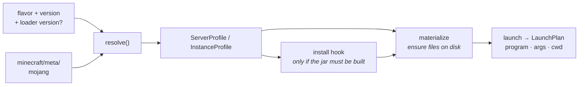

# Minecraft providers

*[← Architecture](../architecture.md)*

The `minecraft` subsystem answers three questions: **which distributions can you
run**, **which versions of each**, and **what exactly does launching one
require**. Everything downstream — provisioning a server, launching an instance —
consumes its answers.

It holds no state of its own, but it does write regenerable files under `meta/`:
the catalogue readers keep the last good copy of each response in
`meta/catalogue/` (the offline fallback). `ResolveRequest` carries the `meta` root
and the cache for a flavor that keeps what it resolves from.

## Flavors

A *flavor* is a distribution of Minecraft. There is one registry; a flavor
declares which sides it serves, and a lookup for the other side fails as an
unknown flavor. Vanilla is the only built-in; every other distribution comes
from a plugin. The official plugins `fabric`, `neoforge`, `paper` (Paper and
Folia) and `spigot` (Spigot and CraftBukkit) register under their bare ids.

| Flavor | Server | Client | Loads | Notes |
|---|:--:|:--:|---|---|
| `vanilla` | ✓ | ✓ | — | Mojang's own, built in |

The registry is runtime-mutable: `Minecraft::register(owner, official, live, provider)`
and `unregister(owner)`, with the same ownership rules as content sources (the
built-in is permanent; any other id reads `<owner>.<id>`, except an official
plugin's, which may take a bare id).

A provider names itself in one `FlavorInfo` (`id`, `name`, `summary`, the
content its loader consumes as `loads`, the prerequisites it needs on this
machine as `requires`, and its `sides`), lists the game versions it supports, and
*resolves* a request into a server or client launch profile.

Two things follow, and both exist so that shipping a flavor is a daemon-side
change alone:

- **A flavor describes itself on the wire.** `Flavor` carries the `summary` a
  picker renders and the `accepts` set an entry of it would have — no front-end
  keeps a table ([0008](../decisions/0008-flavor-declares-accepted-content.md)).
- **A flavor states what it needs before you commit to it.** A flavor that
  builds on this machine can need a program such as `git`; the catalogue
  resolves missing prerequisites at build time, each with a name you would
  recognise and where to get it ([0006](../decisions/0006-flavor-states-its-requirements.md)).

Adding a flavor is a plugin. The content flows never change, because what an
entry accepts is composed from the provider's `loads` plus what the side reads
for itself.

A plugin adds one as a `flavor` provider (`proto::provider::flavor`, asked through
`provider.invoke`), wrapped in a
`PluginFlavorProvider` (`engine/src/plugins/providers/flavor.rs`) and registered
as `<plugin>.<id>` when the plugin is enabled. A flavor decides the code the game
runs, so it needs the unrestricted `flavor:provide` permission, and the guest
only describes: every profile it returns is vetted before the engine acts on it.
Each artifact must carry a sha1 and sit on one of the plugin's network hosts,
every path must stay relative, the Java major must be one the launcher knows,
and the jar must be a download or named as built. One refusal fails the whole
resolve. A plugin flavor builds what its profile names as built through the
optional `build` operation, whose plan the host runs from the `install` hook in an area of its own and
places ([0110](../decisions/0110-a-flavor-builds-in-its-own-area.md),
[0124](../decisions/0124-a-build-is-a-plan-the-host-runs.md), [Plugins](plugins.md#provider-surfaces)). The profile types live in
`proto::profile` so the SDK can build them.

Two pieces the vanilla flavor uses are shared with plugins
([0119](../decisions/0119-downloads-are-host-side.md)). `minecraft/maven.rs` is the one parser of
`group:artifact:version[:classifier][@ext]`: the path under a repository, the filename and the URL come from it, and
a part with a character a Maven name lacks, or made only of dots, does not parse. `minecraft/rules.rs` is the one
evaluator of Mojang `rules` (the last applicable rule decides, no rules allow, a rule naming `features` is skipped, and
`os.name` and `os.arch` are compared against the host's `windows`/`osx`/`linux` and `x86`/`x86_64`/`arm64`;
`os.version` is not evaluated). Vanilla's manifest libraries and arguments, and a plugin's, are filtered at resolve
time, so a persisted profile is for the machine that resolved it.

## Profiles — what a launch needs

`resolve()` turns *(flavor, version, optional loader version)* into a
**`ServerProfile`** or **`InstanceProfile`**. A server profile names its jar
(`Download(artifact)`, or `Built { filename }` when the install hook produces it),
how it launches (`Jar`, or `ArgsFile` for a flavor whose install generates one, with a file per OS; a flavor layered over vanilla may name it too),
the required Java major and the flavor's recommended JVM args. An instance
profile carries the client jar, libraries, asset index and arguments. The
profiles are engine types, stored on the entry records; no channel hands one to a
client.

Manifest parsing lives in `minecraft/meta/` — Mojang's piston-meta, deserialized
in its own JSON shape rather than pretending it is ours.

**Mojang's manifest is the ordering ground truth.** Whether one version is newer
than another — which decides whether an update is a downgrade — is judged by
position in Mojang's catalogue, never by parsing version strings. It also
supplies release/snapshot status that most upstreams never state.

## The launch pipeline

Three modules sit over the profiles:

**`materialize`** idempotently ensures profile pieces on disk, skipping what is
already there:

| Piece | Where it lands |
|---|---|
| single jars | the entry's `data/`, or `meta/versions/` |
| libraries | Maven layout under the shared `meta/libraries/` |
| assets | content-addressed — `meta/assets/indexes/<id>.json` + `meta/assets/objects/<hh>/<hash>` |
| natives | unpacked into `meta/natives/<version>/`, from jars fetched into the libraries root |

Two shapes belong to the pre-1.19 era. A **native** is a library the JVM loads
through `java.library.path` rather than the classpath: those manifests ship one
classifier jar per OS, and `materialize` unpacks the host's into the natives
directory (the era after them ships the same binaries as ordinary rule-gated
libraries, so the list is simply empty). An asset index flagged `virtual` or
`map_to_resources` belongs to a client that reads assets *by path*, so the hashed
store is mirrored to a named tree — under `meta/assets/virtual/<id>/`, or the
instance's own `resources/` for the oldest — and `${game_assets}` points the
game at it.

Downloads are verified through `Downloader` wherever upstream publishes a hash, with a bounded number of
concurrent fetches. Because the roots are shared, a second instance on the same
version costs almost nothing.

**`launch`** is pure assembly of a **`LaunchPlan`** (program, args, cwd):
classpath joining and Mojang `${placeholder}` substitution for auth, paths and
names. No I/O — which is what makes it unit-testable, and it is unit-tested.
The per-entry memory and `jvm-args` settings it receives (`JavaSettings`, whose
memory check queries the host) live in the engine's `jvm` module, outside it.

**`rcon`** is a minimal RCON client — connect, authenticate, then commands whose
multi-packet replies it reads to the end. It is the server console's transport,
chosen because it is re-establishable state that survives a daemon restart,
where a stdin pipe is not
([0055](../decisions/0055-the-console-is-rcon-not-a-pipe.md)). The engine's
`console` module keeps one connection per server and reads command completions
out of the server's `help`
([0077](../decisions/0077-the-console-keeps-its-connection.md)).

**`world.rs`** reads a save's own `level.dat` (gzipped NBT, via `fastnbt`) so a
world can describe itself rather than being reduced to a folder name
([0022](../decisions/0022-a-world-describes-itself.md)).

**`log4j.rs`** generates the per-session logging config each instance launch runs
under — Log4Shell-safe by construction
([0039](../decisions/0039-per-session-log4j-config.md)).

**`ping.rs`** speaks Server List Ping to a managed server on loopback or to a
host from an instance's multiplayer list. **`servers.rs`** reads and edits that
list (`servers.dat`, uncompressed NBT the running game rewrites on exit, keeping
tags Hestia does not know). **`quickplay.rs`** reads the Quick Play log a 1.20+
client writes, which names the world, server or Realm a session last joined.

## Flavors that build their own jar (plugin-provided)

A flavor cannot always download the thing it runs (a NeoForge client's patched
jar, a Spigot server nobody may redistribute), so providers have an **`install`
hook** rather than the launch flows branching on a flavor name. It is idempotent
on the built jar's presence, and each step is a cancellation checkpoint. Core
implements none: a plugin flavor's `build` operation returns a plan the host runs
in an area of its own, and the official `neoforge` and `spigot` plugins use it
([0004](../decisions/0004-neoforge-builds-its-own-jar.md),
[0007](../decisions/0007-spigot-is-compiled-locally.md) record the original
in-core design).

A flavor may recommend JVM flags in its profile. Those flags are the **last**
fallback, beneath the entry's own `jvm-args` and the launcher-wide
`defaults.jvm-args` — and `server info` names which layer supplied the flags a
process is actually running with
([0009](../decisions/0009-flavor-recommends-jvm-flags.md)).

## Decisions

- [0004 — NeoForge's game jar is built, not downloaded](../decisions/0004-neoforge-builds-its-own-jar.md) (now the `neoforge` plugin)
- [0005 — A Paper build is a loader version, and Mojang orders the catalogue](../decisions/0005-paper-build-is-a-loader-version.md) (now the `paper` plugin)
- [0006 — A flavor states what it needs, before the user commits to it](../decisions/0006-flavor-states-its-requirements.md)
- [0007 — Spigot and CraftBukkit are compiled here](../decisions/0007-spigot-is-compiled-locally.md) (now the `spigot` plugin)
- [0008 — What an entry takes is a property of its flavor](../decisions/0008-flavor-declares-accepted-content.md)
- [0009 — A flavor may recommend JVM flags; the user still outranks it](../decisions/0009-flavor-recommends-jvm-flags.md)
