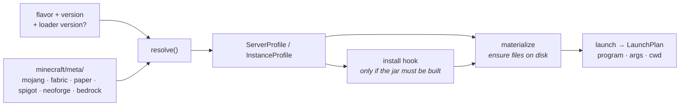

# Minecraft providers

*[← Architecture](../architecture.md)*

The `minecraft` subsystem answers three questions: **which distributions can you
run**, **which versions of each**, and **what exactly does launching one
require**. Everything downstream — provisioning a server, launching an instance —
consumes its answers.

It holds no state of its own, but it does write regenerable files under `meta/`:
the catalogue readers keep the last good copy of each response in
`meta/catalogue/` (the offline fallback), and resolving a NeoForge client fetches
its installer to `meta/neoforge/<build>.jar`, which the install hook then finds on
disk instead of downloading again. `ResolveRequest` carries the `meta` root and
the cache for that.

## Flavors

A *flavor* is a distribution of Minecraft, and an **edition** (`java` or
`bedrock`) comes before it: there is one registry, keyed by `(side, edition,
id)`, so a flavor id is unique only within its edition and Bedrock's `vanilla`
is not Java's. A flavor declares which sides it serves, and a lookup for the
other side fails as an unknown flavor. Instances are Java only
([0112](../decisions/0112-the-edition-is-the-first-axis.md)).

| Edition | Flavor | Server | Client | Loads | Notes |
|---|---|:--:|:--:|---|---|
| java | `vanilla` | ✓ | ✓ | — | Mojang's own |
| java | `fabric` | ✓ | ✓ | mods | loader version pinnable |
| java | `neoforge` | ✓ | ✓ | mods | game jar built locally from the installer |
| java | `paper` | ✓ | | plugins | ships tuned JVM flags per version |
| java | `folia` | ✓ | | plugins | regionised; plugins filtered strictly as `folia` |
| java | `spigot` | ✓ | | plugins | compiled on your machine with BuildTools |
| java | `bukkit` | ✓ | | plugins | likewise (CraftBukkit) |
| bedrock | `vanilla` | ✓ | | — | Mojang's Bedrock Dedicated Server; a native executable, no Java |

A provider names itself in one `FlavorInfo` (`id`, `name`, `summary`, the
content its loader consumes as `loads`, the prerequisites it needs on this
machine as `requires`, and its `sides`), lists the game versions it supports, and
*resolves* a request into a server or client launch profile.

Two things follow, and both exist so that shipping a flavor is a daemon-side
change alone:

- **A flavor describes itself on the wire.** `Flavor` carries the `summary` a
  picker renders and the `accepts` set an entry of it would have — no front-end
  keeps a table ([0008](../decisions/0008-flavor-declares-accepted-content.md)).
- **A flavor states what it needs before you commit to it.** Spigot and
  CraftBukkit need `git`; the catalogue resolves missing prerequisites at build
  time, each with a name you would recognise and where to get it
  ([0006](../decisions/0006-flavor-states-its-requirements.md)).

`entry.flavors` answers one `EditionCatalogue { edition, rules, flavors, nameKey }`
per edition the side offers (a server two, an instance one). The edition's
property `rules` and the `server.properties` key a server is listed under
(`nameKey`) ride on it, so a picker is built from the answer alone. What differs
*between* editions is not in the providers: it is in the engine's `edition/`
module, a closed `match` that each flow asks
([0112](../decisions/0112-the-edition-is-the-first-axis.md)).

Adding a flavor is one impl plus one registry line. The content flows never
change, because what an entry accepts is composed from the provider's `loads`
plus what the side reads for itself.

## Profiles — what a launch needs

`resolve()` turns *(flavor, version, optional loader version)* into a
**`ServerProfile`** or **`InstanceProfile`**. A server profile names its jar
(`Download(artifact)`, or `Built { filename }` when the install hook produces it),
how it launches (`Jar`, or `ArgsFile` for a flavor whose install generates one),
the required Java major and the flavor's recommended JVM args. That is a
`ServerRuntime::Java`; a Bedrock profile is `ServerRuntime::Native { archive,
executable, env }` — a zip, an executable and the environment it needs
(`LD_LIBRARY_PATH=.` on Linux) — with no Java major and no JVM args, so nothing
can apply Java settings to it
([0113](../decisions/0113-a-server-runtime-is-java-or-native.md)). An instance
profile carries the client jar, libraries, asset index and arguments. The
profiles are engine types, stored on the entry records; no channel hands one to a
client.

Manifest parsing lives in `minecraft/meta/` — one module per upstream, each
deserializing that API's own JSON shape rather than pretending it is ours.

**Mojang's manifest is the ordering ground truth.** Whether one version is newer
than another — which decides whether an update is a downgrade — is judged by
position in Mojang's catalogue, never by parsing version strings. It also
supplies release/snapshot status that most upstreams never state.

## The launch pipeline

Three modules sit over the profiles:

**`materialize`** idempotently ensures profile pieces on disk, skipping what is
already there:

| Piece | Where it lands |
|---|---|
| single jars | the entry's `data/`, or `meta/versions/` |
| libraries | Maven layout under the shared `meta/libraries/` |
| assets | content-addressed — `meta/assets/indexes/<id>.json` + `meta/assets/objects/<hh>/<hash>` |
| natives | unpacked into `meta/natives/<version>/`, from jars fetched into the libraries root |

Two shapes belong to the pre-1.19 era. A **native** is a library the JVM loads
through `java.library.path` rather than the classpath: those manifests ship one
classifier jar per OS, and `materialize` unpacks the host's into the natives
directory (the era after them ships the same binaries as ordinary rule-gated
libraries, so the list is simply empty). An asset index flagged `virtual` or
`map_to_resources` belongs to a client that reads assets *by path*, so the hashed
store is mirrored to a named tree — under `meta/assets/virtual/<id>/`, or the
instance's own `resources/` for the oldest — and `${game_assets}` points the
game at it.

Downloads are verified through `Downloader` wherever upstream publishes a hash, with a bounded number of
concurrent fetches. Because the roots are shared, a second instance on the same
version costs almost nothing.

**`launch`** is pure assembly of a **`LaunchPlan`** (program, args, cwd):
classpath joining and Mojang `${placeholder}` substitution for auth, paths and
names. No I/O — which is what makes it unit-testable, and it is unit-tested.
The per-entry memory and `jvm-args` settings it receives (`JavaSettings`, whose
memory check queries the host) live in the engine's `jvm` module, outside it.

**`rcon`** is a minimal RCON client — connect, authenticate, then commands whose
multi-packet replies it reads to the end. It is the server console's transport,
chosen because it is re-establishable state that survives a daemon restart,
where a stdin pipe is not
([0055](../decisions/0055-the-console-is-rcon-not-a-pipe.md)). The engine's
`console` module keeps one connection per server and reads command completions
out of the server's `help`
([0077](../decisions/0077-the-console-keeps-its-connection.md)). A Bedrock server
has no RCON; its console is the supervisor's stdin endpoint
([0114](../decisions/0114-a-bedrock-console-is-a-reattachable-stdin-endpoint.md)).

**`world.rs`** reads a save's own `level.dat` (gzipped NBT, via `fastnbt`) so a
world can describe itself rather than being reduced to a folder name
([0022](../decisions/0022-a-world-describes-itself.md)).

**`log4j.rs`** generates the per-session logging config each instance launch runs
under — Log4Shell-safe by construction
([0039](../decisions/0039-per-session-log4j-config.md)).

**`ping.rs`** speaks Server List Ping to a managed Java server on loopback or to a
host from an instance's multiplayer list. **`servers.rs`** reads and edits that
list (`servers.dat`, uncompressed NBT the running game rewrites on exit, keeping
tags Hestia does not know). **`quickplay.rs`** reads the Quick Play log a 1.20+
client writes, which names the world, server or Realm a session last joined.

## Bedrock Dedicated Server

`minecraft/bedrock/` is the one Bedrock provider. Installing unpacks Mojang's zip
over the entry's `data/`, keeping the files a user owns, and copies the zip's own
`server.properties` aside as the properties schema. The version list is Mojang's
download links merged with the Bedrock-OSS feed, with preview builds as
snapshots, and downloads are pinned to `www.minecraft.net`
([0115](../decisions/0115-the-bds-catalogue-merges-mojang-and-the-community-feed.md)).

BDS 1.26 serves only NetherNet, so Hestia writes `transport=nethernet` before
every start and there is no RakNet status ping; a server's status comes from its
console ([0116](../decisions/0116-bedrock-pins-nethernet.md)). Its worlds are
LevelDB with a little-endian `level.dat`, read by a small native NBT reader in
`bedrock/nbt.rs` rather than `fastnbt`, which is big-endian Java only.

## Flavors that build their own jar

Two flavors cannot simply download the thing they run, so providers grew an
**`install` hook** rather than the launch flows branching on a flavor name. It is
idempotent on the built jar's presence, and each step is a cancellation
checkpoint.

### NeoForge

NeoForge publishes no metadata service and no patched jar. Everything comes out
of its installer jar on `maven.neoforged.net`, read in-process with the `zip`
crate: `version.json` is the launch profile, `install_profile.json` names a chain
of ten small Java tools, and running that chain locally produces the jar the
loader actually runs. A first create or launch therefore takes a few minutes.

The catalogue needs no service either — a NeoForge version *is* its game version
plus a build number, under two schemes split by Minecraft's move to calendar
versioning, with semver build metadata outranking that arithmetic. The 1.20.1
line is a separate maven artifact and a second catalogue source rather than a
parsing case. A NeoForge **server** has no launchable jar at all: it runs from a
generated argument file naming its module path
([0004](../decisions/0004-neoforge-builds-its-own-jar.md)).

### Spigot and CraftBukkit

Mojang's takedown means neither jar legally exists as a download. SpigotMC
publishes **BuildTools**, which clones the upstream repositories, decompiles the
vanilla server, applies the patch sets and compiles the result on your machine —
so a first create takes several minutes and needs `git` installed.

One build serves both flavors and every entry on that version: the work tree is
shared (`meta/spigot/`, outputs under `jars/<version>/`) and the jar is copied
into each entry's `data/`. The build runs as a **supervised workload**, so its
output is readable live, a cancel reaches the whole tree, and two creates racing
on one version join the same build ([0007](../decisions/0007-spigot-is-compiled-locally.md)).

### Paper and Folia

One self-contained jar per build, so a profile is the vanilla shape with the jar
swapped. PaperMC publishes many builds per game version, and a build number goes
in `loader_version` — the same slot Fabric's loader builds already use — rather
than growing a parallel concept. Unpinned resolves to the newest `STABLE` build,
falling back to the newest of any channel so a freshly released game version is
never uninstallable ([0005](../decisions/0005-paper-build-is-a-loader-version.md)).

Paper also publishes a tuned G1GC flag set per version, which the profile
carries. Those flags are the **last** fallback, beneath the entry's own
`jvm-args` and the launcher-wide `defaults.jvm-args` — and `server info` names
which layer supplied the flags a process is actually running with
([0009](../decisions/0009-flavor-recommends-jvm-flags.md)).

## Decisions

- [0004 — NeoForge's game jar is built, not downloaded](../decisions/0004-neoforge-builds-its-own-jar.md)
- [0005 — A Paper build is a loader version, and Mojang orders the catalogue](../decisions/0005-paper-build-is-a-loader-version.md)
- [0006 — A flavor states what it needs, before the user commits to it](../decisions/0006-flavor-states-its-requirements.md)
- [0007 — Spigot and CraftBukkit are compiled here](../decisions/0007-spigot-is-compiled-locally.md)
- [0008 — What an entry takes is a property of its flavor](../decisions/0008-flavor-declares-accepted-content.md)
- [0009 — A flavor may recommend JVM flags; the user still outranks it](../decisions/0009-flavor-recommends-jvm-flags.md)
- [0112 — The edition is the first axis, and one module owns what each edition does](../decisions/0112-the-edition-is-the-first-axis.md)
- [0113 — A server runtime is Java or native, and a native one never meets Java](../decisions/0113-a-server-runtime-is-java-or-native.md)
- [0115 — The BDS catalogue merges Mojang's links with the Bedrock-OSS feed](../decisions/0115-the-bds-catalogue-merges-mojang-and-the-community-feed.md)
- [0116 — Bedrock pins NetherNet, and status comes from the console](../decisions/0116-bedrock-pins-nethernet.md)
