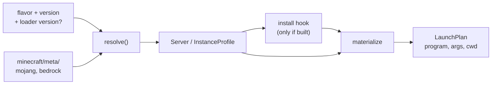

# Minecraft providers

*[← Architecture](../architecture.md)*

The `minecraft` subsystem answers three questions: which distributions can you run, which versions of each, and what
does launching one require. Provisioning a server and launching an instance consume its answers.

It holds no state of its own beyond regenerable files under `meta/`: the catalogue readers keep the last good response
in `meta/catalogue/` (the offline fallback).

## Editions and flavors

An **edition** (`java` or `bedrock`) comes first; a **flavor** is a distribution within it. One registry looks up by
`(side, edition, id)`, so Bedrock's `vanilla` is not Java's. A flavor declares which sides it serves. Instances are Java
only.

| Edition | Flavor    | Server | Client | Notes                                                    |
|---------|-----------|:------:|:------:|----------------------------------------------------------|
| java    | `vanilla` | yes    | yes    | Mojang's own, built in                                   |
| bedrock | `vanilla` | yes    |        | Bedrock Dedicated Server, built in; native, no Java      |

Every other flavor is a Java flavor from a plugin: the official `fabric`, `neoforge`, `paper` (Paper and Folia) and
`spigot` (Spigot and CraftBukkit) plugins, registered as `<plugin>.<id>` (`fabric.fabric`). The registry is
runtime-mutable (`register(owner, standing, provider)`, `unregister(owner)`); built-ins are permanent.

A provider names itself in one `FlavorInfo`:

| Field                | Meaning                                                                                           |
|----------------------|---------------------------------------------------------------------------------------------------|
| `id`, `name`, `summary` | what a picker renders                                                                          |
| `sides`              | server, client or both                                                                            |
| `loads`              | the content kind its loader consumes (mods, plugins, none)                                        |
| `loader`, `compatible` | the name a content platform and pack formats use for it; absent means the flavor id             |
| `requires`           | prerequisites on this machine (such as `git`), resolved as missing when the catalogue is built    |

From `loads` plus what the side reads for itself, the entry's accepted content set is composed, so content flows never
change when a flavor is added. A front-end keeps no flavor table.

`entry.flavors` answers one `EditionCatalogue { edition, rules, flavors, nameKey }` per edition the side offers, so a
picker is built from the answer alone. What differs between editions is in the engine's `edition/` module (see
[engine](engine.md#editions)), not in the providers.

### Plugin flavors

A plugin adds a `flavor` provider (`proto::provider::flavor`, called through `provider.invoke`), wrapped in
`PluginFlavorProvider` and registered when the plugin is enabled. It needs the unrestricted `flavor:provide`
permission, and the guest only describes: the host vets every profile before acting on it.

- Each artifact carries a sha1 and sits on one of the plugin's network hosts; paths stay relative; the Java major must
  be one the launcher knows; the jar is a download or named as built. One refusal fails the whole resolve.
- **Layered over vanilla.** `resolve-client` and `resolve-server` answer either a full profile or only what is added
  (libraries, main class, arguments) over the vanilla profile, which the host merges.
- **Building.** A flavor that cannot download what it runs (NeoForge's patched jar, Spigot) names it as built in its
  profile and implements `build`. `build` returns a `BuildPlan { fetch, steps, outputs }`; the host runs it in an area
  of its own, `meta/flavors/<plugin>/`, under the process supervisor, and places the outputs. An output may be a
  directory (`destination`: `entry` or `libraries`), and a server may launch from an args file. The install hook is
  idempotent on the built jar's presence, and each step is a cancellation checkpoint.
- The profile types live in `proto::profile`, so the SDK can build them. See [Plugins](plugins.md).

Two helpers are shared with plugins. `minecraft/maven.rs` parses `group:artifact:version[:classifier][@ext]` into the
repository path, filename and URL. `minecraft/rules.rs` evaluates Mojang `rules` (the last applicable rule decides; a
rule naming `features` is skipped; `os.name` and `os.arch` are matched to the host; `os.version` is not evaluated).
Libraries and arguments are filtered at resolve time, so a persisted profile is for the machine that resolved it.

## Profiles

`resolve()` turns *(flavor, version, optional loader version)* into a `ServerProfile` or `InstanceProfile`. Profiles
are engine types stored on the entry records; no channel hands one to a client.

- A **server profile** has a `ServerRuntime`: `Java { jar, launch, java_major, jvm_args }` (`jar` is `Download` or
  `Built { filename }`; `launch` is `Jar` or `ArgsFile`) or `Native { archive, executable, env }` for BDS. The variant
  is the type, so Java settings cannot be applied to a native server.
- An **instance profile** carries the client jar, libraries, asset index and arguments.
- A flavor may recommend JVM flags. They are the last fallback, beneath the entry's `jvm-args` and
  `defaults.jvm-args`, and `server info` names which layer supplied the flags.

`minecraft/meta/` parses Mojang's piston-meta in its own JSON shape. **Mojang's manifest is the ordering ground truth**:
whether one version is newer than another (so whether an update is a downgrade) is its position in the catalogue, never
a parsed version string. It also supplies release or snapshot status.

## The launch pipeline

**`materialize`** idempotently ensures profile pieces on disk:

| Piece         | Where it lands                                                                       |
|---------------|--------------------------------------------------------------------------------------|
| single jars   | the entry's `data/`, or `meta/versions/`                                             |
| libraries     | Maven layout under `meta/libraries/`                                                 |
| assets        | `meta/assets/indexes/<id>.json` and `meta/assets/objects/<hh>/<hash>`                |
| natives       | unpacked into `meta/natives/<version>/`                                              |

Downloads are verified wherever upstream publishes a hash, with bounded concurrency. Because the roots are shared, a
second instance on the same version costs almost nothing.

Pre-1.19 clients need two extras. Their natives ship as one classifier jar per OS, which `materialize` unpacks into the
natives directory (later versions ship rule-gated libraries, so the list is empty). An asset index flagged `virtual` or
`map_to_resources` belongs to a client that reads assets by path, so the hashed store is mirrored to a named tree under
`meta/assets/virtual/<id>/` or the instance's `resources/`, and `${game_assets}` points at it.

Other modules:

| Module         | Role                                                                                                                |
|----------------|---------------------------------------------------------------------------------------------------------------------|
| `launch`       | pure assembly of a `LaunchPlan`: classpath joining and `${placeholder}` substitution; no I/O, so it is unit-tested   |
| `rcon`         | a minimal RCON client; the Java server console's transport                                                           |
| `world.rs`     | reads a save's `level.dat` (gzipped NBT, `fastnbt`) so a world describes itself                                      |
| `log4j.rs`     | the per-session Log4j2 config each instance launch runs under, Log4Shell-safe (`%m{nolookups}`)                      |
| `ping.rs`      | Server List Ping to a managed server or a multiplayer-list host                                                      |
| `servers.rs`   | reads and edits `servers.dat` (uncompressed NBT the game rewrites on exit), keeping tags it does not know            |
| `quickplay.rs` | reads the Quick Play log a 1.20+ client writes, which names the world, server or Realm last joined                   |

The engine's `console` module keeps one RCON connection per server and completes commands from the server's own
`help`. A Bedrock server has no RCON; its console is the supervisor's stdin endpoint.

Memory and `jvm-args` (`JavaSettings`) live in the engine's `jvm` module, outside `launch`.

## Bedrock Dedicated Server

`minecraft/bedrock/` is the one Bedrock provider.

- Installing unpacks Mojang's zip over `data/`, keeping files the user owns, and copies the zip's own `server.properties`
  aside as the properties schema.
- The version list merges Mojang's download links with the Bedrock-OSS feed (previews are snapshots); downloads are
  pinned to `www.minecraft.net`.
- BDS 1.26 serves only NetherNet, so Hestia writes `transport=nethernet` before every start. There is no RakNet ping;
  status comes from the console.
- Worlds are LevelDB with a little-endian `level.dat`, read by a small native NBT reader (`bedrock/nbt.rs`), because
  `fastnbt` is Java big-endian only.
