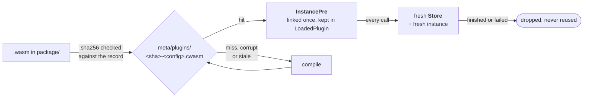
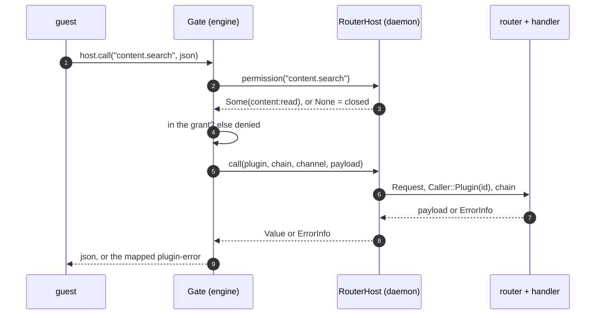
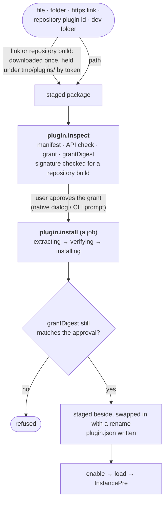

# Plugins

A plugin is a **WASM component the daemon runs in a sandbox**. It can call the
daemon's channels, hear its events, adjust or refuse an operation at a hook
point, fill an open registry (content sources, flavors, pack formats, Java
distributions), add commands, pages, settings and themes, and reach the network,
declared programs and local endpoints, but only through what the user granted
at install. The runtime lives in the engine ([`crates/engine/src/plugins/`](engine.md));
the daemon owns which plugins are loaded and lends them its channels.

**The API is mechanisms, not features**
([0106](../decisions/0106-the-plugin-api-is-mechanisms-not-features.md)). The
WIT is a fixed set of general mechanisms; hook points, provider kinds and their
operations, contracts and topics are data in `proto`. A new one changes neither
the ABI nor the daemon, and a port of a core feature to a plugin may use only
what a third party could use.

- Writing one? [plugins/publishing.md](../plugins/publishing.md),
  [plugins/repository.md](../plugins/repository.md) and
  [plugins/permissions.md](../plugins/permissions.md) are the author guides;
  [plugins/paths.md](../plugins/paths.md) covers what a guest sees of the filesystem.
- Why it is built this way: decisions
  [0091](../decisions/0091-plugins-are-wasm-components.md) to
  [0132](../decisions/0132-a-distributor-ships-setting-defaults-in-the-package.md),
  listed [below](#decisions).

## Where the pieces are

| Piece | Where | Role |
|---|---|---|
| Manifest, grant, permissions, scopes, contracts | `crates/proto/src/plugin/` (`permission.rs`, `scope.rs`, `grant.rs`, `manifest.rs`), `repository.rs` | the wire and the `plugin.toml` schema; `MIT OR Apache-2.0` |
| Hook points, provider kinds and operations, topic registry | `crates/proto/src/hook.rs`, `provider.rs` + `provider/`, `events.rs` | what varies, as data |
| The ABI | `crates/sdk/wit/` (`hestia:plugin@1.0.0`) | one WIT package; its version is `proto::plugin::API_VERSION` |
| Guest SDK | `crates/sdk/` (`hestia-sdk`) | bindings and proto types for a Rust plugin; `MIT OR Apache-2.0` |
| Sandbox, store, install, trust | `crates/engine/src/plugins/` | `PluginRuntime`, `Plugins`, hooks, providers, repositories |
| Loaded state, events, host calls | `crates/daemon/src/runtime/plugins/` | `RouterHost` (the `HostCalls` impl), event delivery, enable/disable |
| Channels | `crates/daemon/src/services/plugin.rs` | the `plugin.*` registrar |
| Authoring tools | `crates/cli/src/commands/plugin/` | `new`, `pack`, `check`, `publish`, `keygen`, `dev`, and the management verbs |

The engine never links `ipc` or `client`; what it needs from the daemon is the
`HostCalls` trait (`permission`, `touched`, `call`, `run_job`), which `RouterHost`
implements over the router.

## The sandbox

`PluginRuntime` owns the daemon's one wasmtime `Engine`: the component model,
WASI preview 2 (`wasm32-wasip2` guests) and `wasi:http`, linked once, async.



- **Fresh store per call.** A call instantiates from the cached `InstancePre`
  into a new `Store`, so no call sees another's memory and a trapped or cancelled
  call costs nothing but itself. `lifecycle.init` runs the same way, once on
  enable. State that must last goes in the plugin's `data/` directory; there is no
  key/value import. A read-modify-write of a file is made atomic across overlapping calls by the `data` import's named
  locks, released with the store ([0118](../decisions/0118-host-pushed-events-and-a-call-budget-instead-of-a-resident-instance.md)).
- **Compiled-component cache.** `meta/plugins/<wasm-sha256>-<config-hash>.cwasm`,
  beside a `.sha256` of the artifact. A missing, truncated or mismatching file, or
  a failed deserialize, is deleted and recompiled
  ([0091](../decisions/0091-plugins-are-wasm-components.md)). It is part of
  `meta/`, so it is one unit to reclaim
  ([0054](../decisions/0054-meta-root-for-materialised-files.md)).
- **Time.** A 10 ms epoch tick (a thread of its own, not a tokio task) makes a
  spinning guest yield to the executor; the cut-off is a wall-clock timeout per
  call that covers waiting for a slot, guest compute and awaited host calls:

  | Call | Timeout |
  |---|---|
  | hook | 2 s |
  | event delivery | 5 s |
  | page render / action | 10 s |
  | `lifecycle.init` | 10 s |
  | content source / flavor | 30 s |
  | command (`plugin.run`) | 1 h; a cancel is asked, then the call is dropped after 10 s |

- **Memory.** A pooling allocator is shared by all plugins (16 instance slots,
  256 MiB per memory, one memory and four tables per component), and each store
  adds `StoreLimits` of the same size, trapping on a refused grow.
- **Concurrency.** At most 4 calls run at once per plugin and 16 across all of
  them; a call waiting past its deadline times out.
- **Traps.** Three traps inside ten minutes disable the plugin until it is
  enabled again (`CallError::Disabled`).
- **The filesystem.** WASI sees one preopened directory, `data/`, mounted at
  `/data`, plus `/build`, `/vanilla` and `/files` for the calls that are lent them
  ([plugins/paths.md](../plugins/paths.md)). TCP, UDP and name lookup are off; the environment is empty.
- **Output.** stdout and stderr are captured into the plugin's log, rate-limited
  and truncated; a dev plugin streams it to `hestia plugin dev`.

The threat model for this boundary is in
[0091](../decisions/0091-plugins-are-wasm-components.md#threat-model). Its
boundary is guest code against the daemon; the data home is one trust domain.

## Permissions

A manifest's `[permissions]` is a table: each permission is a key and carries a
**scope**, the entries it reaches, by kind (`network:connect` takes `hosts` and
`unhashed`, `entry:read` takes `files`, `ipc:connect` takes `endpoints`,
`process:spawn` takes `programs`, `launch:patch` takes `properties`). What a
manifest contributes (hooks, events, schedules, themes, secret settings) is
derived from it and listed beside them. Together they are the **grant**, which is
`permission → scope` and nothing else: the user approves exactly that at install,
and an update that widens it asks again. The tiers and the full table are in
[plugins/permissions.md](../plugins/permissions.md).

- **One table drives it.** `Permission::spec` says, for each permission, its tier,
  the scope kinds it accepts and whether it needs an entry of the first. Validation
  (a kind the permission does not take, a required scope left empty, each entry
  against its kind's rule) reads it, and so do `Grant::widening_over` (a permission
  added, or any entry added to a scope, widens; it walks the maps, so a new
  `ScopeKind` is covered), `Grant::approval_digest` (the canonical JSON of the
  whole grant) and the approval prompts, which loop over permissions and their
  scope kinds. A permission without a `spec` arm fails to compile; one missing from
  `Permission::ALL` fails `crates/proto/tests/scope.rs`
  ([0117](../decisions/0117-a-grant-is-permission-to-scope.md)).
- **Contributions are a scope of their own.** `Grant::contributions` holds the
  `hooks`, `events`, `schedules`, `secrets` and `themes` kinds, derived from the
  manifest, so they widen, hash and render like any scope. A program entry is the
  program's whole definition on one line, so a changed definition is a new entry;
  `Grant::programs` keeps the definitions the host runs.

- **A contract names its permission.** `Contract::PLUGIN` and `Topic::PLUGIN` are
  `Option<Permission>`, `None` by default. `None` means closed, so a channel added
  later is unreachable until someone classifies it, and `crates/proto/tests/permission.rs`
  fails a contract that is neither classified nor on its denied list
  ([0092](../decisions/0092-a-contract-names-the-permission-a-plugin-needs.md)).
- **An ambient contract names none.** `Contract::AMBIENT` marks a channel whose whole
  result is a harmless fact (`app.info`, `host.info`, `net.status`).
  Any plugin may call it: the router lists it apart from the permissioned channels,
  `HostCalls::ambient` lets the gate forward it, and it is no `Permission`, so it
  is in no grant, no digest and no approval prompt. The `permission.rs` test still
  forces every contract to be permissioned, ambient or denied, and pins the ambient
  list ([0126](../decisions/0126-an-ambient-channel-needs-no-permission.md)).
- **`domain:action` names**: `entry`, `process`, `content`, `account`, `config`,
  `java`, `network`, `ipc`, `ui`, `launch`, `flavor`, `pack`. The domain is the
  channel prefix it opens.
- **Two tiers.** `Sandboxed`, and `Unrestricted` for the permissions that reach
  native code (`entry:write`, `config:write` (kept here although no setting is yet writable by plugins), `content:write`, `process:control`,
  `process:spawn`, `ipc:connect`, `flavor:provide`, `pack:provide`, `java:provide`). The install prompt states the latter as full
  access to the computer, and the daemon reports the tier so no front-end keeps a
  table of its own.
- **Settings are an allowlist.** `config.get`/`config.list` need `config:read` and `config.set` needs
  `config:write`, but the permission is only the first gate: `proto::config::PLUGIN_ACCESS` marks every setting
  `none`, `read` or `readwrite` for plugins, an unlisted key is `none`, and a reply is filtered to the readable keys.
  A test fails a setting the table does not list
  ([0129](../decisions/0129-a-plugin-reaches-only-what-is-listed.md)).
- **Always closed:** every secret-bearing channel (logs, `server.properties`, the
  per-entry config reads, sign-in and token channels, skins), plus update, daemon lifecycle
  and `plugin.*`. The list and the reason for each entry are in 0092.
- **Where it is enforced.** On a channel call, `Gate::dispatch` asks the host for
  the channel's permission and checks it against the grant before anything is
  routed; a missing permission is `denied`, not a missing import. The
  linker supplies every import to every plugin, and each import checks the grant
  when called, reading its scope through `Grant` accessors (`hosts`, `endpoints`,
  `properties`, `program`, `covers`).
- **A contract declares its narrowing.** `Contract::NARROWED_BY` names the scope
  kind of its `PLUGIN` permission that narrows it, and `Contract::touches` reads the
  entries a call reaches from its parameters. The router keeps that extractor beside
  the permission, `HostCalls::touched` hands the gate the result, and the gate
  refuses a call whose entries the caller's scope does not cover (`Touched::Malformed`
  when the payload does not decode). No handler checks a grant of its own; the
  `plugin_api` snapshot lists `narrowedBy` for each narrowed channel and fails one
  whose kind its permission does not take.

## Calling the daemon

A guest has two imports into the daemon, both carrying proto JSON as strings so
every existing contract crosses unchanged: `host.call` for a request/response
channel and `host.run-job` for a job channel, which resolves with the job's `Done`
payload.



`RouterHost` routes through the same router as a socket client, so decoding, the
account gate, the entry guards and `CHANGES` publication apply unchanged; the
handler sees `Caller::Plugin(id)`. For a job, it generates the job id, subscribes
to that id before starting the channel so a fast job cannot finish unseen, and
waits for the terminal event. If the guest's call ends first (timeout, cancel,
dropped store) a `Watch` guard cancels the job.

**The call chain stops loops.** A `CallChain` lists the plugins on the current
path. It travels explicitly with the call, because the job runner moves work into
`tokio::spawn` and a task-local would be lost there. Entering a plugin already on
the path is refused (`Reentry`), as is a path deeper than 8 (`MAX_CHAIN_DEPTH`).
Anything a call causes that reaches a plugin (a hook, an event handler, a
provider) takes the same chain.

### Errors

Every call between host and plugin fails with one WIT variant, `plugin-error`, in both directions
([0115](../decisions/0115-a-plugin-error-is-its-own-typed-enum.md)); its Rust mirror is `GuestError`
(`engine/src/plugins/error.rs`), and that file is the only place the two sides are translated.

*Host to plugin* (`From<&ErrorInfo> for GuestError`, an exhaustive match): a daemon failure reaches the plugin as

| Case | From |
|---|---|
| `not-found` | the `*NotFound` kinds, `ConfigKeyUnknown`, `UnknownChannel` |
| `invalid` | validation, conflict and malformed-request kinds (`FieldRequired`, `InvalidValue`, `AlreadyExists`, `NotRunning`, `MalformedRequest`, archive and modpack faults, `PluginCommandInvalid`, ...) |
| `denied` | `DeveloperModeOff`, `ElevationRequired`, and the gate's own refusals (no permission, closed channel) |
| `unsupported` | `UnsupportedOperation`, `ContentKindRejected`, `QuickPlayUnsupported`, unsupported loaders and URLs, `MultiSessionDisabled`, `SyncUnitDisabled`, `IncompatibleVersion` |
| `offline` | `Offline`, `OfflineMode` |
| `upstream` (no status) | `Upstream` |
| `sign-in-required` | `SignInRequired`, `PluginSignInRequired`, `SessionExpired`, `LoginDeclined`, `LoginTimedOut` |
| `not-configured` | `ConfigKeyUnset` |
| `missing-requirement` | `MissingRequirement` (with its url); a declared program that is not installed, from `process` (the name and url of its `requires`, or its command and no url) |
| `busy` | `EntryRunning` and the `*InProgress` kinds, `WorkRunning` |
| `failed` | everything else: plugin, repository and update kinds, `Io`, `DownloadFailed`, `Internal`, ... |

A `ProgramError` or `IpcError` maps the same way (`Denied` to `denied`, `NotFound` to `not-found`, ...). `HostCalls`
carries the `ErrorInfo` whole, so there is no second classification in the daemon.

*Plugin to host* (`GuestError::into_info`, via `CallError::into_info`): what a plugin answers becomes the `ErrorInfo` its
caller sees. `offline` is `Offline`, naming the provider when the call was a provider operation; `upstream` and
`rate-limited` of a provider are `Upstream` naming the provider's `Service`; `sign-in-required` is `PluginSignInRequired` naming the plugin;
`not-configured` is `PluginSettingInvalid` with the key; every other case is `PluginCallFailed` carrying the message
(for a command, page or hook with no provider to blame, `upstream` and `rate-limited` are that too). `unsupported` is
not an error of the call at all: `CallError::Unsupported` lets an optional provider operation fall back and fails a
required one. A hook's error is a veto whose reason is the message; a hook that traps or times out is skipped.

**A plugin's own commands** are one export, `commands.run(command, args)`, not
channels. The manifest's `[[contributes.commands]]` is the schema; the daemon
checks arguments against it first. `plugin.run` carries no `PLUGIN` permission, so
a plugin cannot start another's command through `host.call`. The CLI reaches them
as `hestia <plugin> <command>`. Plugin ids may not take a CLI verb
(`RESERVED_IDS`). A command id is one to three words and the CLI matches the
longest one; a `words` argument takes the bare words after it.

`server.files.read` is `entry:read` for a plugin, narrowed to the `files` of that
permission's scope: the contract names `ScopeKind::Files` and the path it reads, the
gate does the rest, and the list is part of the `Grant`, so it is shown at install
and widens an update
([0092](../decisions/0092-a-contract-names-the-permission-a-plugin-needs.md),
[0117](../decisions/0117-a-grant-is-permission-to-scope.md)).

## Events

`contributes.events` is a list of topic globs. The daemon decides what a plugin
receives, once per event, before anything is queued (`events::admit`):

- the topic must match a glob in the grant;
- it must name a permission the grant holds. Every topic is listed in
  `proto::events::TOPICS` (a test fails one that is not), and `Topic::permission`
  reads it from the payload where events differ: `changed` needs the permission
  of its scope (`entries` → `entry:read`, `java` → `java:read`, …) and names
  only the scope; `net.state` needs `network:connect`. A topic that names none,
  such as process output, is never delivered;
- a `job` event goes only to a plugin granted the permission of the channel that
  started the job;
- `plugin.state` needs no permission but is cut to its id and state;
- a topic the host pushes to one plugin (`plugin.schedule`, `ipc.readable`, `ipc.closed`) is never admitted from the hub:
  `proto::pushed::is_private` lists them, and only the owning plugin's own inbox ever carries them.

`changed` carries `ids`, the stable ids the request resolved. The router hands each request a `Touched` set, the entry
guards (`find_server`, `find_instance`) and the plugin handlers add to it, and the registrar publishes it with the
scope after the handler succeeds; empty means the whole scope. The account topics (`account.signed_in`,
`account.signed_out`, profile only) are published by the accounts handlers, and `server.ready` by a per-start watcher
(`runtime/ready.rs`) that pings the game port until the server answers.

Each plugin has a bounded inbox of 256 events. When it is full the oldest is
dropped and a warning is logged at most once a minute, so a slow plugin loses
history rather than growing the daemon. Delivery stops when the plugin is
disabled, removed or reloaded.

### Host-pushed events and the call budget

A plugin is a fresh instance per call, so something else has to watch what it cares about. A connection's reader task
(`plugins/ipc/inbound.rs`) buffers what arrives and pushes `ipc.readable` and `ipc.closed` through the plugin's `Pushed`
receiver into its `Delivery`, which admits them only for a plugin that subscribes and holds `ipc:connect`. `readable`
is edge-triggered: it fires on the first bytes that arrive while no `receive` waits and re-arms when the plugin
receives (or when a receive leaves bytes behind), and `closed` fires once, after the last bytes. The reader works on a
Unix socket and a Windows named pipe alike, being generic over the stream.

Every host-initiated wake-up spends a token from the plugin's `Budget` (`runtime/plugins/budget.rs`): 30 in a burst,
one refilled per second, a pure type with the clock passed in. It is checked once, where the inbox is drained
(`within_budget`): a tick over budget is skipped, an event waits for a token, and the refusal is warned at most once a
minute and counted in `PluginStats::throttled`. Calls a person made (commands, pages, providers, hooks) never come
through the inbox and are not budgeted
([0118](../decisions/0118-host-pushed-events-and-a-call-budget-instead-of-a-resident-instance.md)).

### Schedules

`contributes.schedules` declares timers: `[[contributes.schedules]]` with an `id`
and `every`, in seconds (1 s to 30 days, at most 8 per plugin, ids unique; the call budget, not the floor, limits how
often a plugin really runs). Each
tick is a `plugin.schedule` event `{ id }` pushed straight into that plugin's own
inbox. It is never published to the hub, so no other plugin or client hears it,
and it needs no permission; the schedules are part of the grant and listed when
the user approves. The timers live in the plugin's `Delivery`, so they start
and stop with its events. A tick missed while the machine slept is skipped, and a
tick is dropped while one of the same schedule still waits. In the SDK a tick
arrives in `Plugin::event` as the typed `ScheduleEvent` topic, `call.on::<ScheduleEvent>(…)`
([0108](../decisions/0108-a-schedule-is-an-event-to-its-own-plugin.md)).

## Hooks

A hook point is data in `proto::hook`: a `HookPoint` names itself, the
permissions a plugin needs to declare it, the `Context` the plugin is shown and
the `Patch` it may answer. Every point crosses the ABI through one export,
`hooks.intercept(point, context)`, as JSON; the engine's `Hook` impl for a point
says what the host keeps of a patch (`vet`) and how patches combine (`fold`).
The points today are `before-launch`, `before-server-start` and
`before-content-install`. Hooks are **customisation, not a control**: each plugin runs under a 2 s deadline, and a timeout, trap, refused re-entry or
an answer that is not the point's patch skips it with a `PluginHookFailed`
warning on the result while the operation goes ahead. Only an explicit veto stops it (`PluginVetoed`). Plugins run
in id order and their patches fold in that order. A launch or server-start patch
is filtered through an allowlist (`patch.rs`: a fixed set of GC and heap flags, `-D`
keys the manifest declared, no code-loading options); anything else is dropped with
a warning. A patch may also name a `wrapper`: one of the plugin's own `PATH`
`[[programs]]` (`gamemoderun`, `mangohud`), run in front of the game or server
command by its path pinned at approval ([0101](../decisions/0101-plugins-spawn-only-declared-programs.md)).
It needs `process:spawn`; an unknown or data-directory program, a missing
permission or a vanished file drops it with the same `LaunchArgDropped` warning.
Wrappers nest, so the first plugin in id order is outermost. Details, including which claim a hook holds, are in
[0095](../decisions/0095-interceptors-are-bounded-and-fail-open.md).

## Provider surfaces

A plugin adds to an engine registry with `contributes.providers = [{ kind, id }]`.
A kind is data in `proto::provider`: a `ProviderKind` names itself and the
permissions it needs, and each `ProviderOp` pairs an operation name with typed
`Args` and `Reply`, a contract in the other direction. Every operation of every
kind crosses the ABI through one export, `provider.invoke(kind, id, op, args)`.

The engine wraps each contribution in the registry's own trait over a `Guest`
(`plugins/providers/`), which stamps the plugin's id on everything returned,
calls the guest with the 30 s provider timeout, and maps a guest failure to
`PluginCallFailed` naming the plugin. A guest answers `unsupported` for an
operation it does not implement; an optional operation then takes its
documented fallback in the host (`projects` asks `project` for each,
`versions-by-id`, `identify` and `loader-versions` find nothing, and
`resolve-manifest` fails the import naming the source), a required one
fails the call. A source's `info` may name a `requires-setting`; the host keeps
the source out of use until that setting of the plugin holds a value, and lists
it with the missing key ([0122](../decisions/0122-a-source-declares-its-setting-and-one-vet-checks-every-download.md)). `Contributions` connects, registers and unregisters every kind
in one place, so the daemon never names a kind. Ids read `<plugin>.<id>`; a
plugin signed by the official key registers its providers under the bare `<id>` instead (`adoptium`, not
`adoptium.adoptium`), which is how it replaces a core provider of that name. `Contributions::connect` takes the flag, so
the id a guest carries, the `Service::Provider` it reports and the registered id are the same string. Registration
refuses a duplicate id, with one exception: an official plugin's bare id may equal a built-in's, and then it
**shadows** it ([0116](../decisions/0116-an-official-provider-shadows-the-builtin.md)). `Roster` keeps both entries and
`snapshot()` yields one per id: the live shadower, standing where the built-in was listed, else the built-in. The
built-in is the fallback in the one sense the registry can give: it answers again as soon as the plugin is unregistered
(disabled, removed, failed to load) or its `LoadedPlugin` is disabled after repeated traps (each registration carries a
`Live` check), with no restart. A guest's `unsupported` answer for an optional operation still takes the host's generic
default, not the built-in's implementation. A non-official plugin's bare id stays refused, and a second official claiming
a bare id already held by a plugin is a `Duplicate`. Shadowing and unshadowing are logged at `info`.

| Kind | Needs | Registers into | Page |
|---|---|---|---|
| `content` | `content:read`, `network:connect` and a host | the content source registry | [Content & modpacks](content.md#sources) |
| `flavor` | `flavor:provide`, `network:connect` and a host | the flavor registry | [Minecraft providers](minecraft.md) |
| `java` | `java:provide`, `network:connect` and a host | the Java provider roster | [The engine](engine.md) |
| `pack` | `pack:provide` | the pack formats import detection ranks and export offers | [Import & export](transfer.md#pack-formats-from-plugins) |

Adding a kind is its vocabulary in `proto::provider`, an adapter module beside
the others, and a line in each of `Contributions::connect`, `register` and
`unregister`.

A flavor may answer with only what it adds to the vanilla profile, which the host resolves and merges
([0113](../decisions/0113-a-flavor-builds-on-the-vanilla-profile.md)).

A flavor artifact needs a sha1 or sha256 the download is verified against, or the `unhashed` marker from a host the
manifest lists ([0114](../decisions/0114-an-unhashed-download-is-declared.md)).

What a flavor adds may be declarative ([0119](../decisions/0119-downloads-are-host-side.md)). `providers/normalise.rs`
runs on the guest's `onVanilla` answer before vetting: a library given as a `maven` coordinate plus repository gets its
name, path, URL and file from the one coordinate parser (`minecraft/maven.rs`), and with `sha1Sidecar` and no checksum
its `<url>.sha1` is fetched under the plugin's own `Policy` (the sidecar host must be granted; each URL once per
resolve) and becomes the checksum; libraries and arguments carrying `rules` are filtered by the evaluator
vanilla uses (`minecraft/rules.rs`) and dropped when they disallow this machine. Vetting, persistence, materialising
and launching only ever see the plain `Library`. A coordinate that does not parse, a repository that is not an
http(s) base URL, a library that names both a coordinate and its own path, or a sidecar that is missing or holds no sha1
refuses the whole answer. The queries that carry a `target` (`os`, `arch`, `javaMajor`, `pathSeparator`; `resolve-*`,
`loader-versions` and `build`) are filled by the host from the same vocabulary, so a guest never probes the platform.

A flavor whose profile names something it cannot download implements the optional
`build` operation ([0110](../decisions/0110-a-flavor-builds-in-its-own-area.md)). Its answer is a plan the host runs ([0124](../decisions/0124-a-build-is-a-plan-the-host-runs.md)), described below.
The adapter calls it from the flavor's `install` step with a per-call context: two
extra preopens beside `/data`, `/build` (read-write, `meta/flavors/<plugin-id>/`)
and `/vanilla` (read-only, a host-owned copy of the side's vanilla jar and nothing else), and a
progress and cancel sink that maps onto `ProvisionProgress` and the provision's
cancel, under the one-hour command timeout. The guest writes only under `/build`;
`providers/build.rs` copies each named output to the place the profile gave it (a
`ServerJar::Built` filename in the server's data directory, or the path of a
`Library` marked `built` under `meta/libraries/`), refusing a symlink, an escape
and a target the profile did not declare, and fails the provision unless every
built file exists. An output may instead be a directory tree with a `destination` (the server's data directory or
the libraries root), placed file by file, keeping what exists in the data directory and replacing what a build placed in libraries; a `Library` may be kept off `-cp`
with `classpath: false`; and a server may launch from an args file with a per-OS alternative the host picks, whether its profile is `full` or an `onVanilla` addition
([0121](../decisions/0121-a-build-places-trees-and-the-profile-launches-from-an-args-file.md)). A flavor's description also declares its content-platform `loader` and `compatible` loaders, which content queries
filter versions by instead of the flavor id, and an open `interchange` map `{ format-id: key }` that the `.mrpack`,
Prism and plugin pack formats read from the registered flavors to match a loader to a flavor
([0127](../decisions/0127-a-flavor-description-declares-its-loader.md)). `versions` may answer bare ids, which the
host types and orders against the vanilla catalogue, and an `onVanilla` answer may override the Java major
(refused unless the launcher can provide it).

A `build` answers a **plan** `{ fetch, steps, outputs }` ([0124](../decisions/0124-a-build-is-a-plan-the-host-runs.md)),
which `providers/plan.rs` vets whole before anything runs and then executes. A download goes through the plugin's
`Downloads` (the grant's `Policy`, checksum, cache) into the build area; a step goes through `Programs::vet` and
`Programs::prepare`, the checks and the environment a guest's own `exec` gets, so a program, its arguments, its
environment names and its Java major must fit a declared invocation, and an argument may name only the `${build}` and
`${vanilla}` mounts. `cwd`, `creates`, download destinations and outputs must be plain paths under `/build`. Each step
then runs as a `crate::process::Task` under the process supervisor, owned by `plugin:<id>`, with the cleared environment
the invocation allows; its task id (`engine::build_task_id`) names the plugin, game version, step and a hash of the
step, so a still-running identical step is joined. The step's `narrate` filter (`skipPrefixes`) picks the lines shown as
progress, cancel is checked before each download and step and stops the running one, and a step whose `creates` all exist
is skipped. Builds of one plugin still serialize on its area lock, so a second create of the same version finds its
results present and only places its own outputs. A guest may instead run programs itself with `exec`, whose output now
reaches the call's progress as it prints.

## Declarative UI and themes

A plugin never ships markup, scripts or styles into the app. A page is a
`UiNode` tree returned by the guest's `ui` export; the host draws it with its own
components, in the desktop and the terminal
([0096](../decisions/0096-plugin-ui-is-a-declarative-tree.md)). Pages sit in one
of three slots (`nav`, `entry`, `settings`); `plugin.ui.render` and
`plugin.ui.action` call the guest, and an action answers with effects (`render`,
`toast`, `navigate`, `refresh`). The desktop side is described under
[plugin pages](frontends.md#plugin-pages).

General primitives beyond text and tables ([0123](../decisions/0123-the-ui-vocabulary-grows-by-general-primitives.md)):
`remote_image` (and its `avatar` shape), `badge`, `tabs`, a `confirm` text on a button, and a `filter` on a table. A remote
image is never fetched by the webview: the front-end asks `plugin.image`, and `Engine::fetch_plugin_image` fetches it through
the image proxy under the plugin's `Policy`, so the URL and every redirect hop must be on a host `network:connect` names.
A page contribution may declare `topics` and `refresh_every`; while it is open the front-end draws it again on such a topic
(throttled) or interval, and the plugin never receives the event. `PageContext.locale` carries the user's language.

The one exception is the `webview` node: an HTML page from the plugin's `assets/`
in an opaque-origin, scripts-only iframe, served under its own CSP, that reaches
the host only through a `postMessage` bridge limited to that plugin's `plugin.run`
and `plugin.ui.action` ([0109](../decisions/0109-plugin-webviews-are-opaque-iframes.md),
[author's guide](../plugins/webview.md)).

A theme is a stylesheet in `themes/`, declared in `contributes.themes` and gated by
`ui:css`. It is untrusted CSS, contained by the desktop's CSP
([0093](../decisions/0093-the-desktop-runs-under-a-csp.md)), by native approval
dialogs, by an opt-in pick and by a safe mode that loads no plugin CSS
([0100](../decisions/0100-themes-are-plugin-css.md)).

### Message catalogs

A package may carry `messages/<locale>.json`, a flat object of texts by key with `{name}` placeholders (at most 256 KiB
each). `plugins/messages.rs` resolves a locale from the general to the specific (`en`, then the language, then the exact
locale) and is the one reader for both consumers: `plugin.messages` serves the app, which translates the manifest's own
texts by convention keys (`page.<id>.title`, `setting.<key>.label|help|placeholder`, `group.<name>`) and falls back to the
manifest's text, and the guest's `messages.catalog` import serves the text of a page it draws. A locale that is not a plain
tag is refused, so it cannot name a path.

## Assets

The webview never reads a plugin's files itself. The `hestia-plugin` scheme turns
a request into a `plugin.asset` call, and `Plugins::asset` is the one place that
decides: the plugin is installed and enabled, the path is relative and under
`assets/` or `themes/`, the canonical file still lies beneath that directory, the
extension is in a fixed table (the mime comes from it), and the file is at most
8 MiB ([0098](../decisions/0098-plugin-assets-are-served-by-the-daemon.md)).
`plugin.asset` and `plugin.themes` are the shell's, with no `PLUGIN` permission.

## Settings and secrets

`[[settings]]` declares typed settings (a `secret` kind among them). Values live in
`plugins/<id>/settings.json`, written owner-only like `accounts.json`. Listing
reports a secret only as set or unset; its value leaves the daemon only for the
plugin that owns it, through the `settings` import. `plugin.settings.*` edits them
from the CLI (`hestia plugin config`, which prompts for a secret without echo) and
the desktop, and the plugin's `settings-changed` export is told when one changes. The plugin may write its own declared
settings with `settings.set`, which goes through the same `PluginSettings::set` and write lock as the user's, so the value
is validated and persisted the same way; a setting may also declare `min`, `max`, `pattern`, `placeholder`, `group` and an
https `help_url`, which `Setting::check` enforces for both writers; the clients get a `changed` event for the plugin and its own
`settings-changed` is not run for its own write, so it cannot loop.

## Network

`network:connect` with its `hosts` gates outbound HTTP. `wasi:http` is
linked for everyone and each request is decided in `http.rs`: https only, no
credentials in the URL, no IP literal, the host must match a granted entry (an
exact host, or `*.domain` for the names one label below it; a wildcard over a
public suffix such as `*.github.io` fails manifest validation,
  [0129](../decisions/0129-a-plugin-reaches-only-what-is-listed.md)), and the daemon must be
online. Dialling goes through the shared guard client, whose resolver refuses
addresses that point inside the machine, so a granted name cannot reach the local
network. A request has a 30 s timeout and a 32 MiB body cap.

A URL a provider returns (a content file, a flavor artifact, a Java build) is checked against the same host list at
the provider, and the provider owns the `Policy` (`vouch.rs`) built from its grant. Provenance travels with the
provider, never with the URL: `ContentProvider::download_policy`, `FlavorProvider::download_policy(url)` and the
`policy` on a `JavaPackage` name it, and the flow that fetches builds its `Downloader` with it. A downloader holding a
policy fetches through the same guard client over https only, with redirects walked by hand: every hop is checked
against the grant again, and a download with no checksum must sit on an unhashed host on every hop. A refusal fails the
download as `DownloadFailed` naming the reason. A plugin flavor's profile persists, so its policy is asked again at
every launch; files on Mojang's own hosts (the vanilla layer it builds on) stay under the core policy. One rule decides
whether a file a plugin names may be fetched, `Policy::vet_artifact`: a granted https host, and a well-formed checksum or
`unhashed` from an unhashed host. A flavor artifact, a content file, a Java build and a pack file resolved by a source's
`resolve-manifest` all go through it (a pack file's empty URL is a file its author withholds). Files a pack's own
index names are not plugin-supplied and keep the core client. `identify` lends the guest the local files read-only, for
that call, at `/files/<n>` ([0122](../decisions/0122-a-source-declares-its-setting-and-one-vet-checks-every-download.md)).

A guest fetches a file through the `download` import, which is the same path with the guest as the caller
([0119](../decisions/0119-downloads-are-host-side.md)): `download.rs` vets the URL under the plugin's `Policy`, resolves
`dest` through the writable mounts of the call (the rule `process.exec`'s `cwd` uses, plus a plain file name in an
existing directory), and runs the engine's `Downloader` with the content-addressed cache, a 4 GiB cap, and the call's
progress, cancel and deadline. The failure keeps its reason (`Refused`, `Fault`) so `GuestError::fetch` answers
`denied`, `not-found`, `upstream` with the status, `offline` or `invalid` and never a string. The downloader opens its
`.part` exclusively, so a symlink planted at the staging name is refused.

The engine's `loopback` feature (enabled only by its own dev-dependency, so tests in the separate integration crate can
serve from a loopback host a grant names, over http) is never part of a build that ships.

A plugin request feeds the shared reachability state the way a core one does
([0067](../decisions/0067-reachability-is-observed-not-asked.md)): any answer, an HTTP error status included, marks the
network up, and a transport failure (a connect error or a timeout) marks it down. A plugin request is never retried, so
its one failure stands for the spent retries of a core request. A refused request never left the machine and moves
nothing. The guest sees the failure as `connection-timeout` or `destination-unavailable`, which the SDK turns into
`offline`; a provider that answers `offline` is reported as its own service being `Offline`.

## Local endpoints

`ipc:connect` with its `endpoints` reaches local programs over a Unix socket under
the user's runtime and temp directories, or a Windows named pipe
(`plugins/ipc.rs`, the dialing behind `cfg`). An entry is a relative name whose
last segment may end in `*`; a bare `*` is refused, so a grant always names what
it allows. The host keeps each connection open across calls, since every call
runs on a fresh instance, and the plugin names it again by id; at most 8 are
open, a message is at most 1 MiB, and all close when the plugin is disabled,
removed, reloaded or taken out of service after repeated traps. This is how a
plugin talks to a running Discord, or any other local program, speaking its
protocol itself. The host reads each connection itself and tells the plugin when bytes arrive or the peer closes
([Events](#host-pushed-events-and-the-call-budget)).

## Spawning programs

`process:spawn` runs only the `[[programs]]` the manifest declares. A program is an
identity (what runs) and its invocations (how it may be called), kept apart
([0120](../decisions/0120-a-programs-identity-is-separate-from-its-invocations.md)).
The identity is a `PATH` name pinned to an absolute path and the sha256 of the file
there at approval, a file in `data/` copied to a host-owned `plugins/<id>/bin/` and
run only after its per-target sha256 matches, or a Hestia-managed Java (`java` a
major, a `{ min, max }` range the call picks inside with `java-major`, or `"profile"`,
the Java of the call's game version, valid only in a call that carries one), resolved
at call time (installed when missing) through a `ManagedJava` resolver the daemon lends
the runtime at load, and never pinned. An invocation is argument patterns with the
environment names and `path` programs it may use; `proto::plugin::Program::matching`
picks the first one a call fits and `engine/src/plugins/invocation.rs` `select` adds
the Java major, a pure function a caller that runs programs on the host's behalf
reuses. A `PATH` program found only after approval never runs: the call fails and
the plugin is flagged `needs_approval` (`HostCalls::needs_approval`), the state an
update asking for more lands in. A program not on the computer is `missing-requirement`
with the name and link of its `requires`. A flavor's `requires` lists programs it
needs, and the flavor list reports the unmet ones (`Flavor.requires`). No shell, working directory `data/` unless
`exec` names `cwd`, a guest path under a writable mount of the call (`/data`, or
`/build` during a flavor's `build`), empty environment plus declared names (and,
for a program that lists `path`, a `PATH` of only those programs' pinned
directories). `exec` runs under the current call's remaining budget, observes its
cancel, kills the child's whole process tree on cancel, timeout or drop, and
replaces `${build}`, `${vanilla}` and `${data}` in an argument with the host path
of that mount of the call. A flavor `build` also holds an exclusive lock on
`meta/flavors/<plugin-id>/.lock`. A spawned agent is supervised under the owner
`plugin:<id>`, visible and stoppable only by its plugin, and stopped when the
plugin is disabled or removed
([0101](../decisions/0101-plugins-spawn-only-declared-programs.md)). The SDK's
`hestia::process` has `exec` for run-to-completion (output capped at 1 MiB per
stream) and `spawn`, `stop`, `status`, `logs`, `list` for agents.

## Installing

A package is a `.hplugin` zip: `plugin.toml`, the component, `assets/`, `themes/`.
Nothing during install runs plugin code.



- **Sources.** A local archive or folder, an https link to a `.hplugin`, a plugin
  from an added repository (`<label>/<id>` or a bare id), and a **dev** install
  that runs a folder in place and reloads it on every rebuild (mtime polled once a
  second; a folder inside the plugins directory is refused).
- **Developer mode.** The `developer` config key (default off) gates what only an author needs: a `dev` install, the
  `plugin.log` stream (a subscription filtered to a dev plugin, and its publication) and the extra `PluginInfo.developer`
  diagnostics (grant digest, component cache directory, error chain). The daemon refuses them with
  `ErrorInfo::DeveloperModeOff`, whatever the client; the CLI additionally hides the authoring verbs. Setting the key to
  false disables every dev plugin, which also ends its reload poll, with the reason as its last error. A dev install may
  also be marked **official for registration only** (`plugin dev --official`, `PluginInstallParams.official`,
  `PluginRecord.devOfficial`, shown as `PluginInfo.devOfficial`): while developer mode is on, its providers register
  under bare ids and may shadow built-ins, so a port can be tested before it is signed. The one read of the flag is
  `Plugins::dev_official` in the daemon, consulted where `Contributions::connect` takes `official`; the grant, approval
  digest, permission checks, `PluginInfo.official` (derived from the signer, so false), bundled install and auto-update
  never see it. A dev install has no signer and cannot be updated, so the real official key's privileges are out of reach. Installing from a
  file, link or repository, enable, disable, remove and settings are never gated.
- **What you approve is what lands.** A downloaded package is held under
  `tmp/plugins/` by an opaque token (fifteen minutes; `tmp/` is emptied at startup
  besides), so inspect and install see the same file. The install takes the grant
  digest the user approved and refuses a package whose grant, or the path or file content any `PATH` program
  resolves to, differs: the digest covers the grant together with those pins (path and sha256) (`Grant::approval_digest`, the one place it is
  computed; the preview, the install, the stored record and the load check all derive it there).
- **Limits.** 64 MiB uncompressed per package and 1 MiB for the manifest, enforced
  by the capped extractor. The manifest's `api = "^N.M.P"` must be satisfied by
  the host's `API_VERSION`, or the install is refused instead of failing at
  instantiation.
- **Bundled official plugins.** Installers carry the plugins pinned in `plugins.lock`; at start, before any plugin
  loads, `Plugins::seed_bundled` (`engine/src/plugins/bundled.rs`) installs each one that is missing or newer than the
  official install it replaces. The package must verify against an official key, which is what lets its computed
  grant install with no prompt (`approvedBy: official` on the record); an upgrade that widens the grant, a package
  that fails verification and a plugin the user removed (`plugins/bundled.json`) are all left alone. See
  [packaging.md](../packaging.md#the-bundled-official-plugins).
- **A plugin that does not run.** A theme-only package has no component and no
  `api`. A plugin's state is `enabled`, `disabled`, `failed` (with the load error),
  `needs_approval` or `needs_update` (built for a plugin API this host no longer exposes; the update check still
  lists it, so a compatible build is offered); a daemon in safe mode loads none.
- **App updates.** An app update that changes the plugin API carries the official plugins with it: it stages compatible
  builds before downloading, refuses when one has none or asks for a wider grant than was approved, and the new daemon installs them before loading any
  ([0112](../decisions/0112-the-app-and-official-plugins-update-together.md)).

### Repositories and trust

A repository is a signed index (`plugins.json`, on its own orphan `repo` branch) with one
minisign public key and an optional spare, added by its index URL. It has one shape
([0094](../decisions/0094-a-plugin-repository-has-one-shape.md),
[plugins/repository.md](../plugins/repository.md)) and publishes to its own branch
([0111](../decisions/0111-a-repository-publishes-to-its-own-branch.md)).

- **Trust follows the key.** `plugin.repo.add` pins the key the index declares, and
  its spare `next`. Every later refresh, and every build, must verify against them,
  and the signed trusted comment binds the signature to its subject
  (`hestia-build id=… version=… file=…`, `hestia-index version=… expires=…`), so it
  cannot be replayed onto another plugin or an older index
  ([0097](../decisions/0097-trust-follows-the-repository-key.md)).
- **Check, then cache.** The signature is verified before anything is parsed, then
  the declared key, the version against the cached one (the version is the signing
  time) and the expiry (30 days); only then is the index cached. A failed check never
  replaces the cache. An expired index is stale: no new installs or updates until a
  fresh one, and installed plugins keep running.
- **Updates and revocation** come only from a repository pinning the key that
  signed the installed plugin, and an index revokes only what its own key signed.
  Revocation is enforced on every refresh: a revoked installed version is disabled
  with the reason as its error. Removing a repository leaves its plugins enabled
  and without updates.
- **Update checks** (`plugin.outdated`, `engine/src/plugins/update.rs`) read the same
  catalogue code: for each signed install, the repositories pinning its signer key are
  grouped as mirrors, the newest listing wins and `pick` chooses its build, so there is no
  second picker. A build the host's API cannot run is reported `apiCompatible: false`;
  a version without a build, an obsolete plugin and every unsigned or local install are
  not reported, except an unsigned URL install when the call sets `unsigned`. The daemon
  runs it a minute after start and every six hours (`spawn_plugin_update_checker`),
  refreshing each repository once through the normal refresh path, and publishes
  `plugin.updates` when the list changes; the topic names no permission, so no plugin
  hears it. Offline it answers from the cached indexes and sets `offline`. After each check, official
  plugins (signer is an official key) whose offer is runnable here and whose `widened` grant is empty are applied
  through the same `Plugins::update` path as `plugin.update` (`daemon/src/runtime/plugins/auto.rs`,
  `Engine::auto_update_candidates`), under the plugin's install claim; an update whose full grant
  turns out wider than the installed one is refused by that path and left for the user. Each success is logged at info
  and published as `plugin.auto_updated` (id, from, to; no plugin may receive it), and is dropped from the
  `plugin.updates` list. Third-party and widened updates only surface in `plugin.updates`. `plugins.auto-update`
  (default on) turns it off; it also does nothing while the network state is offline. There is no metered-connection
  signal, so `network.offline` is the way to opt out of network use.
- **Applying an update** (`plugin.update`, a job; `Plugins::apply_update` in
  `engine/src/plugins/update.rs`, loaded by `daemon/src/runtime/plugins/update.rs`) stages the
  newest build from a repository pinning the installed signer, verifies it like an install,
  and refuses it unless it is newer and signed by that same key. A grant wider than the
  installed one (compared as a whole `Grant`, not a permission list) needs `approve` to be
  its digest, else the call fails with `plugin_update_needs_approval` before anything
  changes; an equal or narrower grant applies. So does an update that would move a pin the installed
  version holds (a different path, different content at the same path, or the program no longer found): without approval the installed pins are kept
  as they are, so an unattended update is held exactly like a widened one. A program not pinned before stays
  unpinned until approved; the first call that reaches it once it exists flags the plugin for approval. The swap renames `package/` to
  `package.prev/` and writes the replaced record to `plugin.prev.json`, so exactly one
  previous version exists; `data/` is untouched. The new build is loaded beside the running
  one and replaces its slot only once `init` succeeds, so calls in flight finish on the old
  code. A build that fails to load is rolled back and the done event carries
  `plugin_update_rolled_back`; one that traps in its first minute is rolled back by a
  watcher, which logs it, publishes `plugin.rolled_back` (id, the version taken out, the version restored; no plugin
  may receive it) and shows up as the plugin's state change. A crash between the two
  renames is repaired at the next start. Nothing else ever installs an older version.
- **Signing is CLI-only.** The engine links `minisign-verify`; `hestia plugin
  keygen`, `pack --sign` and the index signing use the signing crate in `cli`.
- **Official.** A plugin is official when its recorded signer is one of
  `common::app::official_plugin_pubkeys()` (a current key and an offline spare); the flag is derived on every read, and
  only a plugin so signed may take a bare provider id. A repository whose index
  names an official key is refused at `repo.add`
  ([0099](../decisions/0099-official-plugins-are-signed.md)). A debug build reads
  `HESTIA_OFFICIAL_PLUGIN_PUBKEY` for local runs.
- **The official repository** (`common::app::OFFICIAL_PLUGIN_REPOSITORY`) is seeded
  into `repositories.json` when absent, re-pinned to those keys on every load, and refused by
  `repo.remove` (`RepositoryOfficial`); `RepositoryInfo.official` lets a front-end
  hide remove. A weekly workflow (`official-index.yml`, kept out of the release gate) verifies the published index with the compiled keys
  and fails when it expires within 10 days.

## On disk

```
<data_home>/
├── plugins/
│   ├── repositories.json   the added repositories and their pinned keys
│   ├── bundled.json        the bundled plugin ids already seeded, so a removed one stays removed
│   └── <id>/
│       ├── plugin.json     the record: source, signer, grant, grant digest, who approved it, enabled, pinned programs (path and hash)
│       ├── package/        the extracted package
│       ├── data/           the plugin's own directory; the only one it can write
│       ├── bin/            host-owned copies of verified data-directory programs
│       └── settings.json   setting values, owner-only; may hold secrets
├── meta/plugins/           compiled components (.cwasm) — regenerable
├── meta/flavors/<id>/      a plugin's build area, `/build` during its `build` — regenerable
├── updates/plugins/<api>/  official builds staged for the app update that brings that plugin API
└── tmp/plugins/            packages fetched from a link, held until installed
```

The last good copy of each repository index is kept with the other catalogue
responses under `meta/`. The directory scan is the registry; `*.staging` leftovers
are reclaimed at startup.

## The SDK and the WIT package

`crates/sdk/wit/` is the ABI: one package, `hestia:plugin`, whose version is the
API version (`proto::plugin::API_VERSION`, `crates/sdk/tests/version.rs` fails on
drift). Imports: `host` (`call`, `run-job`), `log`, `process`, `progress`,
`settings`, `ipc`, `data`, `download` and the `http-client` world over `wasi:http`; exports:
`lifecycle`, `commands`, `events`, `settings-changed`, `ui`, `hooks`
(`intercept`) and `provider` (`invoke`). Every function that can fail returns `plugin-error` ([Errors](#errors)). That list is closed: a new hook point or
provider kind is data in `proto`, not a new interface. `hestia-sdk` wraps the
exports in a `Plugin` trait whose methods all default to "nothing here", and every
export routes the same way: the method receives a router value (`Commands`,
`Events`, `Pages`, `Intercept`, `Provide`) and the plugin chains handlers on it
before `finish()`. What `proto` defines is routed by type (`Events::on::<T: Topic>`,
`Intercept::on::<Point>`, `Provide::on::<Op>`) and decodes into the proto
payload. What the manifest names is routed by its id: `Commands::on("id", |args:
MyArgs| …)` and `Pages::on("id", render, action)`, where the arguments are the
plugin's own struct (`Scoped<A>` adds the entry of a scoped command) and a page's
action is the plugin's own enum, written onto a button or form by the `ui`
builders and read back typed. A request no handler takes answers `unsupported`
(commands, pages, providers), adds nothing (hooks) or is ignored (events, which
cannot be answered); a payload that does not decode is `Error::Invalid`, or for an
event a `warn` line. The matching makes no host call, so it is tested natively.

`hestia::http` is a small client over `wasi:http`: a `Request` builder, a `Response` with headers and status classes, a
`Url` builder with percent-encoding, and `Response::error_for_status`, the one place a status becomes a typed `Error`
(`404` not found, `429` rate limited with its `Retry-After`, anything else upstream; `401` and `403` stay upstream for
the plugin to map). The mapping is pure and tested natively. `hestia::hash` gives `sha1`, `sha256` and `sha512` as hex,
over the `sha1` and `sha2` crates the engine already uses.

The API changes by caret semver: additive bumps the minor, breaking the major, and
the host never serves two versions. `crates/proto/tests/plugin_api.rs` snapshots
every plugin-reachable contract and topic, every hook point and provider
operation, and the WIT files, so a change under an
unchanged version fails
([0091](../decisions/0091-plugins-are-wasm-components.md)). `proto` and `sdk` are
`MIT OR Apache-2.0` so a plugin may use any license; everything else stays
GPL-3.0-only. Example plugins live in
[prytaneum/plugin-examples](https://github.com/prytaneum/plugin-examples); the
plugins the tests build are fixtures
([0103](../decisions/0103-example-plugins-live-in-their-own-repository.md)).

## Decisions

| | |
|---|---|
| [0091](../decisions/0091-plugins-are-wasm-components.md) | WASM components on wasmtime, WIT as the one ABI; the **threat model** and licensing |
| [0092](../decisions/0092-a-contract-names-the-permission-a-plugin-needs.md) | a contract names its permission; unnamed is closed |
| [0093](../decisions/0093-the-desktop-runs-under-a-csp.md) | the desktop runs under a CSP |
| [0094](../decisions/0094-a-plugin-repository-has-one-shape.md) | a repository has one shape |
| [0095](../decisions/0095-interceptors-are-bounded-and-fail-open.md) | hooks are bounded and fail open |
| [0096](../decisions/0096-plugin-ui-is-a-declarative-tree.md) | UI is a declarative tree |
| [0097](../decisions/0097-trust-follows-the-repository-key.md) | trust follows the repository's key |
| [0098](../decisions/0098-plugin-assets-are-served-by-the-daemon.md) | assets are served by the daemon |
| [0099](../decisions/0099-official-plugins-are-signed.md) | official means signed by Hestia's key |
| [0100](../decisions/0100-themes-are-plugin-css.md) | themes are plugin CSS |
| [0101](../decisions/0101-plugins-spawn-only-declared-programs.md) | plugins spawn only declared programs |
| [0102](../decisions/0102-one-feature-resolution-for-dev-builds.md) | one feature resolution for dev builds (wasmtime's build cost) |
| [0109](../decisions/0109-plugin-webviews-are-opaque-iframes.md) | a webview is an opaque-origin iframe with a message bridge |
| [0103](../decisions/0103-example-plugins-live-in-their-own-repository.md) | examples live in their own repository; test plugins are fixtures |
| [0104](../decisions/0104-an-archive-format-plugin-maps-files-the-host-copies.md) | an archive format maps files; the host copies them |
| [0105](../decisions/0105-a-java-provider-only-resolves.md) | a Java provider only resolves; the host downloads and extracts |
| [0106](../decisions/0106-the-plugin-api-is-mechanisms-not-features.md) | the plugin API is mechanisms, not features |
| [0108](../decisions/0108-a-schedule-is-an-event-to-its-own-plugin.md) | a schedule is an event delivered to its own plugin |
| [0110](../decisions/0110-a-flavor-builds-in-its-own-area.md) | a flavor builds in an area of its own; the host places the outputs |
| [0111](../decisions/0111-a-repository-publishes-to-its-own-branch.md) | a repository publishes to its own orphan branch |
| [0112](../decisions/0112-the-app-and-official-plugins-update-together.md) | the app and the official plugins update together |
| [0113](../decisions/0113-a-flavor-builds-on-the-vanilla-profile.md) | a flavor builds on the vanilla profile; the host merges it |
| [0114](../decisions/0114-an-unhashed-download-is-declared.md) | an unhashed download is declared, and the host is part of the grant |
| [0115](../decisions/0115-a-plugin-error-is-its-own-typed-enum.md) | a plugin error is its own typed enum, mapped to and from `ErrorInfo` by the host |
| [0116](../decisions/0116-an-official-provider-shadows-the-builtin.md) | an official provider shadows the built-in of the same id; a dev install can register as official |
| [0117](../decisions/0117-a-grant-is-permission-to-scope.md) | a grant is permission to scope, driven by one table |
| [0118](../decisions/0118-host-pushed-events-and-a-call-budget-instead-of-a-resident-instance.md) | host-pushed events and a call budget instead of a resident instance |
| [0119](../decisions/0119-downloads-are-host-side.md) | downloads are host-side: a host download call and declarative Maven libraries |
| [0120](../decisions/0120-a-programs-identity-is-separate-from-its-invocations.md) | a program's identity is separate from its invocations; pins are lazy and approved |
| [0121](../decisions/0121-a-build-places-trees-and-the-profile-launches-from-an-args-file.md) | a build places directory trees; a server may launch from an args file per OS; the build area is the plugin's |
| [0122](../decisions/0122-a-source-declares-its-setting-and-one-vet-checks-every-download.md) | a source declares the setting it needs, and one vet checks every download a plugin names |
| [0123](../decisions/0123-the-ui-vocabulary-grows-by-general-primitives.md) | the plugin UI grows by general primitives, live pages and message catalogs |
| [0124](../decisions/0124-a-build-is-a-plan-the-host-runs.md) | a build is a plan the guest returns and the host runs under the supervisor |
| [0125](../decisions/0125-a-pack-is-a-provider-kind-and-export-formats-are-open.md) | a pack is one provider kind that replaces `format`, and export formats are an open set |
| [0126](../decisions/0126-an-ambient-channel-needs-no-permission.md) | an ambient channel hands out harmless facts and needs no permission |
| [0127](../decisions/0127-a-flavor-description-declares-its-loader.md) | a flavor description declares its loader, its interchange keys and, optionally, only version ids |
| [0129](../decisions/0129-a-plugin-reaches-only-what-is-listed.md) | a plugin reaches a setting, a host or a download only by an entry that names it |
| [0130](../decisions/0130-a-plugin-reaches-all-entries.md) | a plugin's entry access is every entry |
| [0131](../decisions/0131-plugin-tooling-reports-everything-and-builds-quickly.md) | plugin tooling builds quickly, builds against a local SDK and reports every problem |
| [0132](../decisions/0132-a-distributor-ships-setting-defaults-in-the-package.md) | a distributor ships a setting's default inside the package |
