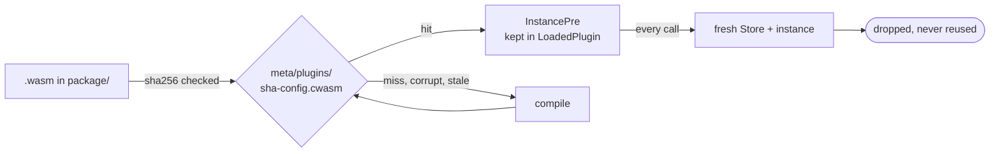
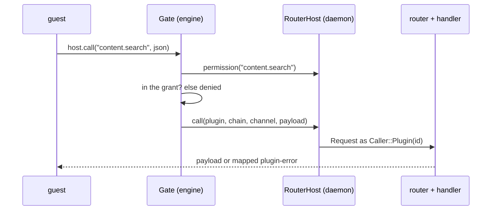
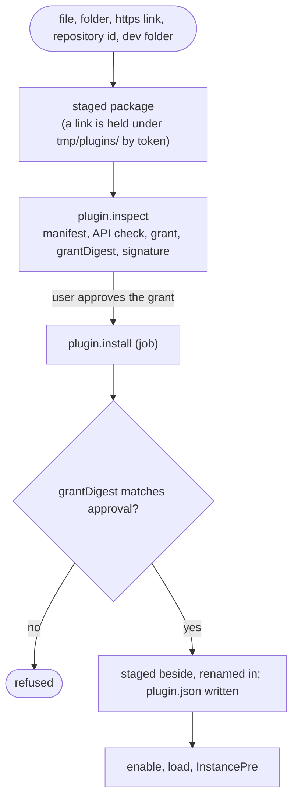

# Plugins

*[← Architecture](../architecture.md)*

A plugin is a **WASM component the daemon runs in a sandbox**. It can call daemon channels, hear events, adjust or refuse
an operation at a hook point, fill an open registry (content sources, flavors, pack formats, Java distributions), add
commands, pages, settings and themes, and reach the network, declared programs and local endpoints, only through what the
user granted at install.

The API is **mechanisms, not features**. The WIT is a fixed set of general mechanisms; hook points, provider kinds and
their operations, contracts and topics are data in `proto`. A new one changes neither the ABI nor the daemon, and a
port of a core feature may use only what a third party could use.

Core ships the mechanisms and the vanilla flavors. Modrinth, CurseForge, every other flavor, Adoptium, the `.mrpack`,
CurseForge and Prism formats, Discord presence and the players page are [official plugins](../plugins/official.md),
signed by Hestia's key and bundled with the installers. Authors: see [plugins/README.md](../plugins/README.md).

## Where the pieces are

| Piece                                   | Where                                                               | Role                                                                   |
|-----------------------------------------|---------------------------------------------------------------------|------------------------------------------------------------------------|
| Manifest, grant, permissions, scopes    | `crates/proto/src/plugin/`                                          | what a plugin declares and the user approves                           |
| Hook points, provider kinds, topics     | `proto/src/hook.rs`, `provider.rs` + `provider/`, `events.rs`       | what varies, as data                                                   |
| The ABI                                 | `crates/sdk/wit/` (`hestia:plugin`)                                 | one WIT package; its version is `proto::plugin::API_VERSION`           |
| Guest SDK                               | `crates/sdk/` (`hestia-sdk`)                                        | bindings and proto types for Rust plugins; `MIT OR Apache-2.0`         |
| Sandbox, store, install, trust          | `crates/engine/src/plugins/`                                        | `PluginRuntime`, `Plugins`, hooks, providers, repositories             |
| Loaded state, events, host calls        | `crates/daemon/src/runtime/plugins/`                                | `RouterHost`, event delivery, enable and disable                       |
| Channels                                | `crates/daemon/src/services/plugin.rs`                              | the `plugin.*` registrar                                               |
| Authoring tools                         | `crates/cli/src/commands/plugin/`                                   | `new`, `pack`, `check`, `publish`, `keygen`, `dev`, management verbs   |

The engine never links `ipc` or `client`. What it needs from the daemon is the `HostCalls` trait (`permission`,
`touched`, `call`, `run_job`), implemented by `RouterHost` over the router.

## The sandbox

`PluginRuntime` owns the daemon's one wasmtime `Engine`: component model, WASI preview 2 (`wasm32-wasip2` guests) and
`wasi:http`, linked once, async.



- **Fresh store per call.** No call sees another's memory, and a trapped call costs only itself. State that must last
  goes in the plugin's `data/` directory; there is no key/value import. The `data` import's named locks make a
  read-modify-write atomic across overlapping calls.
- **Compiled-component cache.** `meta/plugins/<wasm-sha256>-<config-hash>.cwasm` beside a `.sha256`. A missing,
  truncated or mismatching file is deleted and recompiled.
- **Time.** A 10 ms epoch tick (own thread) makes a spinning guest yield. The cut-off is a wall-clock timeout per call
  covering slot wait, compute and awaited host calls:

  | Call                     | Timeout                                                      |
  |--------------------------|--------------------------------------------------------------|
  | hook                     | 2 s                                                          |
  | event delivery           | 5 s                                                          |
  | page render and action   | 10 s                                                         |
  | `lifecycle.init`         | 10 s                                                         |
  | content source, flavor   | 30 s                                                         |
  | command (`plugin.run`)   | 1 h; a cancel is asked, then the call is dropped after 10 s  |

- **Memory.** A shared pooling allocator (16 instance slots, 256 MiB per memory, one memory and four tables per
  component), plus matching `StoreLimits` that trap on a refused grow.
- **Concurrency.** At most 4 calls at once per plugin and 16 overall.
- **Traps.** Three in ten minutes disable the plugin until re-enabled.
- **Filesystem.** WASI sees one preopen, `data/` at `/data`, plus `/build`, `/vanilla` and `/files` for calls that are
  lent them. TCP, UDP and name lookup are off; the environment is empty.
- **Output.** stdout and stderr go to the plugin's log, rate-limited and truncated.

The boundary is guest code against the daemon; the data home is one trust domain.

## Permissions

A manifest's `[permissions]` is a table: each permission is a key and carries a **scope** by kind (`network:connect`
takes `hosts` and `unhashed`, `entry:read` takes `files`, `ipc:connect` takes `endpoints`, `process:spawn` takes
`programs`, `launch:patch` takes `properties`). What a manifest contributes (hooks, events, schedules, themes, secret
settings) is derived and listed beside them. Together they are the **grant**, which is `permission to scope` and
nothing else: the user approves exactly that, and an update that widens it asks again. Tiers and the full table are in
[plugins/permissions.md](../plugins/permissions.md).

- **One table drives it.** `Permission::spec` gives each permission its tier, accepted scope kinds and whether a scope is
  required. Validation, `Grant::widening_over`, `Grant::approval_digest` and the prompts all read it. A permission with
  no arm fails to compile; one missing from `Permission::ALL` fails `crates/proto/tests/scope.rs`.
- **Contributions are a scope too** (`hooks`, `events`, `schedules`, `secrets`, `themes`), so they widen, hash and
  render like any scope.
- **A contract names its permission.** `Contract::PLUGIN` and `Topic::PLUGIN` default to `None`, which is closed, and
  `crates/proto/tests/permission.rs` fails a contract that is neither classified nor on its denied list.
- **Ambient contracts** (`AMBIENT`: `app.info`, `host.info`, `net.status`) return harmless facts, need no permission and
  appear in no grant or prompt.
- **Narrowing.** `NARROWED_BY` names the scope kind that narrows a channel and `touches(&Params)` reads the entries a
  call reaches; the gate refuses a call outside the caller's scope. No handler checks a grant by hand.
- **Names** are `domain:action`: `entry`, `process`, `content`, `account`, `config`, `java`, `network`, `ipc`, `ui`,
  `launch`, `flavor`, `pack`.
- **Two tiers.** `Sandboxed`, and `Unrestricted` for permissions that reach native code (`entry:write`, `config:write`,
  `content:write`, `process:control`, `process:spawn`, `ipc:connect`, `flavor:provide`, `pack:provide`, `java:provide`).
  The install prompt states the latter as full access to the computer.
- **Settings are an allowlist.** `proto::config::PLUGIN_ACCESS` marks every setting `none`, `read` or `readwrite` for
  plugins; an unlisted key is `none`, and replies are filtered to readable keys.
- **Always closed:** every secret-bearing channel (logs, `server.properties`, per-entry config reads, sign-in and token
  channels, skins), plus update, daemon lifecycle and `plugin.*`.
- **Enforcement.** `Gate::dispatch` asks the host for the channel's permission and checks the grant before routing; a
  miss is `denied`. The linker supplies every import to every plugin and each import checks the grant when called.
- **Entry access is every entry.** `entry:read`, `entry:write`, `process:read` and `process:control` reach all servers
  and instances; no scope kind names an entry.

## Calling the daemon

A guest has two imports, both carrying proto JSON strings so every existing contract crosses unchanged: `host.call`
(request/response) and `host.run-job` (resolves with the job's `Done`).



`RouterHost` uses the same router as a socket client, so decoding, the account gate, entry guards and `CHANGES`
publication apply unchanged. For a job it subscribes to the id before starting the channel so a fast job cannot finish
unseen; if the guest's call ends first, a `Watch` guard cancels the job.

**The call chain stops loops.** A `CallChain` lists plugins on the current path and travels explicitly with the call
(the job runner moves work into `tokio::spawn`, which would lose a task-local). Re-entering a plugin already on the path
is refused (`Reentry`), as is a path deeper than 8.

### Errors

Every host-plugin call fails with one WIT variant, `plugin-error`; its Rust mirror `GuestError`
(`engine/src/plugins/error.rs`) is the only place the two sides are translated.

- **Host to plugin** (exhaustive match on `ErrorInfo`): `not-found`, `invalid`, `denied`, `unsupported`, `offline`,
  `upstream`, `sign-in-required`, `not-configured`, `missing-requirement` (with its URL), `busy`, and `failed` for the
  rest. `HostCalls` carries the `ErrorInfo` whole, so the daemon has no second classification.
- **Plugin to host**: `offline` becomes `Offline` (naming the provider for a provider call); `upstream` and
  `rate-limited` become `Upstream` naming the service; `sign-in-required` becomes `PluginSignInRequired`;
  `not-configured` becomes `PluginSettingInvalid`; everything else is `PluginCallFailed` with the message.
  `unsupported` is not an error: an optional provider operation falls back and a required one fails. A hook's error is a
  veto; a hook that traps or times out is skipped.

**Commands** are one export, `commands.run(command, args)`. The manifest's `[[contributes.commands]]` is the schema and
the daemon checks arguments first. `plugin.run` has no `PLUGIN` permission, so one plugin cannot start another's command.
The CLI exposes them as `hestia <plugin> <command>`; plugin ids may not take a CLI verb (`RESERVED_IDS`).

## Events

`contributes.events` is a list of topic globs. The daemon decides once per event, before queuing (`events::admit`):

- the topic matches a glob in the grant, and names a permission the grant holds. Every topic is in
  `proto::events::TOPICS`; `Topic::permission` reads it from the payload where events differ (`changed` needs the
  permission of its scope and names only the scope). A topic naming none, such as process output, is never delivered.
- a `job` event goes only to a plugin holding the permission of the channel that started the job.
- `plugin.state` needs none but is cut to id and state.
- host-pushed topics (`plugin.schedule`, `ipc.readable`, `ipc.closed`) are never admitted from the hub
  (`proto::pushed::is_private`); only the owning plugin's inbox carries them.

`changed` carries `ids`, the stable ids the request resolved (a `Touched` set filled by the entry guards); empty means
the whole scope. Account topics come from the accounts handlers and `server.ready` from a per-start watcher
(`runtime/ready.rs`) that pings the game port.

Each plugin has an inbox of 256 events; when full the oldest is dropped with a warning at most once a minute.

**Host-pushed events and the call budget.** A plugin is a fresh instance per call, so the host watches what it cares
about. A connection's reader task buffers incoming bytes and pushes `ipc.readable` (edge-triggered: first bytes while no
`receive` waits, re-armed on receive) and `ipc.closed` (once, after the last bytes). Every host-initiated wake-up spends
a token from the plugin's `Budget` (30 in a burst, one refilled per second): a tick over budget is skipped, an event
waits, and the refusal is warned at most once a minute and counted in `PluginStats::throttled`. Calls a person made
(commands, pages, providers, hooks) are never budgeted.

**Schedules.** `[[contributes.schedules]]` entries (`id`, `every` in seconds from 1 to 30 days, at most 8) push a
`plugin.schedule { id }` event straight into that plugin's own inbox. It is never published to the hub, needs no
permission, and is part of the grant. A tick missed while asleep is skipped, and a tick is dropped while one of the same
schedule waits. The SDK delivers it as the typed `ScheduleEvent`.

## Hooks

A hook point is data in `proto::hook`: it names itself, the permissions a plugin must declare, the `Context` the plugin
sees and the `Patch` it may answer. All points cross the ABI through one export, `hooks.intercept(point, context)`; the
engine's `Hook` impl says what the host keeps of a patch (`vet`) and how patches combine (`fold`). Points today:
`before-launch`, `before-server-start`, `before-content-install`.

Hooks are customisation, not control. Each plugin runs under 2 s. A timeout, trap, refused re-entry or a non-patch
answer skips it with a `PluginHookFailed` warning while the operation proceeds; only an explicit veto stops it
(`PluginVetoed`). Plugins run in id order and patches fold in that order. A launch or server-start patch is filtered by
an allowlist (`patch.rs`: GC and heap flags, `-D` keys the manifest declared, no code-loading options); the rest is
dropped with a warning. A patch may name a `wrapper`, one of the plugin's own `PATH` programs (`gamemoderun`,
`mangohud`), run in front of the command by its pinned path; it needs `process:spawn`, and wrappers nest with the first
plugin outermost.

## Provider surfaces

A plugin adds to an engine registry with `contributes.providers = [{ kind, id }]`. A kind is data in `proto::provider`:
a `ProviderKind` names itself and its permissions, and each `ProviderOp` pairs a name with typed `Args` and `Reply`.
Every operation crosses the ABI through one export, `provider.invoke(kind, id, op, args)`. The engine wraps each
contribution in the registry's own trait over a `Guest` (`plugins/providers/`), which stamps the plugin's id, applies the
30 s timeout and maps failure to `PluginCallFailed`.

A guest answers `unsupported` for an operation it lacks; an optional one then falls back in the host (`projects` asks
`project` for each, `latest` asks `versions`, `versions-by-id`, `identify` and `loader-versions` find nothing,
`resolve-manifest` fails the import naming the source), a required one fails. A source's `info` may name a
`requires-setting`; the host keeps it out of use until that setting holds a value.

| Kind      | Needs                                        | Registers into                  | See                                                     |
|-----------|----------------------------------------------|---------------------------------|---------------------------------------------------------|
| `content` | `content:read`, `network:connect`, a host    | content source registry         | [Content](content.md#sources)                           |
| `flavor`  | `flavor:provide`, `network:connect`, a host  | flavor registry                 | [Minecraft providers](minecraft.md#plugin-flavors)      |
| `java`    | `java:provide`, `network:connect`, a host    | Java provider roster            | [Engine](engine.md#java-runtimes)                       |
| `pack`    | `pack:provide`                               | import detection and export     | [Import and export](transfer.md#pack-formats-from-plugins) |

**One id.** Every provider id reads `<plugin>.<id>`, whoever signed it, and registration refuses a duplicate or an id
outside the owner's namespace. A bare name is a lookup shorthand resolved by `Roster::resolve`: core's provider of that
name, else the one official plugin's, else the only provider with that provider-id, else `ProviderUnknown` or
`ProviderAmbiguous` (listing full ids). Core stores and sends the full id. `Standing` (official, developer, community) is
only a tie-break.

**One vet for every download.** `Policy::vet_artifact` decides whether a file a plugin names may be fetched: a granted
https host, and a well-formed checksum or `unhashed` from an unhashed host. A flavor artifact, content file, Java build
and pack file all go through it. The provider owns the `Policy` (`vouch.rs`) built from its grant and provenance travels
with it, never with the URL. A downloader holding a policy uses the guarded client over https, walks redirects by hand
and rechecks every hop; a plugin flavor's policy is asked again at every launch. Files on Mojang's own hosts stay under
the core policy.

**Declarative flavor additions.** `providers/normalise.rs` runs on a guest's `onVanilla` answer before vetting: a library
given as a `maven` coordinate plus repository gets its name, path, URL and file from the one parser; with `sha1Sidecar`
and no checksum its `<url>.sha1` is fetched under the plugin's policy and becomes the checksum; `rules` are filtered by
the vanilla evaluator. Vetting and launching see only plain `Library` values. Queries carrying a `target` (`os`, `arch`,
`javaMajor`, `pathSeparator`) are filled by the host, so a guest never probes the platform.

**Builds.** A flavor's `build` returns a plan `{ fetch, steps, outputs }`, vetted whole before anything runs.
Downloads go through the plugin's `Downloads` (policy, checksum, cache) into the build area; steps go through
`Programs::vet` and `Programs::prepare`, so a program, arguments, environment names and Java major must fit a declared
invocation, and an argument may name only the `${build}` and `${vanilla}` mounts. `cwd`, `creates`, destinations and
outputs must be plain paths under `/build`. Each step runs as a `process::Task` under the supervisor, owned by
`plugin:<id>`, with a task id from plugin, game version, step and a hash of the step, so an identical running step is
joined. `narrate.skipPrefixes` picks progress lines, cancel is checked before each download and step, and a step whose
`creates` all exist is skipped. The guest sees `/build` (read-write, `meta/flavors/<plugin>/`) and `/vanilla` (a
read-only host-owned copy of the side's vanilla jar). `providers/build.rs` copies each named output where the profile
said (a built jar's filename, a `built` library path, or a directory tree to a `destination`), refusing symlinks, escapes
and undeclared targets, and fails the provision unless every built file exists. Builds of one plugin serialize on its
area lock.

**Download import.** A guest fetches through `download(url, expect, dest)`: the same path with the guest as caller.
`download.rs` vets the URL, resolves `dest` through the call's writable mounts, and runs the engine's `Downloader` with
the cache, a 4 GiB cap and the call's progress, cancel and deadline. The `.part` file opens exclusively, so a planted
symlink is refused.

## Declarative UI and themes

A plugin ships no markup, scripts or styles into the app. A page is a `UiNode` tree returned by the guest's `ui` export;
the host draws it with its own components, in the desktop and the terminal. Pages sit in one of three slots (`nav`,
`entry`, `settings`); `plugin.ui.render` and `plugin.ui.action` call the guest, and an action answers with effects
(`render`, `toast`, `navigate`, `refresh`). See [plugin pages](frontends.md#plugin-pages).

- The vocabulary grows only by what more than one plugin needs. Beyond text and tables it has `remote_image` (with an
  `avatar` shape), `badge`, `tabs`, `section`, `copy`, list-item badges and images, `empty` states, field help and
  bounds, a `confirm` text on a button and a `filter` on a table. A page can run a command for long work.
- A remote image is fetched by the host (`plugin.image`) through the image proxy under the plugin's `Policy`, so the URL
  and every redirect hop must be on a granted host.
- A page may declare `topics` and `refresh_every`; the front-end redraws it on such a topic (throttled) or interval, and
  the plugin never receives the event. `PageContext.locale` carries the user's language.
- The one exception is the `webview` node: an HTML page from the plugin's `assets/` in an opaque-origin, scripts-only
  iframe under its own CSP, reaching the host only through a `postMessage` bridge limited to that plugin's `plugin.run`
  and `plugin.ui.action`. See [plugins/README.md](../plugins/README.md).
- A theme is a stylesheet in `themes/`, declared in `contributes.themes` and gated by `ui:css`. It is untrusted CSS,
  contained by the desktop's CSP, native approval dialogs, an opt-in pick and a safe mode that loads no plugin CSS.

**Message catalogs.** A package may carry `messages/<locale>.json` (flat, `{name}` placeholders, up to 256 KiB each).
`plugins/messages.rs` resolves a locale general to specific and serves both `plugin.messages` (the app translates
manifest texts by convention keys such as `page.<id>.title`, falling back to the manifest) and the guest's
`messages.catalog` import. A locale that is not a plain tag is refused.

**Assets.** The webview never reads plugin files. The `hestia-plugin` scheme becomes a `plugin.asset` call, and
`Plugins::asset` decides: installed and enabled, a relative path under `assets/` or `themes/`, the canonical file still
beneath that directory, extension in a fixed table, at most 8 MiB. `plugin.asset` and `plugin.themes` are the shell's
and carry no `PLUGIN` permission.

## Settings and secrets

`[[settings]]` declares typed settings (a `secret` kind among them), stored in `plugins/<id>/settings.json`, owner-only.
Listing reports a secret only as set or unset; its value leaves the daemon only for the owning plugin through the
`settings` import. `hestia plugin config` and the desktop edit them, and the plugin's `settings-changed` export is told
of a change. A plugin may write its own settings with `settings.set`, through the same validated path as the user's
(`min`, `max`, `pattern`, `placeholder`, `group`, https `help_url` enforced by `Setting::check`); its own
`settings-changed` is not run for its own write. A distributor can ship a setting's default inside the package: `pack`
and `publish` read `HESTIA_SETTING_<ID>_<KEY>` from the environment.

## Network

`network:connect` with `hosts` gates outbound HTTP. `wasi:http` is linked for everyone and every request is decided in
`http.rs`: https only, no credentials in the URL, no IP literal, the host must match a grant entry (exact, or `*.domain`
for names one label below; a wildcard over a public suffix fails manifest validation), and the daemon must be online.
Dialling uses the shared guard client, whose resolver refuses addresses inside the machine. A request has a 30 s timeout
and a 32 MiB body cap.

A plugin request feeds the shared reachability state like a core one: any answer marks the network up and a transport
failure marks it down. It is never retried, so its one failure stands for a core request's spent retries. A refused
request never left the machine and moves nothing.

## Local endpoints

`ipc:connect` with `endpoints` reaches local programs over a Unix socket under the user's runtime and temp directories or
a Windows named pipe. An entry is a relative name whose last segment may end in `*`; a bare `*` is refused. The host
keeps each connection open across calls (at most 8, messages up to 1 MiB) and closes them all when the plugin is
disabled, removed, reloaded or taken out of service. This is how the official `discord` plugin talks to a running Discord.

## Spawning programs

`process:spawn` runs only the `[[programs]]` the manifest declares. A program is an **identity** (what runs) kept apart
from its **invocations** (how it may be called).

- **Identity** is a `PATH` name pinned to an absolute path and the sha256 of the file at approval; or a file in `data/`
  copied to a host-owned `plugins/<id>/bin/` and run only if its per-target sha256 matches; or a Hestia-managed Java
  (a major, a `{ min, max }` range, or `"profile"`), resolved at call time and never pinned.
- **An invocation** is argument patterns plus the environment names and `path` programs it may use.
  `Program::matching` picks the first a call fits, and `select` adds the Java major.
- A `PATH` program found only after approval never runs: the call fails and the plugin is flagged `needs_approval`. A
  program missing from the computer is `missing-requirement` with the name and link of its `requires`.
- No shell; working directory `data/` unless `exec` names a `cwd` under a writable mount; empty environment plus declared
  names (and a `PATH` of only the pinned directories for a program that lists `path`). Dynamic-loader and Java option
  variables (`LD_*`, `DYLD_*`, `PATH`, `*JAVA*OPTIONS`) are rejected at install.
- `exec` runs under the call's remaining budget, observes cancel, kills the whole process tree on cancel, timeout or
  drop, and replaces `${build}`, `${vanilla}` and `${data}` with the host path of that mount. Output is capped at 1 MiB
  per stream. A spawned agent is supervised under `plugin:<id>`, visible and stoppable only by its plugin, and stopped
  when the plugin is disabled or removed.

## Installing

A package is a `.hplugin` zip: `plugin.toml`, the component, `assets/`, `themes/`. Nothing during install runs plugin
code.



- **Sources.** A local archive or folder, an https link, a plugin from an added repository (`<label>/<id>` or a bare
  id), and a **dev** install that runs a folder in place and reloads on rebuild (mtime polled each second).
- **Developer mode.** The `developer` config key (default off) gates dev installs, the `plugin.log` stream and extra
  `PluginInfo.developer` diagnostics. The daemon refuses them with `DeveloperModeOff`. Turning it off disables every dev
  plugin.
- **What you approve is what lands.** A downloaded package is held by an opaque token for 15 minutes. Install takes the
  grant digest the user approved and refuses a package whose grant, or whose pinned `PATH` program path or content,
  differs. `Grant::approval_digest` is the one place it is computed.
- **Limits.** 64 MiB uncompressed and 1 MiB for the manifest, enforced by the capped extractor. The manifest's
  `api = "^N.M.P"` must be satisfied by the host's `API_VERSION`, or install is refused.
- **Bundled official plugins.** Installers carry the plugins pinned in `plugins.lock`. At start, before any plugin
  loads, `Plugins::seed_bundled` installs each missing or newer one. The package must verify against an official key,
  which is what lets its grant install with no prompt. An upgrade that widens the grant, a package that fails
  verification and a plugin the user removed (`plugins/bundled.json`) are left alone.
- **States.** `enabled`, `disabled`, `failed` (with the error), `needs_approval`, `needs_update` (built for an API this
  host no longer exposes; the update check still offers a compatible build). A theme-only package has no component. A
  daemon in safe mode loads none.
- **App updates.** An app update that changes the plugin API stages compatible official builds first (see
  [the engine](engine.md#self-update)).

### Repositories and trust

A repository is a signed index (`plugins.json` on its own orphan `repo` branch) with one minisign public key and an
optional spare, added by index URL. See [plugins/repository.md](../plugins/repository.md).

- **Trust follows the key.** `plugin.repo.add` pins the declared key. Every refresh and build must verify against it,
  and the signed trusted comment binds the signature to its subject (`hestia-build id=... version=... file=...`,
  `hestia-index version=... expires=...`), so it cannot be replayed onto another plugin or an older index.
- **Check, then cache.** Signature first, then key, version against the cached one (the version is the signing time) and
  expiry (30 days); only then is the index cached. A failed check never replaces the cache. An expired index allows no
  new installs or updates; installed plugins keep running.
- **Revocation** is enforced on every refresh: a revoked installed version is disabled. An index revokes only what its
  own key signed. Removing a repository leaves its plugins enabled and without updates.
- **Update checks** (`plugin.outdated`) read the same catalogue code. For each signed install, repositories pinning its
  signer key are grouped as mirrors and the newest listing wins. The daemon checks a minute after start and every six
  hours, publishing `plugin.updates` when the list changes (no plugin hears it). Official plugins whose offer is
  runnable and whose widened grant is empty are applied automatically (`plugins.auto-update`, default on, off while
  offline). Third-party and widened updates only surface.
- **Applying an update** (`plugin.update`, a job) stages the newest build from a repository pinning the installed signer,
  verifies it like an install and refuses one not newer or not signed by that key. A wider grant, or a moved program pin,
  needs `approve` to be its digest, else `plugin_update_needs_approval`. The swap renames `package/` to `package.prev/`,
  so exactly one previous version exists; `data/` is untouched. The new build loads beside the running one and replaces
  it only once `init` succeeds. A build that fails to load is rolled back; one that traps in its first minute is rolled
  back by a watcher (`plugin.rolled_back`). A crash between the renames is repaired at next start.
- **Official** means the recorded signer is one of `common::app::official_plugin_pubkeys()` (a current key and an offline
  spare); the flag is derived on every read. A repository whose index names an official key is refused. The official
  repository is seeded when absent, re-pinned on every load, and refused by `repo.remove`. A weekly workflow verifies
  its published index and fails when it expires within 10 days.
- **Signing is CLI-only.** The engine links `minisign-verify`; `keygen`, `pack --sign` and index signing live in `cli`.

## On disk

```
<data_home>/
├── plugins/
│   ├── repositories.json   added repositories and pinned keys
│   ├── bundled.json        bundled ids already seeded, so a removed one stays removed
│   └── <id>/               owner-only on Unix
│       ├── plugin.json     source, signer, grant, digest, approver, enabled, pinned programs
│       ├── package/        the extracted package
│       ├── data/           the only directory the plugin can write
│       ├── bin/            host-owned copies of verified data-directory programs
│       └── settings.json   setting values, owner-only
├── meta/plugins/           compiled components (regenerable)
├── meta/flavors/<id>/      a plugin's build area (regenerable)
├── updates/plugins/<api>/  official builds staged for an app update
└── tmp/plugins/            packages held until installed
```

The directory scan is the registry; `*.staging` leftovers are reclaimed at startup.

## The SDK and the WIT package

`crates/sdk/wit/` is the ABI: one package, `hestia:plugin`, whose version is `API_VERSION` (a test fails on drift).
Imports: `host` (`call`, `run-job`), `log`, `process`, `progress`, `settings`, `ipc`, `data`, `download`, and
`wasi:http`. Exports: `lifecycle`, `commands`, `events`, `settings-changed`, `ui`, `hooks` and `provider`. Every fallible
function returns `plugin-error`.

`hestia-sdk` wraps the exports in a `Plugin` trait whose methods default to "nothing here". Each export routes the same
way: the method receives a router (`Commands`, `Events`, `Pages`, `Intercept`, `Provide`) and the plugin chains handlers
before `finish()`. Proto-defined things route by type (`Events::on::<T>`, `Intercept::on::<Point>`, `Provide::on::<Op>`);
manifest-named things by id (`Commands::on("id", ...)`, `Pages::on("id", render, action)`). A request no handler takes
answers `unsupported` (commands, pages, providers), adds nothing (hooks) or is ignored (events). `hestia::http` is a
small `wasi:http` client whose `error_for_status` is the one place a status becomes a typed error; `hestia::hash` gives
`sha1`, `sha256` and `sha512`.

The API changes by caret semver: additive bumps the minor, breaking the major, and the host never serves two versions.
`crates/proto/tests/plugin_api.rs` snapshots every plugin-reachable contract and topic, hook point, provider operation
and the WIT files, so a change under an unchanged version fails. `proto` and `sdk` are `MIT OR Apache-2.0`; everything
else is GPL-3.0-only. Example plugins live in [prytaneum/plugin-examples](https://github.com/prytaneum/plugin-examples).
