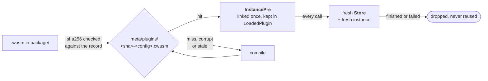
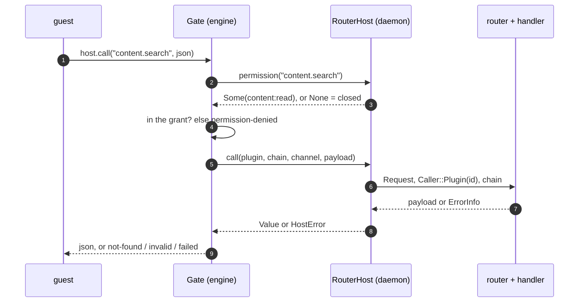
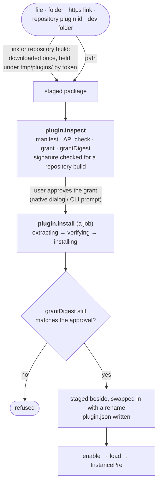

# Plugins

A plugin is a **WASM component the daemon runs in a sandbox**. It can call the
daemon's channels, hear its events, adjust or refuse an operation at a hook
point, fill an open registry (content sources, flavors, archive formats, Java
distributions), add commands, pages, settings and themes, and reach the network,
declared programs and local endpoints, but only through what the user granted
at install. The runtime lives in the engine ([`crates/engine/src/plugins/`](engine.md));
the daemon owns which plugins are loaded and lends them its channels.

**The API is mechanisms, not features**
([0106](../decisions/0106-the-plugin-api-is-mechanisms-not-features.md)). The
WIT is a fixed set of general mechanisms; hook points, provider kinds and their
operations, contracts and topics are data in `proto`. A new one changes neither
the ABI nor the daemon, and a port of a core feature to a plugin may use only
what a third party could use.

- Writing one? [plugins/publishing.md](../plugins/publishing.md),
  [plugins/repository.md](../plugins/repository.md) and
  [plugins/permissions.md](../plugins/permissions.md) are the author guides.
- Why it is built this way: decisions
  [0091](../decisions/0091-plugins-are-wasm-components.md) to
  [0106](../decisions/0106-the-plugin-api-is-mechanisms-not-features.md),
  listed [below](#decisions).

## Where the pieces are

| Piece | Where | Role |
|---|---|---|
| Manifest, grant, permissions, contracts | `crates/proto/src/plugin.rs`, `repository.rs` | the wire and the `plugin.toml` schema; `MIT OR Apache-2.0` |
| Hook points, provider kinds and operations, topic registry | `crates/proto/src/hook.rs`, `provider.rs` + `provider/`, `events.rs` | what varies, as data |
| The ABI | `crates/sdk/wit/` (`hestia:plugin@1.0.0`) | one WIT package; its version is `proto::plugin::API_VERSION` |
| Guest SDK | `crates/sdk/` (`hestia-sdk`) | bindings and proto types for a Rust plugin; `MIT OR Apache-2.0` |
| Sandbox, store, install, trust | `crates/engine/src/plugins/` | `PluginRuntime`, `Plugins`, hooks, providers, repositories |
| Loaded state, events, host calls | `crates/daemon/src/runtime/plugins/` | `RouterHost` (the `HostCalls` impl), event delivery, enable/disable |
| Channels | `crates/daemon/src/services/plugin.rs` | the `plugin.*` registrar |
| Authoring tools | `crates/cli/src/commands/plugin/` | `new`, `pack`, `check`, `publish`, `keygen`, `dev`, and the management verbs |

The engine never links `ipc` or `client`; what it needs from the daemon is the
`HostCalls` trait (`permission`, `call`, `run_job`), which `RouterHost`
implements over the router.

## The sandbox

`PluginRuntime` owns the daemon's one wasmtime `Engine`: the component model,
WASI preview 2 (`wasm32-wasip2` guests) and `wasi:http`, linked once, async.



- **Fresh store per call.** A call instantiates from the cached `InstancePre`
  into a new `Store`, so no call sees another's memory and a trapped or cancelled
  call costs nothing but itself. `lifecycle.init` runs the same way, once on
  enable. State that must last goes in the plugin's `data/` directory; there is no
  key/value import.
- **Compiled-component cache.** `meta/plugins/<wasm-sha256>-<config-hash>.cwasm`,
  beside a `.sha256` of the artifact. A missing, truncated or mismatching file, or
  a failed deserialize, is deleted and recompiled
  ([0091](../decisions/0091-plugins-are-wasm-components.md)). It is part of
  `meta/`, so it is one unit to reclaim
  ([0054](../decisions/0054-meta-root-for-materialised-files.md)).
- **Time.** A 10 ms epoch tick (a thread of its own, not a tokio task) makes a
  spinning guest yield to the executor; the cut-off is a wall-clock timeout per
  call that covers waiting for a slot, guest compute and awaited host calls:

  | Call | Timeout |
  |---|---|
  | hook | 2 s |
  | event delivery | 5 s |
  | page render / action | 10 s |
  | `lifecycle.init` | 10 s |
  | content source / flavor | 30 s |
  | command (`plugin.run`) | 1 h; a cancel is asked, then the call is dropped after 10 s |

- **Memory.** A pooling allocator is shared by all plugins (16 instance slots,
  256 MiB per memory, one memory and four tables per component), and each store
  adds `StoreLimits` of the same size, trapping on a refused grow.
- **Concurrency.** At most 4 calls run at once per plugin and 16 across all of
  them; a call waiting past its deadline times out.
- **Traps.** Three traps inside ten minutes disable the plugin until it is
  enabled again (`CallError::Disabled`).
- **The filesystem.** WASI sees one preopened directory, `data/`, mounted at
  `/data`. TCP, UDP and name lookup are off; the environment is empty.
- **Output.** stdout and stderr are captured into the plugin's log, rate-limited
  and truncated; a dev plugin streams it to `hestia plugin dev`.

The threat model for this boundary is in
[0091](../decisions/0091-plugins-are-wasm-components.md#threat-model). Its
boundary is guest code against the daemon; the data home is one trust domain.

## Permissions

A manifest lists `permissions`, plus the narrower lists they apply to (`network`
hosts, `[[programs]]`, `events` globs, `hooks`). Together they are the **grant**:
the user approves exactly that at install, and an update that widens it asks
again. The tiers and the full table are in
[plugins/permissions.md](../plugins/permissions.md).

- **A contract names its permission.** `Contract::PLUGIN` and `Topic::PLUGIN` are
  `Option<Permission>`, `None` by default. `None` means closed, so a channel added
  later is unreachable until someone classifies it, and `crates/proto/tests/permission.rs`
  fails a contract that is neither classified nor on its denied list
  ([0092](../decisions/0092-a-contract-names-the-permission-a-plugin-needs.md)).
- **`domain:action` names**: `entry`, `process`, `content`, `account`, `config`,
  `java`, `network`, `ipc`, `ui`, `launch`, `flavor`, `format`. The domain is the
  channel prefix it opens.
- **Two tiers.** `Sandboxed`, and `Unrestricted` for the permissions that reach
  native code (`entry:write`, `config:write`, `content:write`, `process:control`,
  `process:spawn`, `ipc:connect`, `flavor:provide`, `format:provide`, `java:provide`). The install prompt states the latter as full
  access to the computer, and the daemon reports the tier so no front-end keeps a
  table of its own.
- **Always closed:** every secret-bearing channel (logs, `server.properties`, the
  config reads, sign-in and token channels, skins), plus update, daemon lifecycle
  and `plugin.*`. The list and the reason for each entry are in 0092.
- **Where it is enforced.** On a channel call, `Gate::dispatch` asks the host for
  the channel's permission and checks it against the grant before anything is
  routed; a missing permission is `permission-denied`, not a missing import. The
  linker supplies every import to every plugin, and each import checks the grant
  when called.

## Calling the daemon

A guest has two imports into the daemon, both carrying proto JSON as strings so
every existing contract crosses unchanged: `host.call` for a request/response
channel and `host.run-job` for a job channel, which resolves with the job's `Done`
payload.



`RouterHost` routes through the same router as a socket client, so decoding, the
account gate, the entry guards and `CHANGES` publication apply unchanged; the
handler sees `Caller::Plugin(id)`. For a job, it generates the job id, subscribes
to that id before starting the channel so a fast job cannot finish unseen, and
waits for the terminal event. If the guest's call ends first (timeout, cancel,
dropped store) a `Watch` guard cancels the job.

**The call chain stops loops.** A `CallChain` lists the plugins on the current
path. It travels explicitly with the call, because the job runner moves work into
`tokio::spawn` and a task-local would be lost there. Entering a plugin already on
the path is refused (`Reentry`), as is a path deeper than 8 (`MAX_CHAIN_DEPTH`).
Anything a call causes that reaches a plugin (a hook, an event handler, a
provider) takes the same chain.

**A plugin's own commands** are one export, `commands.run(command, args)`, not
channels. The manifest's `[[contributes.commands]]` is the schema; the daemon
checks arguments against it first. `plugin.run` carries no `PLUGIN` permission, so
a plugin cannot start another's command through `host.call`. The CLI reaches them
as `hestia <plugin> <command>`. Plugin ids may not take a CLI verb
(`RESERVED_IDS`).

## Events

`contributes.events` is a list of topic globs. The daemon decides what a plugin
receives, once per event, before anything is queued (`events::admit`):

- the topic must match a glob in the grant;
- it must name a permission the grant holds. Every topic is listed in
  `proto::events::TOPICS` (a test fails one that is not), and `Topic::permission`
  reads it from the payload where events differ: `changed` needs the permission
  of its scope (`entries` → `entry:read`, `java` → `java:read`, …) and names
  only the scope; `net.state` needs `network:connect`. A topic that names none,
  such as process output, is never delivered;
- a `job` event goes only to a plugin granted the permission of the channel that
  started the job;
- `plugin.state` needs no permission but is cut to its id and state.

Each plugin has a bounded inbox of 256 events. When it is full the oldest is
dropped and a warning is logged at most once a minute, so a slow plugin loses
history rather than growing the daemon. Delivery stops when the plugin is
disabled, removed or reloaded.

### Schedules

`contributes.schedules` declares timers: `[[contributes.schedules]]` with an `id`
and `every`, in seconds (30 s to 30 days, at most 8 per plugin, ids unique). Each
tick is a `plugin.schedule` event `{ id }` pushed straight into that plugin's own
inbox. It is never published to the hub, so no other plugin or client hears it,
and it needs no permission; the schedules are part of the grant and listed when
the user approves. The timers live in the plugin's `Delivery`, so they start
and stop with its events. A tick missed while the machine slept is skipped, and a
tick is dropped while one of the same schedule still waits. In the SDK a tick
arrives in `Plugin::on_event`; `schedule::tick(topic, &payload)` returns its id
([0108](../decisions/0108-a-schedule-is-an-event-to-its-own-plugin.md)).

## Hooks

A hook point is data in `proto::hook`: a `HookPoint` names itself, the
permissions a plugin needs to declare it, the `Context` the plugin is shown and
the `Patch` it may answer. Every point crosses the ABI through one export,
`hooks.intercept(point, context)`, as JSON; the engine's `Hook` impl for a point
says what the host keeps of a patch (`vet`) and how patches combine (`fold`).
The points today are `before-launch`, `before-server-start` and
`before-content-install`. Hooks are **customisation, not a control**: each plugin runs under a 2 s deadline, and a timeout, trap, refused re-entry or
an answer that is not the point's patch skips it with a `PluginHookFailed`
warning on the result while the operation goes ahead. Only an explicit veto stops it (`PluginVetoed`). Plugins run
in id order and their patches fold in that order. A launch or server-start patch
is filtered through an allowlist (`patch.rs`: a fixed set of GC and heap flags, `-D`
keys the manifest declared, no code-loading options); anything else is dropped with
a warning. A patch may also name a `wrapper`: one of the plugin's own `PATH`
`[[programs]]` (`gamemoderun`, `mangohud`), run in front of the game or server
command by its path pinned at approval ([0101](../decisions/0101-plugins-spawn-only-declared-programs.md)).
It needs `process:spawn`; an unknown or data-directory program, a missing
permission or a vanished file drops it with the same `LaunchArgDropped` warning.
Wrappers nest, so the first plugin in id order is outermost. Details, including which claim a hook holds, are in
[0095](../decisions/0095-interceptors-are-bounded-and-fail-open.md).

## Provider surfaces

A plugin adds to an engine registry with `contributes.providers = [{ kind, id }]`.
A kind is data in `proto::provider`: a `ProviderKind` names itself and the
permissions it needs, and each `ProviderOp` pairs an operation name with typed
`Args` and `Reply`, a contract in the other direction. Every operation of every
kind crosses the ABI through one export, `provider.invoke(kind, id, op, args)`.

The engine wraps each contribution in the registry's own trait over a `Guest`
(`plugins/providers/`), which stamps the plugin's id on everything returned,
calls the guest with the 30 s provider timeout, and maps a guest failure to
`PluginCallFailed` naming the plugin. A guest answers `unsupported` for an
operation it does not implement; an optional operation then takes its
documented fallback in the host (`projects` asks `project` for each,
`versions-by-id`, `identify` and `loader-versions` find nothing), a required one
fails the call. `Contributions` connects, registers and unregisters every kind
in one place, so the daemon never names a kind. Ids read `<plugin>.<id>`; only a
plugin signed by the official key may take a bare id.

| Kind | Needs | Registers into | Page |
|---|---|---|---|
| `content` | `content:read`, `network:connect` and a host | the content source registry | [Content & modpacks](content.md#sources) |
| `flavor` | `flavor:provide`, `network:connect` and a host | the flavor registry | [Minecraft providers](minecraft.md) |
| `format` | `format:provide` | the archive formats import detection ranks | [Import & export](transfer.md) |
| `java` | `java:provide`, `network:connect` and a host | the Java provider roster | [The engine](engine.md) |

Adding a kind is its vocabulary in `proto::provider`, an adapter module beside
the others, and a line in each of `Contributions::connect`, `register` and
`unregister`.

A flavor whose profile names something it cannot download implements the optional
`build` operation ([0110](../decisions/0110-a-flavor-builds-in-its-own-area.md)).
The adapter calls it from the flavor's `install` step with a per-call context: two
extra preopens beside `/data`, `/build` (read-write, `meta/flavors/<flavor-id>/`)
and `/vanilla` (read-only, a host-owned copy of the side's vanilla jar and nothing else), and a
progress and cancel sink that maps onto `ProvisionProgress` and the provision's
cancel, under the one-hour command timeout. The guest writes only under `/build`;
`providers/build.rs` copies each named output to the place the profile gave it (a
`ServerJar::Built` filename in the server's data directory, or the path of a
`Library` marked `built` under `meta/libraries/`), refusing a symlink, an escape
and a target the profile did not declare, and fails the provision unless every
built file exists. A flavor also declares how Modrinth packs and Prism instances
name its loader (`mrpackKey`, `prismUid`), which the transfer formats read from
the registered flavors.

## Declarative UI and themes

A plugin never ships markup, scripts or styles into the app. A page is a
`UiNode` tree returned by the guest's `ui` export; the host draws it with its own
components, in the desktop and the terminal
([0096](../decisions/0096-plugin-ui-is-a-declarative-tree.md)). Pages sit in one
of three slots (`nav`, `entry`, `settings`); `plugin.ui.render` and
`plugin.ui.action` call the guest, and an action answers with effects (`render`,
`toast`, `navigate`, `refresh`). The desktop side is described under
[plugin pages](frontends.md#plugin-pages).

The one exception is the `webview` node: an HTML page from the plugin's `assets/`
in an opaque-origin, scripts-only iframe, served under its own CSP, that reaches
the host only through a `postMessage` bridge limited to that plugin's `plugin.run`
and `plugin.ui.action` ([0109](../decisions/0109-plugin-webviews-are-opaque-iframes.md),
[author's guide](../plugins/webview.md)).

A theme is a stylesheet in `themes/`, declared in `contributes.themes` and gated by
`ui:css`. It is untrusted CSS, contained by the desktop's CSP
([0093](../decisions/0093-the-desktop-runs-under-a-csp.md)), by native approval
dialogs, by an opt-in pick and by a safe mode that loads no plugin CSS
([0100](../decisions/0100-themes-are-plugin-css.md)).

## Assets

The webview never reads a plugin's files itself. The `hestia-plugin` scheme turns
a request into a `plugin.asset` call, and `Plugins::asset` is the one place that
decides: the plugin is installed and enabled, the path is relative and under
`assets/` or `themes/`, the canonical file still lies beneath that directory, the
extension is in a fixed table (the mime comes from it), and the file is at most
8 MiB ([0098](../decisions/0098-plugin-assets-are-served-by-the-daemon.md)).
`plugin.asset` and `plugin.themes` are the shell's, with no `PLUGIN` permission.

## Settings and secrets

`[[settings]]` declares typed settings (a `secret` kind among them). Values live in
`plugins/<id>/settings.json`, written owner-only like `accounts.json`. Listing
reports a secret only as set or unset; its value leaves the daemon only for the
plugin that owns it, through the `settings` import. `plugin.settings.*` edits them
from the CLI (`hestia plugin config`, which prompts for a secret without echo) and
the desktop, and the plugin's `settings-changed` export is told when one changes.

## Network

`network:connect` plus a `network` host list gates outbound HTTP. `wasi:http` is
linked for everyone and each request is decided in `http.rs`: https only, no
credentials in the URL, no IP literal, the host must match a granted entry (an
exact host, or `*.domain` for subdomains at any depth), and the daemon must be
online. Dialling goes through the shared guard client, whose resolver refuses
addresses that point inside the machine, so a granted name cannot reach the local
network. A request has a 30 s timeout and a 32 MiB body cap. A content source's
files are checked against the same host list before the engine downloads them.

## Local endpoints

`ipc:connect` plus an `ipc` list reaches local programs over a Unix socket under
the user's runtime and temp directories, or a Windows named pipe
(`plugins/ipc.rs`, the dialing behind `cfg`). An entry is a relative name whose
last segment may end in `*`; a bare `*` is refused, so a grant always names what
it allows. The host keeps each connection open across calls, since every call
runs on a fresh instance, and the plugin names it again by id; at most 8 are
open, a message is at most 1 MiB, and all close when the plugin is disabled,
removed, reloaded or taken out of service after repeated traps. This is how a
plugin talks to a running Discord, or any other local program, speaking its
protocol itself.

## Spawning programs

`process:spawn` runs only the `[[programs]]` the manifest declares: argument
patterns, an environment name list, and either a `PATH` name pinned to an absolute
path at approval or a file in `data/` copied to a host-owned `plugins/<id>/bin/`
and run only after its per-target sha256 matches, or, with `java = <major>` in
place of `command`, the Hestia-managed runtime of that major, resolved at call
time (installed when missing) through a `ManagedJava` resolver the daemon lends
the runtime at load, and never pinned. No shell, working directory `data/` unless
`exec` names `cwd`, a guest path under a writable mount of the call (`/data`, or
`/build` during a flavor's `build`), empty environment plus declared names (and,
for a program that lists `path`, a `PATH` of only those programs' pinned
directories). `exec` runs under the current call's remaining budget, observes its
cancel, kills the child's whole process tree on cancel, timeout or drop, and
replaces `${build}`, `${vanilla}` and `${data}` in an argument with the host path
of that mount of the call. A flavor `build` also holds an exclusive lock on
`meta/flavors/<id>/.lock`. A spawned agent is supervised under the owner
`plugin:<id>`, visible and stoppable only by its plugin, and stopped when the
plugin is disabled or removed
([0101](../decisions/0101-plugins-spawn-only-declared-programs.md)). The SDK's
`hestia::process` has `exec` for run-to-completion (output capped at 1 MiB per
stream) and `spawn`, `stop`, `status`, `logs`, `list` for agents.

## Installing

A package is a `.hplugin` zip: `plugin.toml`, the component, `assets/`, `themes/`.
Nothing during install runs plugin code.



- **Sources.** A local archive or folder, an https link to a `.hplugin`, a plugin
  from an added repository (`<label>/<id>` or a bare id), and a **dev** install
  that runs a folder in place and reloads it on every rebuild (mtime polled once a
  second; a folder inside the plugins directory is refused).
- **Developer mode.** The `developer` config key (default off) gates what only an author needs: a `dev` install, the
  `plugin.log` stream (a subscription filtered to a dev plugin, and its publication) and the extra `PluginInfo.developer`
  diagnostics (grant digest, component cache directory, error chain). The daemon refuses them with
  `ErrorInfo::DeveloperModeOff`, whatever the client; the CLI additionally hides the authoring verbs. Setting the key to
  false disables every dev plugin, which also ends its reload poll, with the reason as its last error. Installing from a
  file, link or repository, enable, disable, remove and settings are never gated.
- **What you approve is what lands.** A downloaded package is held under
  `tmp/plugins/` by an opaque token (fifteen minutes; `tmp/` is emptied at startup
  besides), so inspect and install see the same file. The install takes the grant
  digest the user approved and refuses a package whose grant differs.
- **Limits.** 64 MiB uncompressed per package and 1 MiB for the manifest, enforced
  by the capped extractor. The manifest's `api = "^N.M.P"` must be satisfied by
  the host's `API_VERSION`, or the install is refused instead of failing at
  instantiation.
- **Bundled official plugins.** Installers carry the plugins pinned in `plugins.lock`; at start, before any plugin
  loads, `Plugins::seed_bundled` (`engine/src/plugins/bundled.rs`) installs each one that is missing or newer than the
  official install it replaces. The package must verify against an official key, which is what lets its computed
  grant install with no prompt (`approvedBy: official` on the record); an upgrade that widens the grant, a package
  that fails verification and a plugin the user removed (`plugins/bundled.json`) are all left alone. See
  [packaging.md](../packaging.md#the-bundled-official-plugins).
- **A plugin that does not run.** A theme-only package has no component and no
  `api`. A plugin's state is `enabled`, `disabled`, `failed` (with the load error) or
  `needs_approval`; a daemon in safe mode loads none.

### Repositories and trust

A repository is a signed index (`plugins.json`, on its own orphan `repo` branch) with one
minisign public key and an optional spare, added by its index URL. It has one shape
([0094](../decisions/0094-a-plugin-repository-has-one-shape.md),
[plugins/repository.md](../plugins/repository.md)) and publishes to its own branch
([0111](../decisions/0111-a-repository-publishes-to-its-own-branch.md)).

- **Trust follows the key.** `plugin.repo.add` pins the key the index declares, and
  its spare `next`. Every later refresh, and every build, must verify against them,
  and the signed trusted comment binds the signature to its subject
  (`hestia-build id=… version=… file=…`, `hestia-index version=… expires=…`), so it
  cannot be replayed onto another plugin or an older index
  ([0097](../decisions/0097-trust-follows-the-repository-key.md)).
- **Check, then cache.** The signature is verified before anything is parsed, then
  the declared key, the version against the cached one (the version is the signing
  time) and the expiry (30 days); only then is the index cached. A failed check never
  replaces the cache. An expired index is stale: no new installs or updates until a
  fresh one, and installed plugins keep running.
- **Updates and revocation** come only from a repository pinning the key that
  signed the installed plugin, and an index revokes only what its own key signed.
  Revocation is enforced on every refresh: a revoked installed version is disabled
  with the reason as its error. Removing a repository leaves its plugins enabled
  and without updates.
- **Update checks** (`plugin.outdated`, `engine/src/plugins/update.rs`) read the same
  catalogue code: for each signed install, the repositories pinning its signer key are
  grouped as mirrors, the newest listing wins and `pick` chooses its build, so there is no
  second picker. A build the host's API cannot run is reported `apiCompatible: false`;
  a version without a build, an obsolete plugin and every unsigned or local install are
  not reported, except an unsigned URL install when the call sets `unsigned`. The daemon
  runs it a minute after start and every six hours (`spawn_plugin_update_checker`),
  refreshing each repository once through the normal refresh path, and publishes
  `plugin.updates` when the list changes; the topic names no permission, so no plugin
  hears it. Offline it answers from the cached indexes and sets `offline`. After each check, official
  plugins (signer is an official key) whose offer is runnable here and whose `widened` grant is empty are applied
  through the same `Plugins::update` path as `plugin.update` (`daemon/src/runtime/plugins/auto.rs`,
  `Engine::auto_update_candidates`), under the plugin's install claim; an update whose full grant
  turns out wider than the installed one is refused by that path and left for the user. Each success is logged at info
  and published as `plugin.auto_updated` (id, from, to; no plugin may receive it), and is dropped from the
  `plugin.updates` list. Third-party and widened updates only surface in `plugin.updates`. `plugins.auto-update`
  (default on) turns it off; it also does nothing while the network state is offline. There is no metered-connection
  signal, so `network.offline` is the way to opt out of network use.
- **Applying an update** (`plugin.update`, a job; `Plugins::apply_update` in
  `engine/src/plugins/update.rs`, loaded by `daemon/src/runtime/plugins/update.rs`) stages the
  newest build from a repository pinning the installed signer, verifies it like an install,
  and refuses it unless it is newer and signed by that same key. A grant wider than the
  installed one (compared as a whole `Grant`, not a permission list) needs `approve` to be
  its digest, else the call fails with `plugin_update_needs_approval` before anything
  changes; an equal or narrower grant applies. The swap renames `package/` to
  `package.prev/` and writes the replaced record to `plugin.prev.json`, so exactly one
  previous version exists; `data/` is untouched. The new build is loaded beside the running
  one and replaces its slot only once `init` succeeds, so calls in flight finish on the old
  code. A build that fails to load is rolled back and the done event carries
  `plugin_update_rolled_back`; one that traps in its first minute is rolled back by a
  watcher, which logs it, publishes `plugin.rolled_back` (id, the version taken out, the version restored; no plugin
  may receive it) and shows up as the plugin's state change. A crash between the two
  renames is repaired at the next start. Nothing else ever installs an older version.
- **Signing is CLI-only.** The engine links `minisign-verify`; `hestia plugin
  keygen`, `pack --sign` and the index signing use the signing crate in `cli`.
- **Official.** A plugin is official when its recorded signer is one of
  `common::app::official_plugin_pubkeys()` (a current key and an offline spare); the flag is derived on every read, and
  only a plugin so signed may take a bare provider id. A repository whose index
  names an official key is refused at `repo.add`
  ([0099](../decisions/0099-official-plugins-are-signed.md)). A debug build reads
  `HESTIA_OFFICIAL_PLUGIN_PUBKEY` for local runs.
- **The official repository** (`common::app::OFFICIAL_PLUGIN_REPOSITORY`) is seeded
  into `repositories.json` when absent, re-pinned to those keys on every load, and refused by
  `repo.remove` (`RepositoryOfficial`); `RepositoryInfo.official` lets a front-end
  hide remove. A weekly workflow (`official-index.yml`, kept out of the release gate) verifies the published index with the compiled keys
  and fails when it expires within 10 days.

## On disk

```
<data_home>/
├── plugins/
│   ├── repositories.json   the added repositories and their pinned keys
│   ├── bundled.json        the bundled plugin ids already seeded, so a removed one stays removed
│   └── <id>/
│       ├── plugin.json     the record: source, signer, grant, grant digest, who approved it, enabled, pinned program paths
│       ├── package/        the extracted package
│       ├── data/           the plugin's own directory; the only one it can write
│       ├── bin/            host-owned copies of verified data-directory programs
│       └── settings.json   setting values, owner-only; may hold secrets
├── meta/plugins/           compiled components (.cwasm) — regenerable
├── meta/flavors/<id>/      a flavor's build area, `/build` during its `build` — regenerable
└── tmp/plugins/            packages fetched from a link, held until installed
```

The last good copy of each repository index is kept with the other catalogue
responses under `meta/`. The directory scan is the registry; `*.staging` leftovers
are reclaimed at startup.

## The SDK and the WIT package

`crates/sdk/wit/` is the ABI: one package, `hestia:plugin`, whose version is the
API version (`proto::plugin::API_VERSION`, `crates/sdk/tests/version.rs` fails on
drift). Imports: `host` (`call`, `run-job`), `log`, `process`, `progress`,
`settings`, `ipc` and the `http-client` world over `wasi:http`; exports:
`lifecycle`, `commands`, `events`, `settings-changed`, `ui`, `hooks`
(`intercept`) and `provider` (`invoke`). That list is closed: a new hook point or
provider kind is data in `proto`, not a new interface. `hestia-sdk` wraps the
exports in a `Plugin` trait with default methods, and `intercept`/`provide`
route a request to typed handlers with `.on::<Point>(…)` and `.on::<Op>(…)`.

The API changes by caret semver: additive bumps the minor, breaking the major, and
the host never serves two versions. `crates/proto/tests/plugin_api.rs` snapshots
every plugin-reachable contract and topic, every hook point and provider
operation, and the WIT files, so a change under an
unchanged version fails
([0091](../decisions/0091-plugins-are-wasm-components.md)). `proto` and `sdk` are
`MIT OR Apache-2.0` so a plugin may use any license; everything else stays
GPL-3.0-only. Example plugins live in
[prytaneum/plugin-examples](https://github.com/prytaneum/plugin-examples); the
plugins the tests build are fixtures
([0103](../decisions/0103-example-plugins-live-in-their-own-repository.md)).

## Decisions

| | |
|---|---|
| [0091](../decisions/0091-plugins-are-wasm-components.md) | WASM components on wasmtime, WIT as the one ABI; the **threat model** and licensing |
| [0092](../decisions/0092-a-contract-names-the-permission-a-plugin-needs.md) | a contract names its permission; unnamed is closed |
| [0093](../decisions/0093-the-desktop-runs-under-a-csp.md) | the desktop runs under a CSP |
| [0094](../decisions/0094-a-plugin-repository-has-one-shape.md) | a repository has one shape |
| [0095](../decisions/0095-interceptors-are-bounded-and-fail-open.md) | hooks are bounded and fail open |
| [0096](../decisions/0096-plugin-ui-is-a-declarative-tree.md) | UI is a declarative tree |
| [0097](../decisions/0097-trust-follows-the-repository-key.md) | trust follows the repository's key |
| [0098](../decisions/0098-plugin-assets-are-served-by-the-daemon.md) | assets are served by the daemon |
| [0099](../decisions/0099-official-plugins-are-signed.md) | official means signed by Hestia's key |
| [0100](../decisions/0100-themes-are-plugin-css.md) | themes are plugin CSS |
| [0101](../decisions/0101-plugins-spawn-only-declared-programs.md) | plugins spawn only declared programs |
| [0102](../decisions/0102-one-feature-resolution-for-dev-builds.md) | one feature resolution for dev builds (wasmtime's build cost) |
| [0109](../decisions/0109-plugin-webviews-are-opaque-iframes.md) | a webview is an opaque-origin iframe with a message bridge |
| [0103](../decisions/0103-example-plugins-live-in-their-own-repository.md) | examples live in their own repository; test plugins are fixtures |
| [0104](../decisions/0104-an-archive-format-plugin-maps-files-the-host-copies.md) | an archive format maps files; the host copies them |
| [0105](../decisions/0105-a-java-provider-only-resolves.md) | a Java provider only resolves; the host downloads and extracts |
| [0106](../decisions/0106-the-plugin-api-is-mechanisms-not-features.md) | the plugin API is mechanisms, not features |
| [0108](../decisions/0108-a-schedule-is-an-event-to-its-own-plugin.md) | a schedule is an event delivered to its own plugin |
| [0110](../decisions/0110-a-flavor-builds-in-its-own-area.md) | a flavor builds in an area of its own; the host places the outputs |
| [0111](../decisions/0111-a-repository-publishes-to-its-own-branch.md) | a repository publishes to its own orphan branch |
