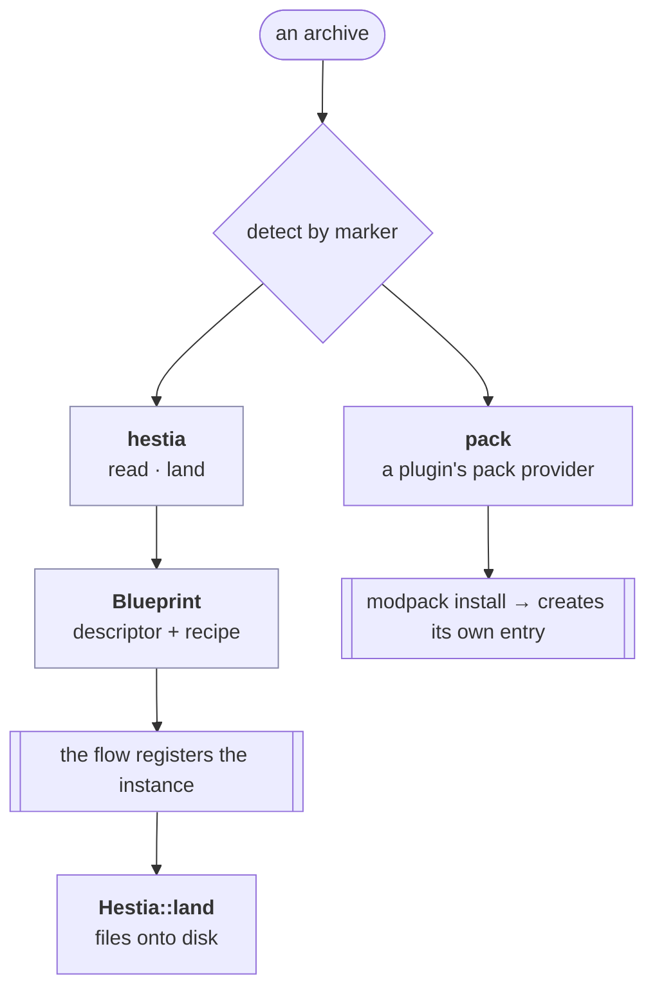

# Import & export

An instance moves in and out of the launcher as **one file**. This is what
instances have instead of backups, and the shape is different on purpose: a
server is infrastructure that must be recoverable *in place*, so it is archived
on a schedule under its own entry root; an instance is something you play,
share, and carry between machines, so its archive is one portable file you write
deliberately.

One format is built in, and plugins add the rest: `.mrpack`, Prism / MultiMC and CurseForge packs are the official
plugins' formats, not the launcher's. Without a pack plugin, import and export handle hestia's own archive only, and a
foreign archive is refused as unrecognised.

| Format | Marker | In | Out | What it is |
|---|---|---|---|---|
| **hestia** | `hestia.instance.json` | ✅ | ✅ | the entry directory minus content a source can serve again, + the instance's record — the profile is resolved on the importing host |
| **a plugin's pack** | what the plugin declares | ✅ | ✅ | any format a `pack` provider reads and writes — see [below](#pack-formats-from-plugins) |

## Detection, not declaration

`hestia instance import <file>` takes a file and nothing else. Every one of these
formats is a zip and people rename them, so the format is decided by the **marker
file inside**, following Prism's own approach — someone handed an archive should
not have to know which launcher made it.

The **shallowest** marker wins, and hestia's own only breaks a tie ahead of a
plugin's. Depth has to come first: a manifest an archive happens to ship inside
its `config/` is a file it *uses*, not what the archive *is*.

One marker is not specific enough to settle it by presence: any archive may
carry a `manifest.json`. So a plugin's pack that holds its declared members is
also asked `claims`, and counts only when the guest says yes
([0076](../decisions/0076-a-pack-file-is-identified-wherever-it-came-from.md),
[0125](../decisions/0125-a-pack-is-a-provider-kind-and-export-formats-are-open.md)).

Every pack format is a plugin's, and detection ranks them beside hestia's own.
A pack is then handed, already open, to the modpack flow.

## The seam



Hestia's archive is read into a [`Blueprint`] — a descriptor and a `Recipe` that
carries the identity the archive keeps — and landed onto an instance the launcher
has already registered; it never creates the instance itself. Any other format is a
`pack` provider and goes through the modpack flow, so a new format is a plugin and
costs core nothing ([0125](../decisions/0125-a-pack-is-a-provider-kind-and-export-formats-are-open.md)).

## What an archive carries

The exclusion rules are shared by every exporter
(`transfer/exclude.rs`) — "which files *are* the instance" is one question with
one answer, and two writers deciding it separately is how a format quietly ships
somebody's crash reports.

Left out, following Prism's own export defaults plus hestia's own:

| Skipped | Why |
|---|---|
| `logs/`, `data/logs`, `data/crash-reports` | regenerated, and large |
| `data/.cache`, `data/.fabric`, `data/.quilt` | loader caches, rebuilt on launch |
| `.DS_Store`, `thumbs.db`, `session.lock` | OS turds and a transient world lock |
| `*.part`, `.discard-*` | something was mid-write |
| `backups/` | server archives, not the instance |
| `recent.json` | where and when its owner played |
| `instance.json` | the record travels in the manifest instead |
| the `data/` **mirror** of a pool item | the managed copy is the record; the mirror is re-made at every launch ([0013](../decisions/0013-managed-dir-of-record.md)) |

**Saves are in.** An instance without its worlds is not the instance. A caller
can still leave any path out — `--exclude data/saves`, or unchecking it in the
desktop's tree — and `instance.export.contents` answers that tree, derived from
the *same file plan the export writes* so the two cannot disagree.

Symlinks are **followed**, unlike the server backup's tar: `data/saves` is
routinely a link into the shared `sync` store, and an archive carrying the link
rather than the worlds would have no game data in it.

## The hestia archive

The entry directory minus whatever a source can serve again, plus a manifest that
is also the marker:

```
cozy.hestia (a zip)
├── hestia.instance.json    the manifest: format version, who wrote it, the record
├── content.json            the pool index — provenance survives the trip
├── modpack.json            the pack the instance runs, when it runs one
├── icon.<ext>, icon.json   the instance's icon and, if generated, what composed it
├── mods/ resourcepacks/ shaderpacks/ datapacks/   local-only files
└── data/                   the game directory: config, options.txt, saves
```

The archive carries **what the instance is, not how a host runs it**. The record's
flavor, game version and loader version are authoritative; its profile (client
jar, libraries, natives, JVM arguments) was resolved for the exporting OS, so the
manifest is written without it and import resolves it on the importing host,
keeping the record's name, Java settings, sharing, playtime and timestamps. That
needs the version catalogue,
which falls back to the cached one offline. The **id is not honoured**: an
imported instance is a new entry and gets a fresh one, so the same archive can be
imported twice.

Content is **referenced, not carried**, when it can be: an item with a URL and a
SHA-1 (`install::referenceable`, the rule the `.mrpack` export applies too) keeps
its record in `content.json` and leaves its bytes out. A local file, or one a
source does not distribute, is embedded. Import then makes the list true
(`flows/restore.rs`): an item whose file is missing is downloaded to its managed
path through the content-addressed cache, verified against its SHA-1, and a
failure unwinds the import so it can be retried. An item that is neither present
nor referenceable is dropped from the index and named in `ImportContentMissing`.

The export picker lists every file, referenced ones included, flagged
`referenced` and counted as nothing in the total. **An exclusion removes the item,
not just its bytes**: `content.json` is rewritten through the same rules as the
files, so an import never lists what the archive does not have
([0081](../decisions/0081-the-archive-carries-identity-and-references.md)).

The marker is deliberately not called `instance.json` — a marker is a claim about
what an archive *is*, so it has to be specific enough that finding it inside
someone else's zip means something.

## Pack formats from plugins

A plugin contributes a pack format with `kind = "pack"` and the `pack:provide` permission — the official plugins do
this for `.mrpack`, Prism / MultiMC and CurseForge. It answers the
`proto::provider::pack` operations `info` (name, the members it reads as names or globs, and the extension it writes),
`claims` (an optional probe over the member names and the text of the declared members), `read` and `write`. `PluginPack`
(`plugins/providers/pack.rs`) registers as `<plugin>.<id>` on the engine, and `detect` ranks it beside hestia's own
format by the depth of the shallowest directory holding every declared member, hestia's first on a tie; a plugin cannot
claim hestia's marker or the id `hestia`. Every other id, `mrpack` included, is the plugin's to take.

`read` is handed the member names, the text of the declared members and the loader keys its format has flavors for, and
answers the pack — name, game version, loader, files — plus the override trees each side takes, optionally delegating
the file list to a content source's `resolve-manifest`, and optionally the instance's `memory`, `jvmArgs` and `icon`.
The host maps the loader key to its flavor, so an inspect and an import show the same loader. A `memory` or `jvmArgs`
the settings reject, or an icon that is not a plain archive path to an image of at most 10 MiB, is dropped and reported
on the result (`PackSettingDropped`, `PackIconDropped`) instead of failing the import. The modpack flow then installs it like an `.mrpack`: it creates the entry, fetches the files and
extracts the trees. Every file goes through `Policy::vet_artifact` and is fetched under the vetting policy
([0122](../decisions/0122-a-source-declares-its-setting-and-one-vet-checks-every-download.md)); every path and tree is
checked to stay inside the entry, and one refused entry refuses the whole answer. `write` is handed the instance, the
game directory's files and the content pool (each referenceable item with its size and SHA-512, hashed in one read),
and names the manifests to store and the instance files to copy; the host
checks each copy against what the export holds and does the writing, reporting the guest's warnings as
`PackExportWarned`. See [0125](../decisions/0125-a-pack-is-a-provider-kind-and-export-formats-are-open.md).

`instance.export.formats` lists every format an export can use — hestia and each registered pack that writes — and
`ExportFormat` carries a provider the way `ImportFormat` does. The front-ends build their format lists, file pickers
and drop zones from it, so with no pack plugin they offer hestia's archive only.

## An import is a create

It registers a new instance and then fills it, so it owns the discipline every
other create has: **an import that fails partway removes the entry it started**.
A registered instance whose files never landed is worse than no instance — it
lists, it cannot launch, and nobody asked for it.

An export is guarded like a backup: the instance must be stopped and racing no
content, pack or transfer job, since all of those write the tree it reads. While
one runs, the things that would rewrite that tree underneath it — a launch's
content mirror, a content install, a rename, a remove — are refused. An import
guards nothing, because the entry it would conflict with is the one it creates.

## Where an archive goes

`instance.export` takes an absolute destination: a file, a directory (a name is
generated inside it), or empty for `<data_home>/exports/`. **Relative paths are
refused** — the daemon is a separate process and does not share a client's
working directory, so a relative path would mean something different on each
side of the socket. The CLI resolves against its own cwd before sending.

The desktop registers `.hestia` with the OS, so a double-clicked archive reaches
the app — as a launch argument, or through single-instance when a window is
already up — and opens the import dialog on it.

## Related decisions

- [0057 — An archive format is a module, not a branch](../decisions/0057-an-archive-format-is-a-module.md) (superseded
  for the built-in formats by [0125](../decisions/0125-a-pack-is-a-provider-kind-and-export-formats-are-open.md))
- [0104 — An archive-format plugin maps files; the host copies them](../decisions/0104-an-archive-format-plugin-maps-files-the-host-copies.md)
- [0125 — A pack is one provider kind that replaces `format`, and export formats are an open set](../decisions/0125-a-pack-is-a-provider-kind-and-export-formats-are-open.md)
- [0081 — The archive carries the instance's identity and references](../decisions/0081-the-archive-carries-identity-and-references.md)
- [0013 — The managed dir is the record](../decisions/0013-managed-dir-of-record.md)
- [0011 — A modpack decomposes into existing parts](../decisions/0011-modpack-decomposes-into-existing-parts.md)
- [0021 — Backups follow docker-mc-backup](../decisions/0021-backups-follow-docker-mc-backup.md)
