# Import and export

*[← Architecture](../architecture.md)*

An instance moves in and out of the launcher as **one file**. This is what instances have instead of backups: a server
is infrastructure recoverable in place, archived on a schedule under its entry root, while an instance is something you
play, share and carry, so its archive is one portable file you write on purpose.

Core reads and writes one format, Hestia's own archive. Any other format is a registered `PackProvider`
(`Engine::register_pack`); none ships, so a foreign archive is refused as unrecognised. Pack formats such as `.mrpack`,
Prism and CurseForge return with the new plugin system.

| Format                  | Marker                    | In  | Out | What it is                                                                          |
|-------------------------|---------------------------|:---:|:---:|-------------------------------------------------------------------------------------|
| **hestia**              | `hestia.instance.json`    | yes | yes | the entry directory minus content a source can serve again, plus the instance record |
| **a registered pack**   | what the provider declares | yes | yes | any format a `PackProvider` reads and writes                                        |

## Detection

`hestia instance import <file>` takes a file and nothing else. Formats are zips that people rename, so the format is
decided by the **marker file inside**. The shallowest marker wins, and Hestia's own wins a tie. Depth comes first: a
manifest an archive ships inside its `config/` is a file it uses, not what it is.

Any archive may carry a `manifest.json`, so a registered pack that holds its declared members is also asked `claims` and
counts only if the provider says yes. No pack can claim Hestia's marker, and ids are namespaced `<owner>.<id>`, so none can take `hestia`.

## The seam

```mermaid
flowchart TD
    FILE([an archive]) --> DETECT{detect by marker}
    DETECT --> HESTIA["hestia: read, land"] --> BP["Blueprint<br/>descriptor + recipe"] --> CREATE[["flow registers the instance"]] --> LAND["Hestia::land<br/>files onto disk"]
    DETECT --> PACK["a registered PackProvider"] --> MODPACK[["modpack install creates its own entry"]]
```



Hestia's archive is read into a `Blueprint` (a descriptor plus a `Recipe` carrying the identity the archive keeps) and
landed onto an instance the launcher already registered; it never creates the instance. Any other format goes through
the modpack flow, so a new format costs core nothing.

## What an archive carries

Exclusion rules are shared by every exporter (`transfer/exclude.rs`):

| Skipped                                   | Why                                                              |
|-------------------------------------------|------------------------------------------------------------------|
| `logs/`, `data/logs`, `data/crash-reports`| regenerated, large                                               |
| `data/.cache`, `data/.fabric`, `data/.quilt` | loader caches                                                 |
| `.DS_Store`, `thumbs.db`, `session.lock`  | OS leftovers and a transient world lock                          |
| `*.part`, `.discard-*`                    | something was mid-write                                          |
| `backups/`                                | server archives, not the instance                                |
| `recent.json`                             | where and when its owner played                                  |
| `instance.json`                           | the record travels in the manifest                               |
| the `data/` mirror of a pool item         | the managed copy is the record; the mirror is remade at launch   |

**Saves are in.** A caller can leave any path out (`--exclude data/saves`, or unchecking it in the desktop's tree).
`instance.export.contents` answers that tree from the same file plan the export writes. **Symlinks are followed**,
unlike the server backup's tar: `data/saves` is routinely a link into the shared sync store.

## The hestia archive

```
cozy.hestia (a zip)
├── hestia.instance.json    manifest: format version, writer, the record
├── content.json            the pool index; provenance survives the trip
├── modpack.json            the pack the instance runs, if any
├── icon.<ext>, icon.json   the icon and, if generated, what composed it
├── mods/ resourcepacks/ shaderpacks/ datapacks/   local-only files
└── data/                   the game directory
```

- **Identity, not host state.** The record's flavor, game version and loader version are authoritative. Its profile was
  resolved for the exporting OS, so the manifest omits it and import resolves it on the importing host (using the
  cached catalogue offline), keeping the record's name, Java settings, sharing, playtime and timestamps. The loader is
  named by the flavor's bare id (`fabric`), so an archive does not depend on which owner supplied the flavor. The id
  is not honoured: an import is a new entry, so one archive can be imported twice.
- **Content is referenced, not carried, when it can be.** An item with a URL and SHA-1 (`install::referenceable`) keeps
  its record and leaves its bytes out. Local or non-distributable files are embedded. Import (`flows/restore.rs`)
  downloads missing referenced items through the cache, verifies SHA-1, and a failure unwinds the import for retry. An
  item neither present nor referenceable is dropped and named in `ImportContentMissing`.
- **An exclusion removes the item**, not just its bytes: `content.json` is rewritten by the same rules, so an import
  never lists content the archive lacks. The picker flags referenced files and counts them as nothing.
- The marker is not `instance.json`: a marker is a claim about what an archive is and must be specific.

## Pack providers

`PackProvider` (`transfer/provider.rs`) is the seam for a format other than Hestia's. It registers as `<owner>.<id>`
through `Engine::register_pack(owner, standing, provider)`; `unregister_packs(owner)` drops an owner's formats.

| Method               | Purpose                                                                                                      |
|----------------------|--------------------------------------------------------------------------------------------------------------|
| `info`               | name, the members it reads (names or globs), the extension it writes                                         |
| `root_of`, `claims`  | where its pack starts in an archive holding the declared members, and an optional probe of those members      |
| `read`               | the pack (name, game version, loader, files), the override trees each side takes, optionally a delegated file list and `memory`, `jvmArgs`, `icon` |
| `write`              | the instance, game-directory files and content pool (each referenceable item with size and SHA-512) in; manifests to store and instance files to copy out |
| `policy`             | the `Policy` the files the format names are fetched under                                                    |

The host owns the archive: a provider never touches the filesystem. It maps the loader key to a flavor, checks every
path and tree stays inside the entry, and does all the writing. A `memory` or `jvmArgs` the settings reject, or an icon
that is not a plain archive path to an image of at most 10 MiB, is dropped and reported (`PackSettingDropped`,
`PackIconDropped`). Export warnings become `PackExportWarned`. `instance.export.formats` lists every format an export
can use, and front-ends build their pickers from it. Tests register the native `fixture::pack::Replay` format
(`crates/engine/tests/fixture/pack.rs`).

## An import is a create

An import registers a new instance and fills it, so it owns the create discipline: **an import that fails partway
removes the entry it started**. A registered instance with no files lists but cannot launch.

An export is guarded like a backup: the instance must be stopped and racing no content, pack or transfer job. Things that
would rewrite its tree (a launch mirror, a content install, a rename, a remove) are refused meanwhile.

`instance.export` takes an absolute destination: a file, a directory (a name is generated), or empty for
`<data_home>/exports/`. Relative paths are refused because the daemon does not share a client's working directory; the
CLI resolves against its own cwd first. The desktop registers `.hestia` with the OS and opens the import dialog on a
double-clicked archive.
