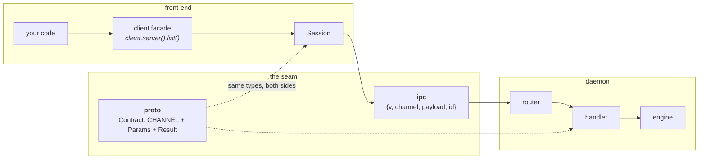
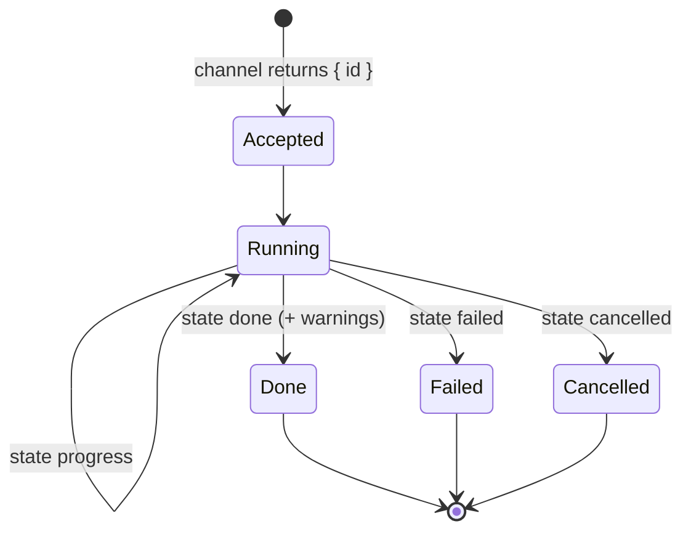

# The socket boundary

*[← Architecture](../architecture.md)*

Everything a front-end does crosses one seam. Three crates own it: **`proto`**
defines the payloads, **`ipc`** carries the bytes, and **`client`** is the typed
SDK every front-end drives the daemon through.

The point of the seam is that there is exactly **one** definition per channel,
shared by both sides. A daemon handler and a client call marshal through the
same Rust types, so they cannot disagree — a mismatch is a compile error, not a
runtime surprise.



## `proto` — the contracts

Pure data. No I/O, no async; `serde` derive is the codec. A **`Contract`** names
its channel once and pairs it with its request and response types:

```rust
pub trait Contract {
    const CHANNEL: &'static str;
    const TIMEOUT: Duration = DEFAULT_TIMEOUT; // 10 s
    type Params: Serialize + DeserializeOwned;
    type Result: Serialize + DeserializeOwned;
}
```

`TIMEOUT` is how long a caller waits for the reply. A contract whose handler
blocks on the network, a disk tree or a person overrides it, once, here — the
client SDK's `Session::call` and the desktop bridge both apply it, and the
front-end's table is generated from it
([0084](../decisions/0084-the-ts-channel-table-is-generated-from-the-contracts.md)).

An unsolicited daemon→client push is a **`Topic`** — the implementing type *is*
its payload. `Empty` is the `{}` payload for channels that take or return
nothing.

One module per domain; `crates/proto/src/lib.rs` lists them.
Three are shared vocabularies rather than domains of their own:

- **`minecraft`** — what the `server` and `instance` domains have in common:
  `Flavor`, `GameVersion`, `Artifact`, `ProvisionProgress`.
- **`content`** — the normalized third-party content vocabulary
  (`ContentProject` with its images, `ContentVersion`, the paginated
  `SearchQuery`/`SearchResult`, `ResolvedModpack`). A front-end never sees a
  platform's raw shape.
- **`naming`** — the rules both sides must apply identically: how a user's
  reference resolves to an entry (`reference_matches`), and how supervisor
  process keys are spelled (`process_in_scope`).

Also `error::ErrorInfo` and `warning::WarningInfo` — structured, exhaustive
vocabularies, so no failure or caveat is prose authored at a call site.

**The wire is camelCase.** Every fielded proto struct carries
`#[serde(rename_all = "camelCase")]`; Rust field names stay `snake_case` and
only the serialized form is renamed, so the webview consumes payloads with no
key conversion. Enum variant *values* stay `snake_case`/`lowercase`, because the
frontend's string-literal union types depend on them. `tests/casing.rs` fails
the build if a new serialized struct omits the attribute. The one deliberate
exception is the `config.*` key vocabulary, which stays kebab-case
([0028](../decisions/0028-camelcase-except-the-config-vocabulary.md)).

Adding a channel is a struct plus an `impl Contract` — see
[contributing.md](../contributing.md).

### The TypeScript projection

ts-rs exports the payload structs; `scripts/lib/gen-channels.py` (run by
`scripts/gen-types.sh`) exports the contracts themselves as
`frontend/src/api/types/channels.ts`:

```ts
export interface Channels {
  "server.status": { params: Partial<ServerRef>; result: ServerInfo };
  "server.restart": { params: Partial<ServerRef>; result: ServerStartResult };
  …
}
export interface Jobs {
  "server.create": { progress: ProvisionProgress; done: ServerDone };
  …
}
export interface Topics { "process.exit": ProcessExitEvent; "job": JobEvents; … }
export const TIMEOUTS: Partial<Record<keyof Channels, number>> = { "server.restart": 150000, … };
```

It reads the Rust source, one entry per `impl Contract`, `impl Job` and
`impl Topic`, and exits non-zero on a block it cannot read or a type ts-rs did
not export. A request struct with a struct-level `#[serde(default)]` is
emitted `Partial<…>` — the daemon fills what a request omits — and so is any
such struct nested in it. The front-end's `call`, `runJob` and event bus are
typed against this table (see [front-ends](frontends.md#the-frontend)).

## `ipc` — transport and envelope

Carries bytes and nothing domain-specific.

| Module | What it owns |
|---|---|
| `transport.rs` | the platform socket (Unix domain socket / Windows named pipe), `bind`/`connect`, a length-framed `FrameReader`/`FrameWriter`, and `Peer` — the connection's verified identity (`uid` and `authorized()` on POSIX via peer credentials) |
| `protocol.rs` | the JSON envelope, encoded and decoded in exactly one place. Request `{v, channel, payload, id?}`, response `{v, ok, payload \| error, id?}`, event `{event, payload}` |
| `endpoint.rs` | where the socket lives — `$XDG_RUNTIME_DIR/hestia/hestiad.sock`, else `/tmp/hestia-<uid>/…`; a named pipe on Windows. A build carrying its own data home takes a name scoped to it (`common::paths::install_scope`), so a portable copy never meets an installed daemon on one socket ([0063](../decisions/0063-an-endpoint-is-scoped-like-its-data-home.md)). `HESTIA_SOCK` overrides it so tests and side-by-side daemons never collide |
| `errors.rs` | the two error codes a client branches on (`NOT_FOUND`, `UNAUTHORIZED`) and the client-facing `IpcError` |

The **runtime directory** holding the ephemeral socket is deliberately distinct
from the engine's persistent data home: one is where a running daemon can be
reached, the other is where your data lives.

`PROTOCOL_VERSION` is `1`, same-major only, and the decode functions refuse to
construct a frame at all for a foreign or missing version — the check cannot be
forgotten at a call site
([0001](../decisions/0001-envelope-fails-closed.md)).

## `client` — the typed SDK

The one way a front-end drives the daemon.

- `Client::connect()` opens a connection to a **running** daemon. It never
  spawns.
- `Client::start()` is the sole path that spawns `hestiad` if it isn't running —
  backing the deliberate start actions (CLI `daemon start`, the tray, the
  desktop's start button and launch).
- `connect_to(endpoint)` targets an explicit socket.

**`Session`** (`session.rs`) is the connection core, public but normally reached through the facades (the
desktop uses `call_raw` and `listen`): one persistent, multiplexed connection whose background reader task fulfils pending
requests by id and routes events to its registered listeners.

| Call | Behaviour |
|---|---|
| `call::<C>()` | marshals through the contract, returns the `proto` result, and waits `C::TIMEOUT` for it |
| `try_call::<C>()` | maps a `not_found` to `None` |
| `run_job::<C: Job>()` | starts a long-running operation, hands each typed progress payload to a callback and blocks until it settles to `C::Done`, `IpcError::Cancelled` or a failure |
| `listen(scope)` | registers an event listener: `Some(scope)` hears events whose id is in that process scope, `None` hears all; it unregisters on drop and ends when the connection closes |
| `call_raw()` | the untyped forward the desktop bridge pipes through |

**Facades** (`facades/`) are one struct per domain, reached through a `Client`
accessor (`client.java().install(21, …)`), mirroring the engine's domain modules
on the other side of the socket. Methods are one-liners over `Session`; a job
method is `run_job::<C>` and nothing else, since the contract already names its
progress and done types.

`spawn.rs` locates and launches the `hestiad` binary, then retries the connection
until it is listening.

Session also carries the **wire trace** — a `trace!` per frame sent and
received with its channel, correlation id, byte size and round-trip time, plus
connection transitions. That is what the CLI's `-vv` buys, for every front-end
that links `client`. Payloads are never logged
([0042](../decisions/0042-vv-buys-wire-visibility.md)).

> **Events fan out to listeners.** `run_job`, `Process::subscribe` and the
> desktop bridge each hold their own listener, so event-driven calls on one
> connection do not exclude each other
> ([0045](../decisions/0045-a-session-routes-events-to-its-listeners.md)).

## Jobs, events and cancellation

Anything that can take minutes — a download, a Java install, a server create, a
backup, a content install, a modpack apply — is a **job**. The start channel
answers immediately with `JobStarted { id }`, and the work streams events under
that id on one topic, `job`.

The start contract *is* the job: it implements `proto::job::Job`, declaring the
`Progress` and `Done` payload types of its own events. Several contracts may
declare the same ones (content add, update and set-version all settle with a
`ContentDone`). Each event is a `JobEvent<P, D>`:

```jsonc
{ "id": "server-create-1", "channel": "server.create", "state": "progress", "phase": "java", … }
{ "id": "server-create-1", "channel": "server.create", "state": "done", "server": { … }, "warnings": [] }
{ "id": "server-create-1", "channel": "server.create", "state": "failed", "error": { "kind": "…" } }
{ "id": "server-create-1", "channel": "server.create", "state": "cancelled" }
{ "id": "server-backup-2", "channel": "server.backup.create", "subject": { "kind": "server", "id": "smp" }, "state": "progress", … }
```

`channel` is the start contract's `CHANNEL`, so an observer that did not start
the job — another window refreshing its lists — can still tell what kind it is.
`subject` names the entry the job acts on (`JobSubject { kind, id }`) and is
absent for a job that has none yet: a Java install, an update download, or a
create or import whose entry does not exist until it finishes. The `state`
payload is flattened beside `id`, `channel` and `subject`; the generated
TypeScript is a union over `state`.

A launch's `ProvisionProgress` also carries `overallCurrent` of `overallTotal`
bytes: the launch plans everything it must download before fetching anything,
and the pair only moves forward across phases, holding its value through a phase
with no bytes (unpacking natives, a loader install). `0/0` means the job has no
plan, and the per-phase `current`/`total` are all there is.

`job.list` answers with every running job as a `JobInfo` — `id`, `channel`,
`subject`, `startedUnix` and the last `progress` payload, untyped because the
registry spans every job family (a client narrows it by `channel`). A job leaves
the list before its terminal event is published, so a list read after that
event never shows it. A client reads it on connect to adopt work started
elsewhere or before a reload; a job that vanished from it died with a daemon
restart.



What a cancel leaves behind is documented on each start contract in
`proto`. Cancellation is an **explicit act** — one `job.cancel { id }`
channel — and inside the engine it is cooperative and checkpointed, never a
kill: stopping at a checkpoint leaves exactly what a network failure at the same
point would have left, so the existing failure paths do the cleanup. A cancelled
job is not an error ([0032](../decisions/0032-jobs-are-cancelled-by-asking.md)).
Why one topic and the contract as the job:
[0083](../decisions/0083-a-job-is-its-contract-and-reports-on-one-topic.md).
The daemon keeps the registry of running jobs, so any client can list them
([0090](../decisions/0090-the-daemon-keeps-the-job-registry.md)).

A plain call that mutates reports too. Its contract sets `Contract::CHANGES` to
a coarse `change::Scope` (`entries`, `accounts`, `skins`, `config`, `java`,
`sync`, `screenshots`, `cache`), and the registrar publishes one
`changed { scope }` after the handler succeeds — so a client that did not make
the call knows what to refetch
([0085](../decisions/0085-a-mutating-call-names-what-it-changed.md)).

A client subscribes with `events.subscribe`, filtered by id. The filter also
covers *session keys beneath* an entry key, which is what lets one subscription
follow an instance across launches
([0037](../decisions/0037-following-logs-is-entry-scoped.md)).

## Failures and warnings

Two structured vocabularies, same discipline:

- **`ErrorInfo`** — the operation did not happen. Mapped to a wire code
  (`ErrorInfo::code()`) at the service boundary, with the structured variant carried alongside so a
  front-end can render it precisely (`ContentKindRejected` names the accepted
  set; `MissingRequirement` names the tool and where to get it;
  `ModpackEntryMismatch` names both sides).
- **`WarningInfo`** — the operation *did* happen, but something degraded. Carried
  on job done events and on the standing views that stay true afterwards
  (`ServerDetails`, so `server info` keeps saying it long after the create
  scrolled past).

`Offline` is the one error a front-end answers with a retry affordance rather
than with its text, so it has its own wire code (`offline`) — and pinned offline
(`OfflineMode`) is a separate variant, because the remedy is a setting to turn
off rather than a connection to wait for
([0067](../decisions/0067-reachability-is-observed-not-asked.md)).

Every warning variant carries a `hint()` beside its `Display` headline: a
warning you cannot act on is noise, so the remediation is part of the type
rather than something each front-end invents. And a warning about something the
*launcher* did wrong is a bug to fix, not text to soften
([0026](../decisions/0026-degraded-outcomes-ride-on-the-result.md),
[0027](../decisions/0027-warnings-the-user-did-not-cause.md)).

## Decisions

- [0001 — The envelope seam fails closed](../decisions/0001-envelope-fails-closed.md)
- [0026 — A degraded outcome rides on the result](../decisions/0026-degraded-outcomes-ride-on-the-result.md)
- [0027 — A warning the user did not cause is a bug](../decisions/0027-warnings-the-user-did-not-cause.md)
- [0067 — Reachability is observed from real traffic, and offline is a state the whole system reads](../decisions/0067-reachability-is-observed-not-asked.md)
- [0028 — camelCase everywhere, except the `config.*` vocabulary](../decisions/0028-camelcase-except-the-config-vocabulary.md)
- [0032 — A job is cancelled by asking](../decisions/0032-jobs-are-cancelled-by-asking.md)
- [0045 — A session routes events to its listeners](../decisions/0045-a-session-routes-events-to-its-listeners.md)
