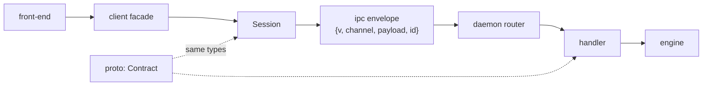

# The socket boundary

*[← Architecture](../architecture.md)*

Every front-end action crosses one seam, owned by three crates: **`proto`** defines the payloads, **`ipc`** carries the
bytes, **`client`** is the typed SDK. Each channel has exactly one definition, shared by both sides, so a mismatch is a
compile error.



## proto: the contracts

Pure data: no I/O, no async; serde derive is the codec. One module per domain, listed in `crates/proto/src/lib.rs`.

```rust
pub trait Contract {
    const CHANNEL: &'static str;
    const TIMEOUT: Duration = DEFAULT_TIMEOUT; // 10 s
    type Params: Serialize + DeserializeOwned;
    type Result: Serialize + DeserializeOwned;
}
```

| Item                         | Meaning                                                                                                   |
|------------------------------|-----------------------------------------------------------------------------------------------------------|
| `Contract`                   | a request/response channel                                                                                |
| `Topic`                      | a daemon-to-client push; the type is its own payload                                                      |
| `Job`                        | a start contract that also declares its `Progress` and `Done` payloads                                    |
| `TIMEOUT`                    | how long a caller waits; slow handlers override it once, and the client and the desktop bridge both apply it |
| `CHANGES: Option<Scope>`     | the state a mutating call changes; the registrar publishes `changed { scope }` after success              |
| `Empty`                      | the `{}` payload                                                                                          |

Shared vocabularies that are not domains of their own:

- **`minecraft`**: `Edition`, `Flavor`, `GameVersion`, `Artifact`, `ProvisionProgress` and the per-edition catalogue
  (`entry.flavors` answers one catalogue per edition).
- **`content`**: the normalized third-party content types. A front-end never sees a platform's raw shape.
- **`naming`**: rules both sides must apply identically: `reference_matches` and supervisor process keys.
- **`error::ErrorInfo`, `warning::WarningInfo`**: exhaustive vocabularies, so no failure or caveat is prose written at a
  call site.

**Casing.** Every fielded struct is `camelCase` on the wire (`tests/casing.rs` enforces it). Enum values stay
`snake_case`, since the frontend's string unions depend on them. The `config.*` key vocabulary stays kebab-case
(`jvm-args`).

### The TypeScript projection

ts-rs exports the payload structs. `scripts/lib/gen-channels.py` (run by `scripts/gen-types.sh`) reads the Rust source
and writes `frontend/src/api/types/channels.ts`: `Channels` (channel to params and result), `Jobs`, `Topics` and
`TIMEOUTS`. It exits non-zero on a block it cannot read. A struct-level `#[serde(default)]` request is emitted
`Partial<...>`. The frontend's `call`, `runJob` and event bus are typed against this table.

## ipc: transport and envelope

| Module      | Owns                                                                                                                    |
|-------------|-------------------------------------------------------------------------------------------------------------------------|
| `transport` | Unix socket or Windows named pipe, length-framed reader and writer, `Peer` (the verified identity)                      |
| `protocol`  | the JSON envelope, encoded and decoded in one place: request `{v, channel, payload, id?}`, response `{v, ok, payload \| error, id?}`, event `{event, payload}` |
| `endpoint`  | `$XDG_RUNTIME_DIR/hestia/hestiad.sock`, else `/tmp/hestia-<uid>/...`; on Windows the pipe `\\.\pipe\hestia-<user SID>-hestiad`, created first-instance-only, local clients only, with an access list for the user and the system, and a client checks that the server process is the same user; scoped by `install_scope` for portable and debug builds |
| `errors`    | the client-facing `IpcError` and the two codes a client branches on                                                     |

`PROTOCOL_VERSION` is `1`, same major only. The decode functions return a typed `DecodeError` (`Malformed` or
`IncompatibleVersion`) and never construct a frame for a foreign or missing version. The daemon answers
`version_mismatch`; the client drops the connection.

## client: the typed SDK

| Entry                  | Behaviour                                                               |
|------------------------|-------------------------------------------------------------------------|
| `Client::connect()`    | connects to a running daemon; never spawns                              |
| `Client::start()`      | the only path that spawns `hestiad` (CLI `daemon start`, tray, desktop) |
| `connect_to(endpoint)` | an explicit socket                                                      |

`Session` is one persistent multiplexed connection. A reader task fulfils pending requests by id and routes events to
registered listeners. Facades (`facades/`) are one struct per domain, reached through `Client` accessors; methods are
one-liners.

| `Session` call        | Behaviour                                                                                    |
|-----------------------|----------------------------------------------------------------------------------------------|
| `call::<C>()`         | marshals through the contract and waits `C::TIMEOUT`                                         |
| `try_call::<C>()`     | maps `not_found` to `None`                                                                   |
| `run_job::<C: Job>()` | starts a job, passes typed progress to a callback, settles to `Done`, `Cancelled` or failure |
| `listen(scope)`       | registers a listener; `Some(scope)` hears events in that process scope, `None` hears all     |
| `call_raw()`          | the untyped forward the desktop bridge uses                                                  |

`spawn.rs` locates `hestiad`, launches it and retries the connection. Session also emits the wire trace (channel,
correlation id, byte size, round trip; never payloads), which is what the CLI's `-vv` shows.

## Jobs, events and cancellation

Anything that can take minutes is a job: a download, a Java install, a server create, a backup, a content install. The
start channel answers `JobStarted { id }` and the work streams under that id on one topic, `job`.

```jsonc
{ "id": "server-create-1", "channel": "server.create", "state": "progress", "phase": "java" }
{ "id": "server-create-1", "channel": "server.create", "state": "done", "server": {}, "warnings": [] }
{ "id": "server-create-1", "channel": "server.create", "state": "failed", "error": { "kind": "..." } }
{ "id": "server-create-1", "channel": "server.create", "state": "cancelled" }
```

- `channel` is the start contract's `CHANNEL`, so an observer that did not start the job can tell its kind.
- `subject` (`JobSubject { kind, id }`) names the entry the job acts on; absent when the entry does not exist yet.
- A launch's `ProvisionProgress` also carries `overallCurrent` of `overallTotal` bytes, planned before fetching and
  monotonic across phases. `0/0` means no plan.
- `job.list` answers every running job as a `JobInfo` (id, channel, subject, start time, last progress). A client reads
  it on connect to adopt work started elsewhere. A job leaves the list before its terminal event is published.
- `job.cancel { id }` is an explicit act. Inside the engine cancellation is cooperative and checkpointed, never a kill,
  so stopping leaves what a network failure at that point would leave, and the existing failure paths clean up. A
  cancelled job is not an error. Each start contract documents what a cancel leaves behind.
- A plain call that sets `CHANGES` makes the registrar publish one `changed { scope }`. Scopes: `entries`, `accounts`,
  `skins`, `config`, `java`, `sync`, `screenshots`, `cache`.
- `events.subscribe` filters by id and also covers session keys beneath an entry key, so one subscription follows an
  instance across launches.

## Failures and warnings

- **`ErrorInfo`**: the operation did not happen. Mapped to a wire code at the service boundary, with the structured
  variant carried alongside (`ContentKindRejected` names the accepted set, `MissingRequirement` names the tool).
- **`WarningInfo`**: the operation happened but something degraded. Carried on job `done` events and on standing views
  such as `ServerDetails`. Each variant has a `hint()` naming the remediation.
- `Offline` has its own wire code because a front-end answers it with a retry. Pinned offline (`OfflineMode`) is a
  separate variant: the remedy is a setting, not a connection.
